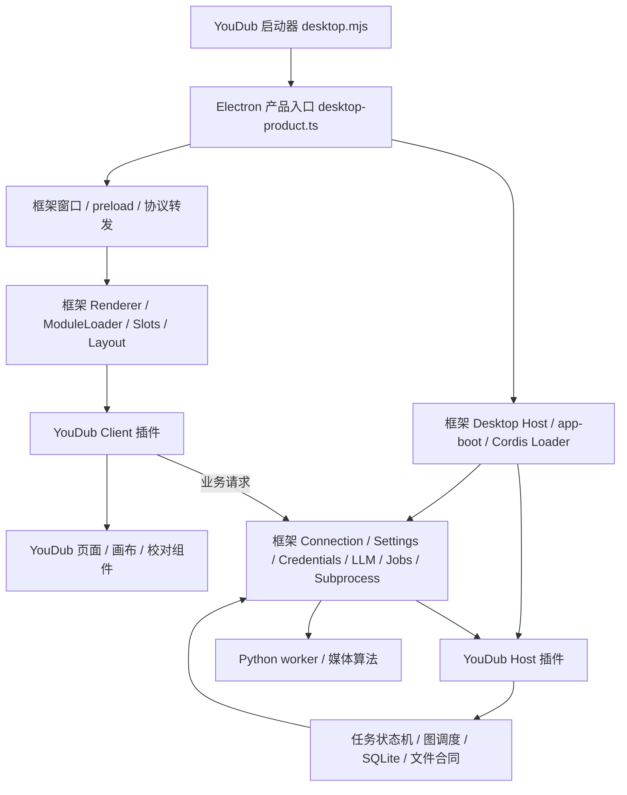
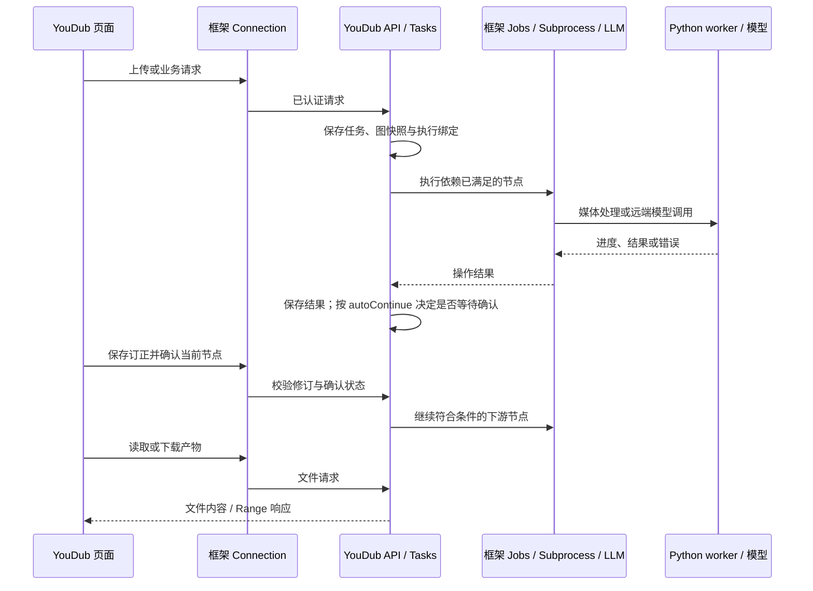

# YouDub 应用架构

YouDub 是视频翻译与配音应用。它维护自己的工作流、任务、媒体产物和审核界面，复用裁剪后的框架组件、插件生命周期、模型服务与桌面能力。

## 核心功能

| 用户任务 | 实际实现 | 必须保留的共用能力 |
| --- | --- | --- |
| 导入本地视频、视频链接与字幕 | `backend/workers/download.py`、`operations.py`；业务文件与上传路由 | 进程管理、文件访问、流式响应 |
| 识别语音、翻译字幕、生成配音 | Whisper、框架 LLM、VoxCPM；Demucs 与强制对齐按工作流选择 | 模型目录、凭据、运行资源、进度与取消 |
| 编排并执行工作流 | `packages/builtin/src/workflow-graph.ts`、节点与任务服务 | 插件服务依赖、Jobs、Subprocess |
| 审核和订正节点结果 | `apps/web/src` 的字幕、音频、文本与结果视图 | 共享控件、主题、状态存储、连接 |
| 保存任务、历史结果并导出 | SQLite、任务修订、工作流文档、文件与产物合同 | 持久化进程和请求生命周期 |
| 准备环境与模型、配置供应商 | YouDub setup/resources、框架模型设置 | 目录选择、凭据、配置与原始安装日志 |
| 安装和管理扩展 | 框架 PluginManager；YouDub 节点、提供商与界面合同 | 插件安装、依赖注入、启停、卸载与清理 |

代码保留依据是上述实际入口及其依赖。Agent 循环、聊天历史、交互登录与已退出产品的重复服务不在运行组合中。插件仍可注册节点、模型提供商和审核界面，无需另建加载器。

产品启动只进入 YouDub，首屏、窗口、原生错误提示、更新提示、Web manifest 和图标统一使用 YouDub。原 Harness 欢迎、账号登录、命令注册和强制更新引导不参与构建；内部包名与来源许可保留。开发与安装包验收只启动候选 YouDub，不自动打开本机安装的 Harness。

业务 API 统一由 `src/backend/api.ts` 注册，通过 Harness Connection 传输；访问权限由 Connection 管理。旧独立 HTTP 服务、Cookie 会话、Loader 装配和网页更新轮询已移除。接口测试直接调用这套业务路由，桌面 Host 测试覆盖实际权限与启动边界。

## 分层与源码位置



| 层 | 源码入口 | 负责的行为 |
| --- | --- | --- |
| 活动框架 fork | [`vendor/deepseek-harness/source`](../../../vendor/deepseek-harness/source) | 保留的 Host、Web、Desktop、服务与前端实现；来源见 [upstream.json](../../../vendor/deepseek-harness/upstream.json) |
| 产品启动与装配 | [`desktop.mjs`](../desktop.mjs)、[`desktop-product.ts`](../src/desktop-product.ts) | YouDub 名称、独立路径、profile、窗口与框架桌面能力的组合 |
| bundle 声明 | [`package.json`](../package.json)、[`cordis.patch.yml`](../cordis.patch.yml) | Host/Client 入口、模块依赖、框架条目的启停和 YouDub 插件配置 |
| Host 业务接入 | [`host.mjs`](../src/host.mjs)、[`backend/`](../src/backend) | 依赖框架服务，装配 YouDub 领域服务与 API |
| Renderer 业务接入 | [`client.jsx`](../src/client.jsx)、[`frontend/`](../src/frontend) | 页面、导航、框架控件适配、主题与语言绑定 |
| YouDub 领域实现 | [`packages/builtin/src`](../../../packages/builtin/src)、[`packages/sdk/src`](../../../packages/sdk/src) | 工作流、任务、节点合同、资源、文件与持久化桥接 |
| YouDub 页面实现 | [`apps/web/src`](../../web/src) | 工作台、动态图标、任务库、工作流画布、节点校对页面 |
| 媒体实现 | [`backend`](../../../backend) | 下载、Demucs、Whisper、分句、TTS、对齐、混音和导出 |

### 版本与来源

活动 fork 的上游基准固定为 `dsh-v0.2.1-rc.2`，提交 `687f282e8625c6b8d11ff58211a90524be2e4317`，见[来源信息](../../../vendor/deepseek-harness/upstream.json)。YouDub 产品版本来自[根 package.json](../../../package.json)；业务 bundle 名为 `@youdub/harness-subtitles`，当前为 `0.1.0`。这个包名沿用最初接入名称，现已包含工作流、字幕、配音、资源与扩展功能。


## 从源码到运行进程

1. [`build-framework.mjs`](../build-framework.mjs) 校验 vendor，复制到 `.cache/harness/source-build`，执行框架 `scripts/build.ts --scope artifacts`，保留构建记录。
2. [`build.mjs`](../build.mjs) 编译 YouDub Host/Client 插件；[`build-desktop.mjs`](../build-desktop.mjs) 编译产品桌面入口和所需框架模块，引用框架构建的 preload。
3. [`prepare-source-development.mjs`](../prepare-source-development.mjs) 调用框架 `prepareDevelopmentProject`，为开发运行时链接源码构建的 CLI、Host、Web 和服务。YouDub 插件使用单独的依赖视图，确保解析到同一套框架包。
4. `npm start` 进入 [`desktop.mjs`](../desktop.mjs)，准备 profile，启动本仓库安装的 Electron。Host 使用该 Electron 的 Node 模式。
5. [`desktop-main.mjs`](../src/desktop-main.mjs) 设置应用名称，进入产品入口。产品入口组合框架 `DesktopProjectManager`、`DesktopHostProcess`、`DesktopBackendController`、preload 和认证协议转发。
6. 框架 Renderer 加载 Client bundle；YouDub 先通过 `root` 插槽显示环境准备，再接入翻译模型配置，随后展示工作台。

桌面窗口中页面与 Host 的连接通过框架协议转发处理；浏览器开发入口直接访问同一框架的 HTTP Host。桌面 Host 端口由桌面控制器管理，开发脚本输出实际地址。浏览器入口默认使用 `3086`。

源码构建产生工作区产物。Electron 与 pnpm 从本仓库锁定依赖安装，Node 使用该 Electron 的 Node 模式；Python、媒体工具和模型通过 YouDub 首启资源流程准备。开发启动不读取已安装的 Harness Desktop 或另一应用的 runtime payload。运行路径和准备方法见[本地开发](DEVELOPMENT.md)。

## Profile 与插件生命周期

[`prepare-profile.mjs`](../prepare-profile.mjs) 通过框架 `initProfile` 按顺序组合：

```text
@youdub/harness-subtitles
```

YouDub 的 patch 正向声明所需框架服务与业务插件。DeepSeek 账号、聊天、编码 Agent、终端工作区和计划任务等产品入口不参与装配。用户的本地配置继续使用框架 profile/home patch 规则，实际结果以框架配置解析器为准。

模型设置和插件管理通过产品选择的 Remote 命名空间装配。聊天、会话控制、Agent 执行循环、浏览器、文档预览、定时任务及其专用类型与测试已删除。Jobs 内的 Agent/会话归属、会话遥测和远端 Agent waterfall 也已移除。通用 RPC、双向流、Context 映射及资源权限继续保留。实际服务以[当前 patch](../cordis.patch.yml)和[保留范围](FRAMEWORK-SCOPE.md)为准。

插件入口使用 `inject` 声明服务依赖，由 Loader 安排激活和销毁。监听、插槽、路由和进程资源通过框架 context 生命周期释放。必需条目出现 pending/failed 时需要修复依赖与配置，启动诊断保留具体原因。

## 框架与业务层的边界

| 能力 | 共用框架负责 | YouDub 负责 |
| --- | --- | --- |
| 网络入口 | Connection 的监听、认证与请求准入 | 已准入请求中的业务路由、参数、文件 Range 与错误合同 |
| 持久配置 | Settings/configForms、配置版本与更新 | YouDub 偏好结构、节点配置和资源选择 |
| 密钥与模型 | Credentials、框架模型表单、LLM 适配器与调用 | 翻译提示、分批、输出上限检查、结果结构和请求证据 |
| 运行中的操作 | Jobs 的状态/取消，Subprocess 的进程与管道 | 何时运行哪个节点、暂停确认、结果复用和图依赖 |
| 数据 | 提供进程和生命周期基础 | SQLite 事务、任务修订、工作流文档、产物和历史结果 |
| 前端基础 | Renderer、ModuleLoader、Slots、Layout、Store、theme、locale、primitives | 页面内容、业务控制器、画布、字幕与音频编辑 |
| 扩展 | PluginManager 的检查、安装、启停、卸载与运行状态 | YouDub 节点/提供商/页面合同，以及扩展目录的产品展示 |

插件扩展沿用 Harness 的安装、装配与销毁机制；YouDub 定义节点、输入输出、产物和专用界面合同。工作流调度能力由 YouDub 领域代码实现，不引入第二套插件加载器或运行框架。

具体调用见[后端说明](BACKEND-DEVELOPMENT.md)。前端保留原控制器的业务 API，通过构建边界接入框架 Store 和控件，见[前端说明](FRONTEND-DEVELOPMENT.md)。

## 一次任务的路径



默认模板为字幕翻译、视频配音、字幕＋配音。人工审核使用各节点的 `autoContinue`；关闭后完成节点会等待确认。图调度和业务状态落在原 YouDub 代码，框架 Jobs 的一次执行状态不等于整个业务任务完成。

## 数据隔离与完整性

桌面默认配置 home 为 `.cache/harness/desktop`，首次启动先选择语言和独立安装目录。业务数据、Python/venv、媒体工具、缓存和模型使用该保存的目录；既有明确配置的旧目录继续读取。Electron 用户数据位于相邻的 `desktop-user-data`。显式 `YOUDUB_HOME` 可隔离首启实验；浏览器入口默认使用另一个 home。详见[路径表](DEVELOPMENT.md#数据与配置)。

保留的 Harness 源码直接复用其组件与服务；产品差异在 Git 中维护。框架来源见[源码说明](../../../vendor/deepseek-harness/README.md)。

[`check-composition.mjs`](../check-composition.mjs) 检查活动构建输入，阻止旧 HTTP/Auth、旧前端根、旧 Loader、旧模型设置和第二份框架实例进入产品 bundle。源码完整性、构建来源、进程健康与真实视频验收分别记录，保留范围见[包清单](FRAMEWORK-SCOPE.md)。
