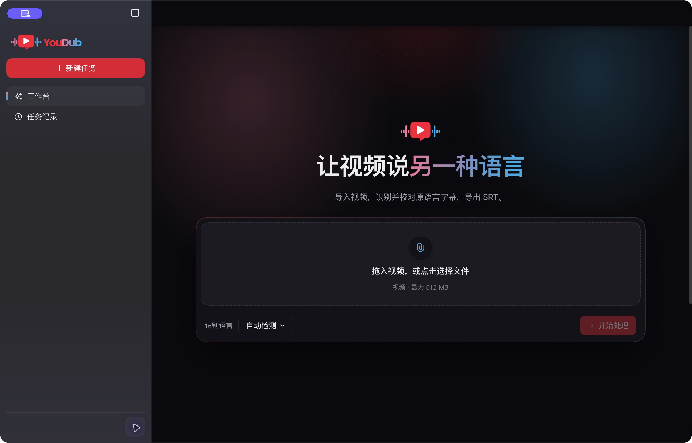

# 验收记录：2026-10-21

分支 `codex/harness-subtitle-poc`，独立 worktree。当前载体为未修改的官方 **Harness Desktop 0.2.1-rc.2**，插件构建使用 Node.js 22.23.2，本机 macOS。

## 当前桌面接入

- 官方 Desktop 使用 `.cache/harness/desktop` 作为 `DSH_HOME`，使用独立 `--user-data-dir`；现有 Harness 实例保持独立。
- 本次窗口来自 `.cache/harness/YouDub Harness.app`，它是官方 `/Applications/DeepSeek Harness.app` 的字节一致 APFS 副本。启动器默认仍使用原官方应用路径。
- 原应用与 APFS 副本的 `app.asar` SHA-256 均为 `b9ec4c2bbc20c9dbc3e39fa4c961434a943434ab0a803052b26753dd15f3b066`。
- 浏览器与桌面统一使用 `dsh-base` + `dsh-web-app` + YouDub bundle；环境配置、认证连接和插件装配均沿用 Harness。
- 页面挂载到官方 `AppFrame` 的 `sidebar`、`main`、`shell.leading` 插槽。任务页标题并入桌面拖拽区，侧栏固定、主区域独立滚动已实测。
- 按钮、菜单、状态标签、状态点、提示和图标来自官方 primitives；共享状态使用官方 `defineStore`，主题通过 `overrideTokens` 与官方主题偏好服务接入。滚动条采用官方主题样式。
- 原 `BrandMark`、SVG 字标、深浅配色和声波/入场动画继续来自 YouDub 原源码。业务视频、字幕多行编辑和识别进度保留业务组件。
- Python 通过官方 `subprocess` 启动，识别登记在官方 `jobs`；任务检查点使用官方 `writeFileAtomic`。字幕状态机及 `task.json` 仍为 YouDub 业务实现。

深浅首页已分别截图并目视核对：YouDub 字标、大标题、光晕、点阵及上传区域完整，侧栏没有滚动条，主区域保留独立滚动条。原版 Logo 声波已观察到不同帧的高度变化。

[桌面导出截图](evidence/desktop-exported.png) 同步保存。

## 桌面真实视频进度

本轮任务为 `129e3a76-81f4-4f94-9c60-06e08563c03e`，使用仓库 `site/assets/zoo-en.mp4`，时长约 18.93 秒。

已验证：

1. 从 Desktop 的原生文件选择器导入视频。
2. 真实执行 FFmpeg 与 Whisper tiny/CPU，得到 3 条字幕并停在“待人工确认”。
3. 在桌面将第二条的 `long arms` 订正为：

   > The cool thing about these guys is that they have really, really long trunks, and that's cool.

4. 未保存时“确认字幕”不可用；保存后内容保留，仍为待人工确认。
5. 侧栏固定、主区域单独滚动，保留原版首屏和动效。
6. 点击确认和导出，在原生保存对话框将文件命名为 `youdub-harness-desktop-zoo-en.srt`，保存到 Downloads。
7. 下载文件与 Host 产物字节一致；原始 ASR 仍为 `long arms`，确认字幕及下载文件包含 `long trunks`。

最终任务为 `exported`，`revision=10`、`confirmedRevision=8`。下载及 Host 产物 SHA-256 均为 `02eb9f62b06c5b3bad558a10c526224c5b07264d5196d2da5e2fbef895202a32`。

证据：[桌面实际下载字幕](evidence/desktop-zoo-en.srt)、[任务与产物核对](evidence/desktop-workflow.json)、[桌面导出截图](evidence/desktop-exported.png)。

## 启动故障与修复

早期桌面接入出现过三轮启动诊断：

- 自定义 `process` 服务遮蔽 Cordis 表达式中的 Node `process`，导致 Host 服务依赖未激活。当前已移除自定义进程服务，使用官方 `subprocess`。
- 关闭布局/会话后，其下游 UI 仍在等待依赖。当前保留官方布局、会话、主题及所需服务，统一维护共享 bundle 的启用关系。
- 关闭设置服务使 `configForms` 缺失，继续阻塞 locale、shortcuts 和日志导出。当前启用官方 `ui-settings`。

修复后的官方 Desktop 已成功进入 YouDub 页面并完成本轮识别、校对保存；上述 pending 启动故障已消除。未修改官方 Desktop 或上游核心代码。

## 自动化检查

`npm test` 当前汇总 **11 项通过**：

- 6 项工作流测试：保存/重启/确认/导出及修改后撤销确认；旧版本与空字幕拒绝；并发操作约束；单个识别执行位和人工确认暂停；worker 失败；执行中断和导出失败状态。
- 1 个官方子进程集成测试父项及 4 个子项：批处理 stdout 与非零退出 stderr、worker 进度及 artifact 协议、原始错误和非法协议终止、取消后返回原始原因。

测试直接启动真实 Harness 本地子进程服务。原始识别结果和错误原因保留，失败不会变成完成状态。

## 当前官方组合的浏览器回归

浏览器以 `dsh-base` + `dsh-web-app` + YouDub bundle 启动，首页和官方布局正常，任务页使用紧凑顶部栏。检查到的 console warning/error 列表为空。

本轮重新打开既有任务 `80ab3f36-e482-459a-b63c-9bcf70c86d9b`，确认过的人工订正文案仍完整保留。再次点击导出，实际下载到 `Downloads/zoo-en (2).srt`；该文件与 Host 产物 SHA-256 均为 `a5643031b3cc661b7e23034b6657a01c1ea767d562cf9e9b4fca95d2e1d36c25`。本轮回归覆盖官方组合启动、页面、既有任务和下载，没有重新执行浏览器识别。

证据：[当前浏览器首页](evidence/browser-official-home.png)、[当前浏览器任务页](evidence/browser-official-task.png)。

## 历史证据：初版浏览器阶段

以下证据来自改用官方 Desktop 和 AppFrame 之前的浏览器 POC，证明当时的媒体链路、状态持久化及鉴权行为，不作为当前桌面截图或下载结果。

两次均从浏览器文件选择器导入 `site/assets/zoo-en.mp4`，真实执行 FFmpeg 和 Whisper tiny/CPU，得到 3 条字幕。最终一轮任务为 `80ab3f36-e482-459a-b63c-9bcf70c86d9b`。

- 首句人工改为 `All right, so here we are in front of the elephants.`，第二句将 `long arms` 订正为 `long trunks` 并修正文句。
- 未保存时禁止确认；保存后保持待确认。停止并重启 Host 后，订正内容和待确认状态保留。
- 点击字幕定位播放后，媒体 `readyState=4`、`paused=false`、`currentTime≈4.98`、`error=null`。
- 人工确认后实际下载 SRT，与 Host 产物字节一致。原始识别保留 `long arms`，确认字幕和下载文件包含 `long trunks`。
- 旧浏览器首屏声波 CSS 动画为 `yd-eq`，周期 1.1 秒、状态 `running`；声波条 scaleY 实测约 0.38–1.0，并保留减少动态效果偏好。

[历史实际下载字幕](evidence/zoo-en.srt) 包含 6 个显示片段，来自现有 YouDub 导出器按标点拆分。

| 核对项 | SHA-256 |
| --- | --- |
| 输入视频 | `ad1b9836ea34d72812d5dc9d134d46807635d699ed51bada00916c8d1dd76e10` |
| 历史浏览器下载 | `a5643031b3cc661b7e23034b6657a01c1ea767d562cf9e9b4fca95d2e1d36c25` |

[历史产物核对数据](evidence/workflow.json)；[历史 HTTP 检查](evidence/http-checks.json)：未认证 401、错误 Origin 403、未确认导出 409 / `REVIEW_REQUIRED`、视频 Range 206。

历史截图：[深色首屏](evidence/home-dark.png)、[浅色首屏](evidence/home-light.png)、[人工校对](evidence/review.png)、[完成导出](evidence/exported.png)。

## 未覆盖范围

桌面真实字幕链路、深浅首页、动效及当前官方组合的浏览器回归已验收。旧版浏览器证据仅覆盖历史阶段。尚未制作或验收 YouDub 品牌安装包、签名发布、跨平台及生产部署。
