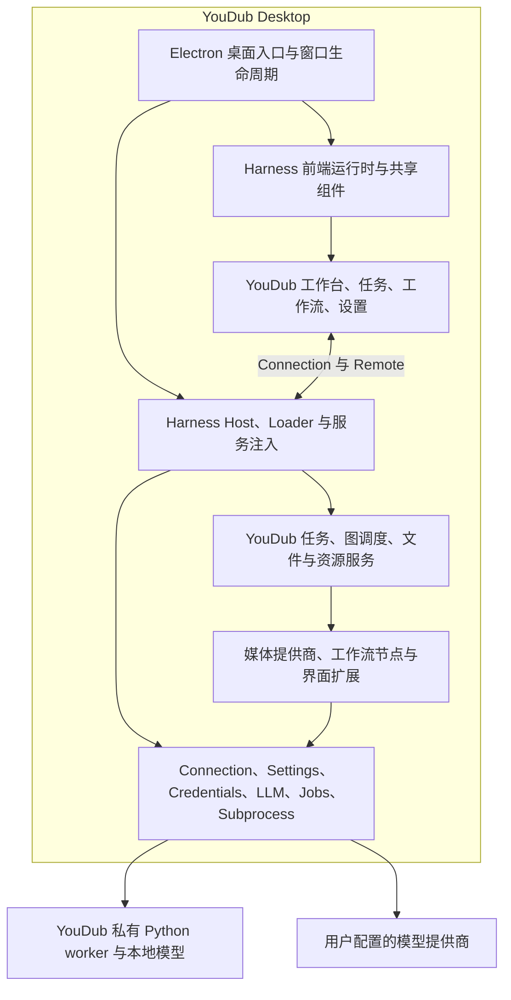

# YouDub Desktop 自有框架分支改造计划

日期：2026-10-22。实施分支：`codex/harness-youdub-integration`。计划基于提交 `4b9dc0a7168135f191dd4050a6d1d9a32d9e14b9` 的源码和现有验收记录。

当前状态（2026-10-23）：P1 已完成；原生首启、模型草稿保护、九节点人工校对、字幕导出与三类扩展已有验证。第 25 批保留 209 个源码包、235 个客户端产物，已修复前后端聚合类型检查，并加入开发 CI。55621d17 的 macOS 与 Windows CI 全部通过：新增聚合类型检查、8,075 项 GUI、6,689 项 profile、264 项业务界面、78 项产品和 525 项 Python 回归通过；Windows 567 项桌面/进程与 32 项产品合同通过。临时第四语言的菜单、刷新/Host 重启和卸载回退也已验证。[本批证据](evidence/refactor-unused-vendor-prune.json) P0、P2–P7 的剩余验收仍开放，见[当前代码审计与 A1–A20 矩阵](CODE-AUDIT.md)。本轮不打包或发布，两份飞书文档在全部完成后更新。

2026-10-23 P4 增量：八类基础控件已统一到原 `components/ui/*`，桌面专用重复实现与对应构建替换已移除。268 项前端回归、类型和构建通过；实际 Host 的首页菜单与节点编辑验证通过，原生交互仍待最终验收。[统一控件证据](evidence/refactor-unified-controls.json)

2026-10-23 P4 后续：工作流 Modal 与控制器 Store 已在业务源码中统一复用官方实现，桌面专用 Dialog/Store 及对应构建替换已删除。268 项前端回归和实际 Host 的键盘、草稿检查通过；原生验收保持开放。[证据](evidence/refactor-shared-modal-store.json)

同日追加：快捷字段浮层共用 Harness Menu；根据实际页面修复隐藏 Portal 的聚焦时机和全宽输入框的横向溢出。7,593 项框架 GUI、268 项业务界面与实际 Host 浏览器验证通过。[浮层记录](evidence/refactor-shared-popover.json) 旧字幕默认配置的实际迁移、重复调用、编辑/删除后重启及历史记录保留也已验证。[迁移记录](evidence/refactor-legacy-defaults-host.json)

## 1. 目标与范围

将当前融合分支改造成由 YouDub 自己维护的 Electron 桌面产品：使用 Harness 的实际框架源码、服务和前端组件，移除 YouDub 无需使用的产品功能及其依赖，保留 YouDub 原业务能力与视觉风格。

### 已确定的约束

- 允许修改来源于 Harness 的活动源码，包括解除产品耦合、提取必要接口和裁剪构建范围。通用实现优先直接复用，修改应对应明确需求。
- Harness 原始归档、原始来源清单、YouDub 初始快照和历史实验结果保持不变。活动 fork 与原始档案分别记录。
- 延续一个框架容器、一套插件生命周期、一套前端运行时。保留 Electron 主进程、Renderer、Host 和 Python worker 的进程边界。
- 保留原动态 Logo、大标题首屏、动效和布局风格。当前 YouTube 红 token 为 `#ff0033`，沿用已有主题定义。[主题源码](../../web/src/app/globals.css)
- 环境、模型、缓存、凭据和业务数据归 YouDub 管理；启动、构建和首启准备能够脱离已安装的 Harness 应用、共享 `~/.dsh` 与原开发者的工作区。
- 模型提供商、URL 和密钥通过页面输入并实际测试；密钥摘要保留现有“前六位＋掩码”规则，短密钥全遮挡。实际 LLM 请求显式配置至少 `65,535` 输出 token，不兼容时停止调用。[现有调用约束](../src/backend/llm.mjs)
- 在当前融合分支继续工作，保持 `main`、`atomgit` 的职责与内容。无需新增长期分支。
- 当前仅实施源码开发改造及验收；不制作安装包、不签名、不发布、不设置自动更新源、不建设在线插件市场。发行后续条件见第 10 节。

网站、示例素材、原实验数据及用户任务不属于删除目标。源码复用和完整功能覆盖继续以[功能账本](FUSION-COVERAGE.md)、[前端映射](../FRONTEND-MAPPING.md)为依据。

## 2. 已核实的现状

以下为指定提交的静态核对结果，运行状态与历史测试结果需要在 P0 重新建立基线。

| 编号 | 现状与证据 | 对改造的影响 |
| --- | --- | --- |
| F1 | profile 组合 `dsh-base`、`dsh-web-app`、YouDub bundle；YouDub patch 有 117 个 `disabled: true`。[装配](../prepare-profile.mjs)、[patch](../cordis.patch.yml) | 建立正向列出的 YouDub 组合，记录每个保留项的使用者与依赖 |
| F2 | 模型页强制注入 `remote.session`；Store 在 DeepSeek 账号分支调用 `modelCatalog`。[注入](../../../vendor/deepseek-harness/source/packages/client/ui-settings-models/src/client/index.ts)、[Store](../../../vendor/deepseek-harness/source/packages/client/ui-settings-models/src/client/store.ts) | 先移除账号专属分支，继续使用已有 LLM/Settings/Credentials 接口，再核对剩余会话依赖 |
| F3 | Desktop Host 显式安装 Office 资源插件和平台账号 session 发布器。[入口](../../../vendor/deepseek-harness/source/apps/desktop-host/src/index.ts)、[Office](https://github.com/liuzhao1225/YouDub-webui/blob/4b9dc0a7168135f191dd4050a6d1d9a32d9e14b9/vendor/deepseek-harness/source/apps/desktop-host/src/office.ts) | 仅关闭 bundle 条目无法删除这组启动逻辑；需要修改 Host 产品装配 |
| F4 | 退出与更新检查直接要求 `agents` 和 `jobs`。[退出检查](../../../vendor/deepseek-harness/source/apps/desktop-host/src/quit-inspection.ts)、[更新检查](../../../vendor/deepseek-harness/source/apps/desktop-host/src/update-tasks.ts) | 删除 Agent 前接通 YouDub 运行、排队、远端等待、资源下载和未保存内容的判断 |
| F5 | 前端通过构建 alias 和 resolver 替换控件、旧 SDK 与 Store 导入。[构建](../build.mjs) | 逐步将源码导入接到统一入口，减少构建期替换；业务组件继续直接复用 |
| F6 | 框架先复制到 staging 做官方全量构建；原件校验、包路径清单和构建收据绑定完整上游。[框架构建](../build-framework.mjs)、[运行时准备](../prepare-source-development.mjs)、[来源检查](../baselines/README.md) | 首次修改上游前先区分原件校验与 fork 构建校验；裁剪时同步更新生成与构建依赖 |
| F7 | `desktop.mjs` 要求 `primary-runtime`；手工准备时同时复制 `office-skills`，开发运行还使用其中的 Node/pnpm。[启动器](../desktop.mjs)、[准备逻辑](../prepare-source-development.mjs) | 调研必需资源的准确闭包，不能直接删除整个 runtime |
| F8 | 当前 CI 主要针对 `main`，macOS/Windows 流程调用旧桌面构建；release 由 `v*` 标签触发。[当时 CI](https://github.com/liuzhao1225/YouDub-webui/blob/711e40e8e69d2c6f2065f15aecc90550dcbf695d/.github/workflows/ci.yml)、[当时 Windows](https://github.com/liuzhao1225/YouDub-webui/blob/711e40e8e69d2c6f2065f15aecc90550dcbf695d/.github/workflows/windows.yml)、[当时发行](https://github.com/liuzhao1225/YouDub-webui/blob/711e40e8e69d2c6f2065f15aecc90550dcbf695d/.github/workflows/release.yml) | 先建立融合分支的源码检查路径，避免触发旧应用打包和错误发行 |
| F9 | `apps/desktop` 已有 Swift/macOS 与 C#/Windows 的旧壳。[旧桌面说明](../../desktop/README.md) | 目录归并必须处理旧入口，不能直接覆盖同名目录 |
| F10 | 已有功能账本和真实样本，同时存在原生交互、B 站、部分音色和发行缺口。[代码复核](CODE-AUDIT.md) | 历史记录用于选择回归范围；本次完成状态必须来自本次版本的证据 |

停用项数量、文件数、成功构建和插件 active 均不代表业务覆盖率。

## 3. 目标架构与源码管理

### 保留边界

| 层 | 保留实现 | 可调整范围 |
| --- | --- | --- |
| 框架内核 | Cordis、Loader、生命周期、Schema、事件与服务注入 | 仅修改已证实的产品耦合；保持服务所有权、激活和销毁语义 |
| 通用 Host 服务 | Connection/Remote、Settings、Credentials、LLM、Jobs、Subprocess、文件访问与诊断 | 移出账号、会话、办公等专属接线；沿用认证、文件授权、取消和错误合同 |
| 前端基础 | Renderer、ModuleLoader、Slots、Store、布局、主题、语言、基础控件 | 开放真实需要的 props/状态，统一产品组件入口与主题 token |
| 桌面产品 | Electron/preload/IPC、窗口、文件对话框、快捷键、退出保护 | YouDub 名称、路径、首启、任务检查、诊断与配置 |
| YouDub 领域 | 原任务状态机、图调度、SQLite、修订、结果复用、worker 与媒体算法 | 按现有业务服务拆分装配；保持历史数据和执行语义 |
| 扩展 | 原 PluginManager 与 YouDub 节点/提供商/页面合同 | 明确支持范围、版本与权限，不承诺所有 Harness 产品插件均可运行 |

工作流决定节点依赖、人工确认和持久状态；Jobs 管理单次执行；Subprocess 管理进程和管道。保留三者的职责，不新增第二套调度器。

插件按可替换能力拆分。第一轮使用现有文件和现有插件注册，普通组件保持组件形式；只有出现独立安装、启停或版本管理需求时才拆成新 npm 包。

### 活动源码与原始基线

1. 使用现有归档与 Git 提交保存 Harness 和 YouDub 初始状态，P0 验证可恢复性。新增本次改造前的非发行快照标识，避免使用 `v*` 标签。
2. 第一轮保留当前目录位置，在来源说明中明确 `vendor/deepseek-harness/source` 转为活动 fork。原始 `source-manifest.json` 仍表示固定来源，不能继续被当作可变源码的预期哈希。
3. 改造记录包含上游基准提交、YouDub 提交、保留/修改/删除模块及原因。扩展现有来源工具即可，避免维护第二份完整活动源码。
4. P6 再决定目录搬移。若归并到 `apps/desktop`，先处理旧桌面入口，再以独立提交搬移当前 Electron 产品；更新导入、脚本、测试和文档。仅为改名进行的大规模移动可延后，产品启动独立性必须完成。
5. 第一轮保持持久化标识和服务合同稳定。`@deepseek-ai/*`、`dsh.bundle`、配置 namespace、节点 ID 等内部标识按兼容需要保留；产品展示统一为 YouDub，来源及许可保留真实名称。

## 4. P0 前期调研清单

P0 需要实际执行下表调查并记录结果。前述静态发现只覆盖调查起点，不能据此直接批量删除包。

| 编号 | 调查内容 | 方法与具体入口 | 交付与完成条件 |
| --- | --- | --- | --- |
| R1 | 框架依赖闭包 | 从 Desktop、Host、Renderer、YouDub 入口追踪 imports、package 依赖、`inject`、配置表达式、动态注册、生成的 Remote 类型和可选服务 | 模块按保留/解耦/删除/待查分类；每个删除候选有使用者清单，类型依赖与运行依赖分别记录 |
| R2 | 实际加载与构建范围 | 对照 profile 解析、PluginManager inventory、前端 ModuleLoader、构建 metafile、preload 和生成代码 | 形成源码、安装、构建、运行四份范围的对应关系；每个保留模块有职责 |
| R3 | 基线恢复与构建来源 | 核对归档、Git tag、公开 tag、原 Desktop 二进制与 npm 基线；在临时目录恢复小范围源码验证 | 原件来源可定位；明确原应用内嵌提交与公开源码版本不同，历史完整性与产品可构建性分别报告 |
| R4 | 启动与运行资源 | 跟踪 `desktop.mjs`、`prepare-source-development.mjs`、Desktop Host、Node/pnpm、yt-dlp、Python/FFmpeg、Office | 列出每项资源的消费者、平台、版本、来源、哈希、准备时机；确定 Office 移除后仍需的资源 |
| R5 | 业务完整性 | 将冻结清单的 58 路由、11 媒体操作、11 worker 操作、9 页面和 50 组元素映射到当前实现；补入后续下载节点、三模板、语言等能力 | 更新现有功能账本；区分保留语义、等价替换、历史遗留和待验收，不能仅按数量对齐 |
| R6 | 界面与交互 | 对照原 YouDub 快照、当前 Electron、首屏/深浅色/菜单/模态/画布/媒体/设置/扩展；检查 alias 和 CSS 来源 | 元素级来源和复用方案；保存可重现的截图与动效/键盘操作基线；列出已有 UI 缺陷 |
| R7 | 配置、凭据和数据 | 核对 profile/home、环境变量回退、凭据引用、数据库 schema、工作流/任务快照、integrity、语言和首启标志 | 形成稳定标识清单与必要迁移表；明确私有配置优先级及跨应用隔离策略，不输出真实密钥 |
| R8 | 任务生命周期 | 跟踪运行、排队、人工等待、异步远端请求、取消、重试、退出和重启；确认 Jobs 与领域任务的差异 | 列出退出时需要保护的状态及来源；确定恢复语义，不把未知外部结果视为成功或自动重发 |
| R9 | 插件合同 | 使用现有 JS Host/Client、Python、多输入审核 fixture，核对安装、版本、缺服务、启停和卸载 | 定义本轮支持的 YouDub 扩展面；保留安装与运行错误，核心插件保护有明确规则 |
| R10 | CI、平台与许可 | 检查 CI/release/pages 触发链、旧发行脚本、保留模块测试、原生二进制、第三方声明 | 明确源码开发检查与发行流程边界；平台验收条件和许可清单完整，不能用旧壳构建代表 Electron 验收 |

结果尽量写回现有架构、前端映射、功能账本和验证记录。只有机器生成的依赖清单、运行 inventory 与验收证据需要独立文件。每条记录带源码提交、命令/操作、平台、结果和证据路径。

## 5. 分阶段实施

所有阶段由当前改造任务的执行者统筹并完成验证。功能、界面、构建和验收都在同一计划内收尾。每阶段仅在相应退出条件满足后标记完成；先完成代码不能关闭该阶段。

### P0：调研、基线与首轮决策

前置：工作区与分支已确认；用户数据所在目录已识别。

- [ ] 完成 R1–R10，核对已有失败与尚未验证项目。
- [x] 保存改造前源码标识、当前工作区状态、运行环境版本和功能基线；现有归档继续使用。
- [x] 在隔离数据目录运行当前 Electron，检查启动、设置、首启状态、任务库及代表性工作流，记录基线问题。
- [ ] 测量同机冷启动/热启动、构建耗时、源码构建产物体积、进程及依赖数量；记录条件，不预设性能收益。
- [x] 确定最小产品组合、先解耦的依赖和可删除模块批次；未解释的依赖留在待查列表。

退出条件：可以从证据说明每个第一批修改的目的、消费者、影响范围和验收方法；原件可恢复；功能和 UI 基线有明确缺口列表。

### P1：建立 fork 的来源规则与源码开发检查

前置：P0 的原始来源与可恢复基线已验证。来源和构建工具可先于原生 UI 基线独立推进；行为改造仍需完成相关依赖调查和基线核对。

- [x] 将“原始归档字节校验”和“当前产品来源/构建校验”分开，保存原始清单，不重新生成原件哈希来接受修改。
- [x] 为保留、修改、删除的上游模块记录来源与理由；构建收据对应实际 fork 提交和选定输入。
- [x] 调整 `build-framework.mjs`、`prepare-source-development.mjs`、`baselines/*` 的全量原件假设，继续验证实际输入、输出和路径一致。
- [x] 接入本次修改的上游模块原有测试及其必要配置/生成工具；原本未复制进活动目录的测试支持文件按来源补齐。继续使用原断言验证控件、凭据、进程与生命周期行为。当前模型设置模块已接入，后续修改的模块继续按本规则补齐。
- [x] 为融合分支接入源码构建、类型、相关测试、活动模块和语言检查；保留现有 `main` 发行链的独立边界。干净 macOS runner 检查已通过，见 [39646789113](https://github.com/liuzhao1225/YouDub-webui/actions/runs/39646789113)。后续每批改动继续运行该检查。
- [x] 审核 CI 的调用链，确保开发检查不生成安装包、不触发签名、release 或 Pages 发布。真实模型任务独立记录，不把凭据写入公共 CI。

重点文件：[基线工具](../baselines)、[构建](../build-framework.mjs)、[运行时准备](../prepare-source-development.mjs)、[CI](../../../.github/workflows/harness-development.yml)。

退出条件：合法 fork 修改有可追溯差异；错误来源和不一致构建仍会失败；开发检查能运行且不会进入旧打包路径；原始归档完整性结论不变。

### P2：最小产品组合与会话依赖解耦

前置：P1 完成；R1/R8 的依赖和状态表可用。

- [x] 基于现有 bundle 实现建立 YouDub 正向装配清单，仅加载明确需要的框架服务、前端模块和业务插件；继续复用原 Loader/profile 配置语义。
- [x] 从模型设置移除 DeepSeek 账号登录、默认账号路由和专属 onboarding；保留提供商发现、添加/编辑、凭据管理和已有 LLM 接口。用户自行配置的 DeepSeek API 提供商仍属于普通模型提供商能力。
- [x] 解除 `ui-settings-models` 与 YouDub Client 对 `remote.session` 的不必要依赖；逐项检查 `ui-session`、SessionController、agent registry、attachments、workspace registry 的剩余消费者。
- [ ] 将退出保护接到 YouDub 实际运行任务、排队工作、下载/安装、远端请求状态及前端未保存内容；等待人工确认的持久任务与未保存草稿分别判断。
- [x] 断开平台账号 session 发布、聊天、编码、子智能体、计划提醒等产品接线；确认共享功能无消费者后移除对应启动项。
- [ ] 保留 Electron sandbox/contextIsolation、IPC 来源校验、Connection 请求准入、文件授权、凭据边界和进程清理。

重点文件：[产品入口](../src/desktop-product.ts)、[Host 入口](../../../vendor/deepseek-harness/source/apps/desktop-host/src/index.ts)、[模型设置](../../../vendor/deepseek-harness/source/packages/client/ui-settings-models/src/client)、[Client](../src/client.jsx)、[profile](../prepare-profile.mjs)。

退出条件：干净 profile 从首启进入工作台；模型页无需会话/Agent 即可工作；启用条目无 pending/failed；运行中退出有真实保护，空闲退出正常，子进程正确结束。仍需暂留的依赖必须注明消费者。

### P3：YouDub 私有运行资源与首启闭环

前置：P2 桌面/Host 生命周期稳定；R4 资源清单完成。

- [x] 移除 Desktop Host 的 Office/LibreOffice 专属组合及强制 `office-skills` 要求；保留经清单证明必要的 Node、pnpm、原生进程能力。源码物理裁剪仍属 P6。
- [x] 直接复用现有下载、校验、解压和资源状态实现，将缺少的开发运行资源准备纳入 YouDub 的可重复命令；开发依赖由锁文件安装，Node 使用 Electron 原实现，不依靠从另一应用安装目录手工复制。
- [x] 将基础启动依赖与界面内媒体环境准备划清：能显示首启界面的最小运行时先准备；Python、FFmpeg、分句资源、模型按现有首启流程处理。
- [x] 首启先选择语言和私有安装目录，通过官方 Settings 保存；确认前不下载。页面确认、原生文件夹选择、Electron 退出与重启读回通过；其余资源恢复行为继续列入 A2/A3。
- [x] 保留 Whisper、Demucs、VoxCPM2、Qwen Aligner 四模型及推理依赖全就绪的门控；模型或依赖未完成时显示实际状态，不能进入已就绪状态。新隔离 profile 已实际验证，见调研记录。
- [ ] 保留下载进度、暂停、继续、显式重试、日志和错误；原错误可定位，不静默降级或改写成成功。
- [x] 核对 Node/pnpm、Python、媒体工具、模型、缓存和凭据的实际解析路径。8fea16f1 经隔离实际 Host 验证所选路径覆盖外部同名环境、用户 Python 包关闭、四模型路径和私有凭据优先级；新 profile 仍需显式准备操作。测试复用既有私有资源，未宣称重新下载安装或原生交互通过。[证据](evidence/refactor-runtime-isolation.json)
- [ ] 检查旧 YouDub 私有目录可继续使用。确需改变目录/配置结构时，在隔离副本验证迁移和失败行为，保留用户数据。

重点文件：[启动器](../desktop.mjs)、[私有环境装配](../src/host.mjs)、[setup](../src/backend/setup.mjs)、[resources](../src/backend/resources.ts)、[原资源清单](../../../packages/builtin/src/runtime-resources.ts)。

退出条件：新工作区通过文档化命令准备并启动，无对原 Harness 安装目录或其他工作区的依赖；四模型/依赖未完成不能放行；页面配置提供商后重启读回；迁移后的历史任务、资源和凭据引用可用。

### P4：前端统一与原版视觉还原

前置：P2 的前端服务接口稳定；P3 首启状态合同确定。

- [ ] 按前端映射逐项选择原业务组件和 Harness 组件源码，建立单一控件、Store、主题和 locale 入口；每替换一组导入，删除对应不再需要的构建 alias。
- [ ] 统一 Shell、侧栏、主区域滚动、窗口拖动区域、菜单/弹窗、焦点和快捷键，移除依赖聊天布局的空白或占位。
- [ ] 直接保留动态 Logo、大标题、首屏动画、视频播放器、画布及校对业务组件；通用元素使用保留下来的 Harness 实现和共享主题 token。
- [x] 对官方组件确实缺少的能力补充小范围公开接口，例如模型表单的 dirty 状态和离开确认；复用原编辑状态，不通过 DOM 探测或另建表单副本。模型设置已通过原 section owner 回调保护关闭和导航；日语原生退出提示和取消保留草稿已实测；其余窗口行为仍在 P7 范围。
- [x] 密钥掩码直接放在原编辑器 API 密钥字段，移除独立已保存摘要；完整密钥不回填，输入值为空。真实页面保存、重开及重启读回通过。
- [ ] 设置按 YouDub 的语言、外观、模型、资源和扩展任务组织，清除代码工作区、DeepSeek 登录及无关版本显示。版本分别标识产品与插件，内部框架来源保留在开发/许可信息中。
- [ ] 界面语言继续在设置中统一选择；保留中文、英文、日语和语言注册机制，界面语言与媒体目标语言分别配置。[语言规则](LOCALIZATION.md)
- [ ] 审核可见文案、错误与空状态；保留必要反馈，避免将框架实现细节和开发进度放进普通用户流程。

验收使用真实 Electron：原始默认窗口 `1280×820`、实现允许的最小窗口 `520×600` 及实际大屏；覆盖深浅色、侧栏开合、长列表、键盘菜单、模态关闭、画布拖拽和原生保存。动效需实际观察，截图只证明静态状态。

退出条件：相关页面逐项对照通过；控件与样式来源清楚；侧栏和内容滚动符合实际布局；中英日设置无缺键、错位和硬编码回退；模型草稿离开行为明确；构建替换层仅保留仍有说明的必要项。

### P5：业务插件与数据兼容收拢

前置：P2/P3 服务和资源接口稳定；P4 中需要的业务扩展槽已明确。

- [ ] 按任务/图调度、资源/首启、媒体提供商、模型翻译、界面扩展整理现有装配；沿用同一个 Loader 和生命周期。
- [ ] 核对图节点输入输出、schema、配置字段、可编辑结果、对应组件和后端 operation，补齐功能账本中的缺项。
- [ ] 保留三类默认模板及节点 `autoContinue`；旧用户模板和历史图快照保持原义。两路审核、汇合、结果复用、修订冲突和取消遵循现有状态机。
- [ ] 保留现有业务 API 与文件端点合同；只有具体接口阻碍解耦时才迁移，文件 Range、上传和授权仍由共享连接承载。
- [ ] 检查 provider/node/plugin ID、模型绑定、integrity、数据库 schema 和文件布局。必要变化制定显式迁移；历史结果和原始 LLM 请求/响应不回写。
- [x] 用现有三个扩展 fixture 验证 JS Host/Client、Python 和多输入审核。实际 Host 页面生命周期、原生导出、缺服务、路径不存在、版本不兼容及失败后状态已核对，证据区分各验收层。见 [P5 记录](evidence/refactor-extension-lifecycle.json)。
- [x] 内置必需能力保护与可选第三方扩展分开处理。保留真实安装管理；原生内置详情没有停用/卸载入口。在线市场目录与发布源仍列为后续发行工作。

重点文件：[Host 装配](../src/host.mjs)、[领域实现](../../../packages/builtin/src)、[媒体 worker](../../../backend/workers)、[扩展 fixture](../test/fixtures)。

退出条件：原业务清单每项有对应实现和验收状态；新旧任务/模板数据可读；节点审核和异步执行语义保持；扩展完整生命周期通过。

### P6：源码、依赖与构建裁剪

前置：P2–P5 对相关功能的验证完成，删除候选已无未解释使用者。

- [ ] 按批次移除无关账号、聊天/Agent、终端工作区、办公工具、实验功能和旧产品入口；同时检查脚本、类型、资源、测试夹具和动态路径。
- [ ] 同步裁剪 workspace/package 依赖、锁文件、TypeScript references、Remote 生成输入、client roster、构建收据及资源清单；第三方声明按保留的实际依赖更新。
- [ ] 复用原构建工具实现，只构建保留范围及其必要依赖，清除固定“全部上游包/全部客户端产物”的假设。
- [ ] 在全新生成目录重建，验证已删除模块不会由 staging、已安装 npm 包或其他工作区链接重新进入产物。
- [x] 清理旧 Swift/C# 壳和专属构建、签名、安装测试及发行 CI；原源码通过基线和裁剪前提交恢复，Electron 复用图标保留。
- [x] 清理旧 Host/Web 根的活动入口，并迁移其仍在使用的领域测试。第 24 批已移除独立 Host、Vite/浏览器引导和旧插件 CLI；原引导实现仅保留为领域测试夹具。业务组件、网站和示例继续保留。[证据](evidence/refactor-legacy-entries-prune.json)
- [ ] 收拢开发命令、产品版本入口和文档；开发者能够从仓库根完成安装、构建、启动和检查。内部包名批量重命名不作为该阶段完成条件。
- [ ] 完成同条件前后测量，分别报告构建、启动、依赖和产物体积变化；媒体推理性能独立测量。

退出条件：选定源码可在干净工作区构建；活动应用只有预期框架和业务实现；删除清单与运行 inventory 对应；无外部工作区链接和无关 runtime 资源；文档可按步骤复现。

### P7：开发版完整验收与交付

前置：P6 完成，候选提交固定；新增失败修复后重新验证受影响范围。

- [ ] 完成第 6 节矩阵；每项带候选提交、平台和证据，不能将历史成功移记为本次通过。
- [ ] 完成 macOS ARM64 的真实 Electron 交互、任务执行和导出；Windows x64 完成来源构建、路径/进程检查及真实桌面操作。缺平台或原生交互条件时保持对应项目待验收。
- [ ] 验证干净首启和现有配置两条路径；新 profile 保持空账号/空用户提供商，已有 profile 保留用户配置。
- [ ] 复核无关功能在源依赖、活动构建、启动注册和可见 UI 中的移除情况，区分第三方库内部合理依赖。
- [ ] 更新架构、开发命令、功能/元素映射、扩展合同和本次验收记录；明确 Windows、网络或模型质量的任何剩余限制。全部改造与验收完成后，使用建平飞书配置同步[全页面展示文档](https://my.feishu.cn/docx/WvNdd2dWEo0NB8xCO4fcFeIdnAe)与[架构和接口设计文档](https://my.feishu.cn/docx/Nm3bdG4CGoDu6gxvMSmcOp43nWd)，更新前读取最新内容，保留图片、评论和历史事实。用户已明确要求最后统一更新。
- [ ] 在当前分支保存阶段提交与验证记录。分支同步后检查源码开发 CI，未通过不能宣布改造完成；不自动合并到 `main`/`atomgit`。

退出条件：本次范围内所有必要验收通过，干净工作区可复现，历史数据兼容，无未解释的核心失败。完成描述限定为源码开发版；安装、更新和公开发行另行验收。

## 6. 验收矩阵

| 编号 | 场景 | 必须观察到的结果 |
| --- | --- | --- |
| A1 | 无 Harness 应用/共享 home 的干净工作区 | 按文档准备并启动 YouDub；资源来自声明来源，路径属于产品或当前工作区，无开发者绝对路径依赖 |
| A2 | 首启资源缺失/部分完成 | Python、工具、分句资源、四模型按真实状态显示；VoxCPM2/Demucs/Qwen 未就绪不能被 Whisper-only 标记放行 |
| A3 | 资源暂停、重试、准备后重启 | 进度与状态真实；显式重试保留失败原因；重启按文件和依赖实际校验，无假 ready |
| A4 | 模型页面实际配置 | 页面输入 URL/Key、保存、发现模型、重开与重启读回；无预登录账号/预置已配置提供商；掩码正确且日志不含密钥 |
| A5 | LLM 不兼容/错误响应 | 调用前验证输出上限至少 65,535；不支持时停止；请求和原始响应证据完整，原错误可见 |
| A6 | 首页与通用交互 | 原 Logo/大标题/动效、YouTube 红、主题、侧栏与滚动正确；菜单、模态、焦点、键盘和窗口尺寸变化通过 |
| A7 | 中英日及语言扩展 | 设置与业务界面切换后重启保持；日语布局/键完整；临时第四语言注册验证无需增加固定侧栏按钮 |
| A8 | 本地视频完整字幕＋配音 | Prepare → Demucs → Whisper/原分句 → Translate → TTS → Align → Mix/Export 按实际模板执行；检查最终音轨、字幕、时间轴和播放 |
| A9 | YouTube zoo 链接＋代理端口 | 从页面配置代理端口，执行真实下载及完整工作流；保存下载错误/网络条件与成功产物，不能用本地视频替代此项 |
| A10 | B 站链接下载 | 真实可访问链接经节点处理；直连/代理合同正确；受网络或站点限制时保持待验收并记录原因 |
| A11 | 人工审核与分支汇合 | 两路可同时等待；保存不等于确认；确认一个分支不释放无关分支；汇合等待所有输入；等待释放执行槽 |
| A12 | 自动继续与持久化 | 同一模板按节点自动下一步设置运行；重启后待确认、草稿/已保存订正及任务修订符合合同 |
| A13 | 重跑、复用和冲突 | 合法中间结果可复用，必要审核仍保留；旧修订写入得到冲突；源任务清理后派生产物按原规则可用 |
| A14 | 取消、失败、外部请求与退出 | 子进程取消、非零退出、远端等待、排队和显式重试状态准确；无自动重发未知外部请求；退出保护与资源释放正确 |
| A15 | 模板与任务管理 | 创建/修改/删除、模板使用/编辑副本、导入/导出、过滤与历史详情通过；用户文档和历史图快照不被默认模板覆盖 |
| A16 | 字幕导入、导出与播放器 | 字幕文件导入、订正、原生保存、Range、双语字幕/音频/视频可读；源与导出文件校验对应，检查同步播放 |
| A17 | 提供商和音色配置 | 原清单中可用的模型/设备/音色配置映射正确；Vox 预设音色等已有缺口补验或明确保留未完成状态 |
| A18 | 扩展生命周期 | 安装/启用/执行/停用/卸载 JS、Python、Client 示例；状态和错误真实；核心保护正确；无旧 loader 或重复框架实例 |
| A19 | 安全与数据兼容 | IPC 来源、文件越界/未授权请求、凭据读写边界和隔离保持；现有用户任务/模板/配置可读且原件未覆盖 |
| A20 | 构建与平台 | 干净源码构建、对应测试和 macOS/Windows 原生验收通过；本轮不会调用旧壳打包/发行脚本 |

真实视频主样本沿用用户指定的 YouTube zoo 视频，完整实验默认使用“字幕＋配音”。流程成功与识别/翻译/配音质量分别记录，不能由任务 succeeded 推导质量合格。

## 7. 验证方法与证据

以下是当前存在的检查入口。实施时随目录与构建范围同步维护；每个阶段选择受影响检查，最终固定候选再做必要的集成验收。

| 范围 | 当前入口 | 改造要求 |
| --- | --- | --- |
| 产品/Host 接入 | `npm --prefix apps/harness test` | 保留原错误、取消、配置、凭据、文件与首启用例，补本次真实解耦回归 |
| 领域/工作流 | `npm run typecheck`、`npm test` | 保留图、修订、人工确认、复用、外部请求的断言 |
| 前端 | `npm --prefix apps/web test`、`apps/web/node_modules/.bin/tsc --noEmit -p apps/web/tsconfig.json` | 组件用例与真实 Electron 交互配合，不能只依靠独立 Vite 页面 |
| 语言 | `npm --prefix apps/harness run check:locales` | 检查键、参数、框架字典及实际页面 |
| Python | `.venv/bin/python -m pytest backend/tests` | 使用项目测试 venv；应用实际推理使用私有 venv，两种证据分别记录 |
| 构建与边界 | `npm run build:framework`、`npm run build:youdub`、`npm --prefix apps/harness run check:composition` | 在 P1/P6 调整实现；保持一次框架实例与源码输入检查 |
| 来源 | `apps/harness/baselines/verify.mjs`、`vendor.mjs`、`desktop-build.mjs` | P1 区分不可变归档检查与可变 fork 检查，不直接沿用“当前文件全部等于上游”规则 |
| 实际使用 | 当前 Electron 与同一 Host 的读回 | 原生选择/保存、退出、焦点和画布在桌面验证；API 读回用于确认持久状态和产物 |

新工作区所需 ignored 配置沿 `.worktreeinclude` 的最小清单处理；使用 `.env` 时创建 `env.txt` 硬链接并检查同 inode。不得复制 `.venv` 来替代环境准备。启动服务前确认端口状态。依赖源沿项目要求使用 npm 镜像、阿里 PyPI 及缺包时的清华源，模型来源与下载哈希分别记录。

证据使用现有 `docs/evidence/` 与验证文档组织；大模型、原始视频、大型运行产物和真实凭据不写入 Git。每项验收保留实际输入、操作、状态、错误、产物检查及候选提交。没有执行的项目标为待验收。

## 8. 风险与处理边界

| 风险 | 处理方式 | 停止该批次的条件 |
| --- | --- | --- |
| 隐藏的服务/类型/生成依赖 | R1/R2 追踪并在删除前解除；重新生成 Remote 与客户端输入 | 出现未解释 pending/failed、缺接口或启动错误 |
| 原件校验阻止合法 fork，或被改哈希掩盖差异 | P1 分离原件与产品来源检查；差异对应提交和原因 | 原始归档/清单改变，或无法说明构建来自哪个源码 |
| 删除 Agent 后丢失退出保护 | P2 先接真实业务状态，再移除依赖 | 有任务/下载/未保存内容被误判为空闲，或空闲状态误报不可用 |
| Office 裁剪连带删除 Node/pnpm | R4 明确工具消费者；P3 保留最小必需资源 | yt-dlp、插件安装或 Host 无法解析必需可执行文件 |
| 构建缓存保留已删除模块 | P6 使用新生成目录并核对实际输入/输出 | 产物依赖被删文件、旧 npm 副本或外部工作区 |
| 包名/目录变化使旧任务不可用 | R7 稳定标识清单；必要迁移在隔离数据副本验证 | 任务、模板、凭据引用或历史产物丢失/被改写 |
| 前端控件统一影响手感 | 原组件直接复用，按页面进行视觉与真实交互对照 | 首屏、动效、焦点、画布或编辑保存出现回退 |
| 误触旧发行流程 | P1 审核触发和调用图；源码 CI 与发行分离 | 开发命令/CI进入安装包、签名、release 或站点发布 |
| 平台/模型/网络验收条件不足 | 记录具体平台、来源和错误，保留项目未完成 | 无法实际执行对应必要验收；不能以其他平台或 fixture 冒充 |

失败后保留原错误和证据，先修根因并验证受影响范围；不自动回滚用户数据，不跳过失败步骤。确需恢复源码时从已记录提交恢复到单独目录对照。

## 9. 执行节奏与完成判定

推荐提交顺序：调研/来源 → 检查与开发 CI → 模型/会话解耦 → 桌面生命周期 → 私有 runtime → 前端直接接线 → 业务与扩展兼容 → 源码/依赖裁剪 → 验收和文档。机械搬移与行为修改分开提交。

前端改造可以在服务合同稳定后逐页推进；大范围删除必须等相关功能退出条件通过。当前计划不新增通用平台、插件市场服务或第二套兼容框架。P0 结束后根据实际依赖批次给出工作量评估，当前不承诺未测量的工期或收益。

上游版本固定到已记录基准。后续更新按缺陷、安全修复或明确能力需求选择性吸收，逐项记录影响与测试；通用底层、产品改造和机械裁剪保持可辨认的提交边界，避免自动追随上游破坏性变更。

阶段状态维护在本表；实施时同步更新 Codex 当前任务的 todolist。各阶段和验收项只有实际通过后才能完成。

| 阶段 | 状态 | 完成标志 |
| --- | --- | --- |
| P0 调研与基线 | 进行中；来源、依赖与功能映射已有记录；性能测量及剩余动态消费者仍待收口 | R1–R10、基线运行与裁剪决策齐全 |
| P1 来源与开发检查 | 已完成；来源分离、干净构建及提交 `1960d82f` 的源码 CI 通过 | fork 可验证，原件不变，源码 CI 无打包 |
| P2 产品解耦 | 进行中；正向组合、会话解耦、原生运行中退出取消及审核重启通过；资源/远端组合退出待验收 | 最小组合、模型设置和退出保护通过 |
| P3 私有运行资源 | 进行中；首启语言/目录、四模型及模型配置重启通过；当前资源恢复与旧目录待验收 | 干净准备、四模型门控、配置隔离通过 |
| P4 前端统一 | 进行中；草稿、掩码、日语、原生工作流文件往返通过；并行控件改动需最终对照 | 原版视觉、组件、语言与原生交互通过 |
| P5 业务与扩展 | 进行中；三类扩展生命周期、异常路径、原生导出与九节点审核通过；其余业务输入待验收 | 功能映射、历史兼容和插件生命周期通过 |
| P6 裁剪与构建 | 进行中；23 批裁剪后 211 包；旧 base/headless、Office 和专属生成器已移除，保留通用框架及其测试消费者 | 干净构建、依赖/来源闭合、开发入口统一 |
| P7 开发版验收 | 进行中；macOS 原生多项通过；最终媒体质量、Windows、最终 CI 及两份飞书文档待完成 | 必要矩阵、平台、分支 CI 与文档通过 |

### P6 第 14 批开发验收补充

旧 SDK 与 Codex/Claude/Harness 外部 subagent 八包及 228 个专属文件已退出活动源码。七项源码构建、932 项定向回归、实际运行闭包和独立 Electron 窗口的首页/设置/扩展/既有任务/原生 SRT 导出通过；原始归档与 YouDub 自有媒体 SDK 保留。本批 `3d20efcb` 的[开发 CI](https://github.com/liuzhao1225/YouDub-webui/actions/runs/39767481216) 已通过，P6 其余包及完整产品覆盖尚未收口。详见[调研记录](REFACTOR-RESEARCH.md)与[本批证据](evidence/refactor-sdk-prune.json)。

### P6 第 15 批开发验收补充

已裁剪 26 个 ACP/LSP、代码协作与电脑浏览器扩展包及 508 个文件。独立源码构建七项、695 项定向回归、六组双语文档、75 包运行闭包及真实 Desktop Host 的两种首启/退出模式通过。本批 `55f5a7e1` 的[干净 macOS CI](https://github.com/liuzhao1225/YouDub-webui/actions/runs/39773213132) 已通过；原生插件生命周期、其余源码收拢与完整产品验收保留待办。详见[本批证据](evidence/refactor-code-extensions-prune.json)。

### P6 第 16 批开发验收补充

已裁剪 21 个旧聊天界面及孤立协作服务包，保留经动态引用确认仍有消费者的模块。七项源码构建、712 项定向回归、125 项客户端测试、两项实际 Host 测试和原件完整性检查通过；客户端原有 1 项预期失败继续验证清理行为。历史缺失的官方 lint 支持已补齐，14 项合同检查通过并纳入开发 CI。本批 `3e439abd` 的[干净 macOS CI](https://github.com/liuzhao1225/YouDub-webui/actions/runs/39777450882) 已通过；原生扩展生命周期和完整产品验收仍未完成。详见[本批证据](evidence/refactor-chat-surfaces-prune.json)。

### P5 插件重装修复验收补充

已修复链接安装改为复制安装后的路径解析，234 项解析器测试、框架构建及真实 Host 检查通过；同进程 Python 扩展启停、卸载重装和实际文件处理已验证。浏览器操作独立 Host，原生保存框仍受锁屏影响；其余扩展案例和整体验收继续开放。详见[证据](evidence/refactor-plugin-reinstall.json)。

### P5 三类扩展页面验收补充

Python、JavaScript 前后端、双输入人工校对三类扩展已通过独立 Host 的页面交互与产物验证；启停释放和卸载保留产物通过，模板重复入口已修正。原生对话框、全新私有运行时及剩余审计继续待办；浏览器结果不替代原生验收。详见[证据](evidence/refactor-extension-lifecycle.json)。

## 10. 后续发行边界

P7 完成后交付的是经过验收的源码开发版。保留安装/更新的后续事项和责任，不把分支改造描述为已发布产品：

- 安装包布局、私有 runtime/模型下载策略、原生依赖与许可证清单。
- macOS 签名、公证和 Windows 安装/卸载验证。
- YouDub 更新源、版本策略、任务进行时更新保护、真实旧版升级与配置迁移。
- 若建设插件市场，再落实目录、下载源、兼容版本、发布与安装验收；当前安装机制继续沿用现有实现。

以上事项在用户恢复打包/发行范围后进入实施。Harness 的 MIT 版权/许可和各第三方声明持续保留。[固定版本许可证](https://raw.githubusercontent.com/deepseek-ai/deepseek-harness/687f282e8625c6b8d11ff58211a90524be2e4317/LICENSE)、[现有第三方声明](../../../vendor/deepseek-harness/source/THIRD_PARTY_NOTICES.md)
