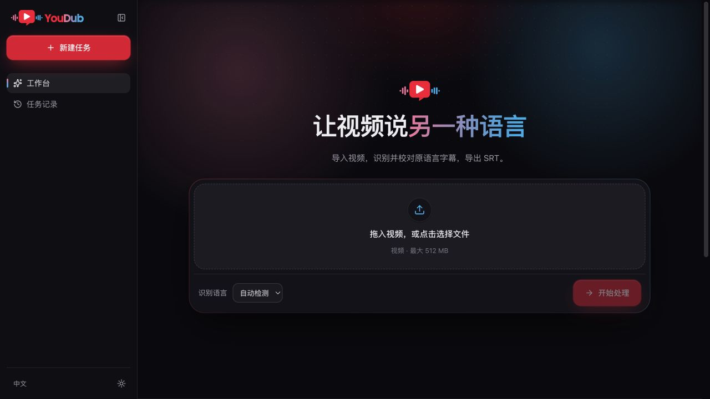
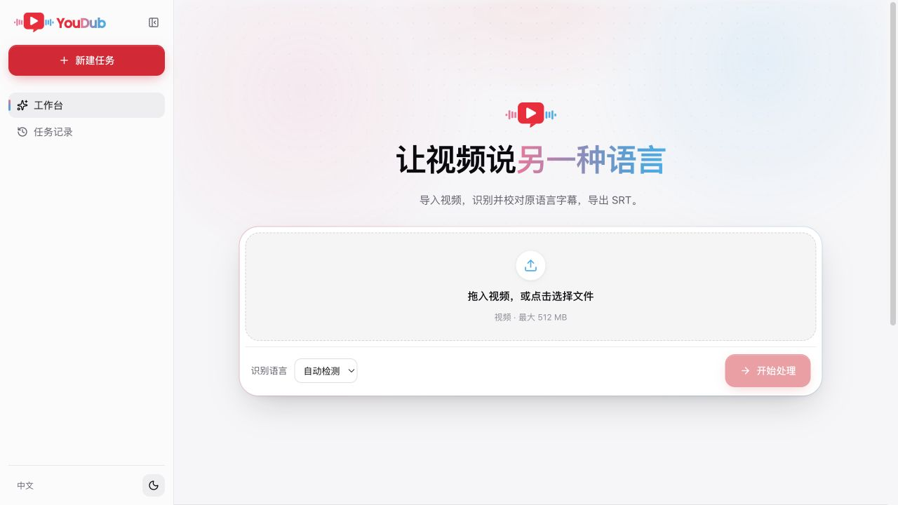
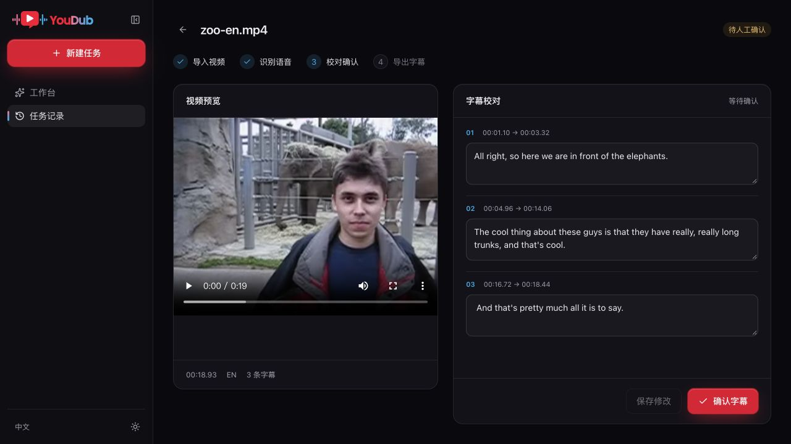
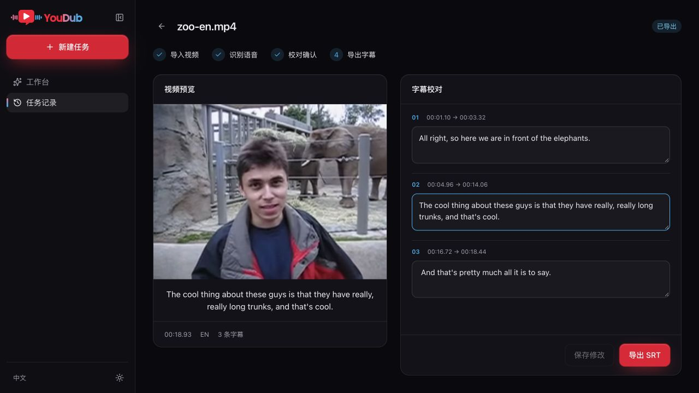

# 验收记录：2026-10-21

分支 `codex/harness-subtitle-poc`，基于 `1c3afca5791bfd437983cf094ba2285bafcf1f91`，独立 worktree。使用官方 Harness `0.2.1-rc.2`，Node.js 22.23.2，本机 macOS。

## 原版视觉

用户选择保留“动态 Logo＋让视频说另一种语言”的原版首屏。

- 直接使用现有 `BrandMark` 和原 SVG 字标。
- 构建时读取原 `globals.css` 的深浅主题变量和 `eq`、`rise` 等动画定义。
- 布局参照原 Studio（提交 `13943b0`）和 `site/assets/workbench.jpg`：248 px 侧栏、72 px 收起态、居中首屏、原光晕和点阵、上传表单。
- 实际浏览器验证深浅主题、侧栏收放、首屏文件选择、待确认任务入口、定位播放、字幕编辑和下载。
- 实测声波 CSS 动画为 `yd-eq`，周期 1.1 s，状态 `running`，不同声波条的 scaleY 在约 0.38–1.0 范围变化。保留减少动态效果偏好。
- 当前原工作区的页面预览因 `@youdub/sdk/client` 缺少 `UpdateProvider` 导出而失败，因此视觉对照使用原组件、源码和已有截图；此问题未纳入本分支修改。

## 真实媒体链路

使用仓库自带 `site/assets/zoo-en.mp4`，约 18.933 秒。两次均从浏览器文件选择器导入，执行真实 FFmpeg 和 Whisper tiny/CPU，识别得到 3 条字幕。

最终一轮任务：`80ab3f36-e482-459a-b63c-9bcf70c86d9b`。

1. 从原版首屏选择视频并点击“开始处理”。
2. 识别结束显示“待人工确认”。
3. 手动将首句改为 `All right, so here we are in front of the elephants.`，将第二句的识别错误 `long arms` 改为 `long trunks` 并修正文句。
4. 修改未保存时，“确认字幕”不可用；保存后仍停在待确认。
5. 终止并重新启动官方 dsh Host。通过首页待确认入口重新打开，人工订正内容完整保留，状态仍为待确认。
6. 点击第二条字幕定位播放：媒体 `readyState=4`、`paused=false`、`currentTime≈4.98`、`error=null`。
7. 点击“确认字幕”后，通过“导出 SRT”实际下载到浏览器下载目录。
8. 下载文件与 Host 产物 SHA-256 相同；原始识别保留 `long arms`，确认字幕和下载文件包含 `long trunks`。

[实际下载字幕](evidence/zoo-en.srt) 生成 6 个 SRT 显示片段。条目数量变化来自复用的 YouDub 导出器按标点拆分显示片段。

- 输入 SHA-256：`ad1b9836ea34d72812d5dc9d134d46807635d699ed51bada00916c8d1dd76e10`
- 下载 SHA-256：`a5643031b3cc661b7e23034b6657a01c1ea767d562cf9e9b4fca95d2e1d36c25`
- [产物与原始识别核对数据](evidence/workflow.json)

## 配置、状态与通信

`--dump-config` 中能看到 YouDub bundle 的 8 个插件行和机器 profile 覆盖；`--dump-config-schema` 中包含 `python`、`modelsDir`、`dataDir` 三项必填配置。没有启用 LLM、Agent 或聊天业务插件。

实际 HTTP 检查：未认证 401、错误 Origin 403、未确认导出 409 / `REVIEW_REQUIRED`、视频 Range 请求 206。Host 生成的 boot HTML 包含官方 `dsh-client-ui-renderer` 与 `@youdub/harness-subtitles`。[检查结果](evidence/http-checks.json)

`npm test` 六项通过：

1. 保存、重启、确认、导出、修改后撤销确认，且原始 ASR 不变。
2. 旧版本保存与空字幕被拒绝，并发修改/确认只成功一个。
3. 同时仅一个识别；待确认释放识别执行位，其他任务不会被自动确认。
4. Worker 失败保留原因，无法继续确认或导出。
5. 重启把执行中的任务标记为中断。
6. 导出失败不被标记为完成。

未进行 Electron 原生窗口、IPC、安装包、签名、跨平台发布或生产环境验收。本次证明官方 Harness 插件宿主可以承载 YouDub 原版视觉和真实字幕业务闭环。
