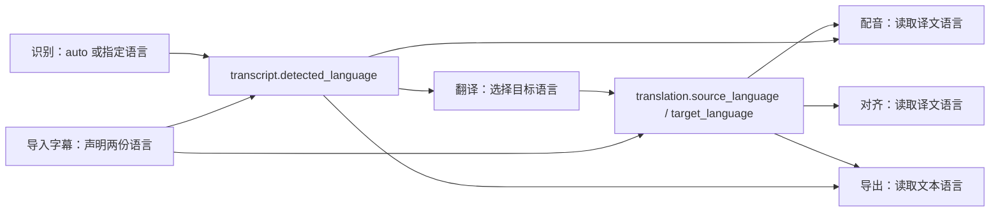

# 节点参数、语言与模型能力设计审查

状态：设计稿，待评审。核对日期：2026-10-21。本文描述当前工作区的问题和拟议调整，不表示节点契约重构已经实施、验证或发布。配套方案见[设置与首次准备流程统一设计](settings-and-setup-unification.md)。

## 1. 结论与范围

所有内置节点需要按同一套职责重新审核；修改集中在参数归属、模型能力表达、上下游语言传递和配置界面。现有图文档、类型端口、依赖调度、结果版本、订正与逐节点人工确认继续使用。当前问题可以通过收敛节点契约解决，保持现有图引擎。

“中文 · 不可用”不能直接证明模型不支持中文。本次问题的原判定路径是：字段声明 `x-optionsFrom`、provider 有 capability、但所选 model 未出现在 catalog 时，候选被置为空，当前值随后被插为禁用的“不可用”项。连接缺失、模型文件未准备、探测失败及模型确实不支持某语言，都因此可能落到同一结果。本次工作区已修复这个误判：[WorkflowOptions](../../apps/web/src/plugin/builtin/workflow-options.tsx) 使用 `knownSupport`，仅在明确模型能力存在时筛选候选；[资源检查](../../packages/builtin/src/setup.ts)也已补齐远端连接与所选模型的就绪检查。这些局部修复尚未发布，后续完整节点契约重构仍待实施。

相关现状证据：

- [runtime.probe](../../backend/workers/bridge.py)和[运行能力探测](../../backend/app/v1/runtime.py)在连接或本地资源缺失时可能返回空 models；远端模型列表来自配置候选，不代表已请求服务验证。
- [节点语言 schema](../../packages/builtin/src/node-contracts.ts)目前主要是字符串长度约束，`x-options` 只提供界面候选；[Python 数据层](../../backend/app/v1/segments.py)另有 `en/zh/ja` 语言列表。界面候选与真正合法值需要统一。
- [图校验](../../packages/builtin/src/workflow-graph.ts)已校验节点/版本、端口、模型、语言和来源关系；其中语言支持检查依赖当前 model 是否存在。
- `translate`、`synthesize`、`align`、`export` 重复配置目标语言；[端口数据](../../packages/builtin/src/media-schemas.ts)本身已经携带 `transcript.detected_language` 和 `translation.source_language/target_language`。
- 当前只把字幕模板的翻译目标从 zh 改为 ja，会触发 export 目标不一致；配音模板还会触发 synthesize 不一致。这是[上游 targetLanguage 比较](../../packages/builtin/src/workflow-graph.ts)的直接结果，说明用户的一次业务选择被拆成多处重复填写。
- [节点详情](../../apps/web/src/plugin/builtin/workflow-settings.tsx)使用通用 ConfigEditor；[该编辑器](../../apps/web/src/plugin/builtin/schema-form.tsx)识别 enum，但不消费当前语言的 `x-options/x-optionsFrom`。同一语言在工作台为候选菜单，在详情仍可成为任意文本框。字段解释应共用，避免两个入口各自定义合法值。

首期不添加全局工作流语言变量、参数联动 DSL、模型 profile 数据库或另一套节点编辑框架。先让每个值有明确责任人，复用现有 schema、端口和编译/执行边界。

## 2. 五类职责必须分开

| 职责 | 保存位置/来源 | 用户操作 | 不承担的内容 |
| --- | --- | --- | --- |
| 节点配置 | `GraphNode.config`，由节点 `configSchema` 校验 | 修改本节点真实的处理选择，如识别语言、翻译目标、背景音、字幕输出 | 上游已经确定的事实、密钥、运行状态 |
| 输入输出数据 | 连接到节点的端口和实际结果，按 schema 校验 | 接线、查看结果、按支持的契约订正 | 依赖另一个全局表单重填语言 |
| Provider / model 能力 | 节点 `provider` 绑定及 provider 描述 | 选择执行服务、模型、设备 | 推断凭据已配置、资源已下载、远端测试已成功 |
| 连接与资源就绪 | SettingsService、secrets、SetupService 的实际状态 | 配置连接、准备所需资源、测试连接、重新检测 | 修改工作流业务参数、把缺资源解释成语言不支持 |
| 人工确认 | `autoContinue`、节点结果 revision、approvedRevision | 在对应节点确认本次结果 | 修改语言或解锁无关分支 |

创建任务时保存精确的图、模型/设备绑定和现有连接快照。运行中的事实显示在任务节点页；配置编辑器不能用最新全局设置覆盖已保存任务。现有保存与执行结构见 [SDK](../../packages/sdk/src/index.ts)、[图编译](../../packages/builtin/src/workflow-graph.ts)及[任务服务](../../packages/builtin/src/tasks.ts)。

## 3. 合法值、模型支持和可运行状态

### 3.1 确定性的三层判断

1. **参数是否合法。** 根据节点 schema 判断。当前内置语言范围收敛为 `en/zh/ja`；只有识别入口允许 `auto`。语言扩展需同时更新节点契约、数据校验和实际执行支持。
2. **所选模型是否支持。** 模型能力信息明确时判断支持/不支持；缺信息时表达未知。模型列表为空本身不能充当语言能力列表为空。
3. **现在能否执行。** 再检查连接、凭据、模型文件、依赖、设备、输入及上游确认。失败原因定位到对应节点和依赖。

使用以下语义，界面无需新增一排状态标签；只在相关控件或启动阻塞位置给出必要原因：

| 证据 | 判定 | 语言控件 | 启动行为 |
| --- | --- | --- | --- |
| schema 不包含值 | 配置无效 | 保留当前原值并标明无效，要求选择合法值 | 拒绝并定位字段 |
| 明确模型能力列表包含 `zh` | 支持中文 | 正常显示“中文” | 继续检查其他条件 |
| 明确模型能力列表不含 `zh` | 当前模型不支持中文 | 已选值保留，标明当前模型不支持；支持项可选 | 拒绝，不自动换英文或换模型 |
| 未选模型 / model 不在当前探测结果 / 能力字段未提供 | 能力未知 | 显示合法语言候选，保留“中文”；在模型位置说明缺项 | 必填模型缺失则阻止；其他情况由适配器的能力声明与就绪校验决定 |
| API Key 或地址缺失 | 连接未配置 | 中文保持合法；提供配置连接入口 | 因连接缺失阻止 |
| 模型文件、依赖未准备 | 资源未就绪 | 中文保持原值；展示准备入口 | 因资源缺失阻止 |
| catalog 请求失败 | 检测失败 | 保留已知配置，不清空或改写字段；显示原错误 | 无可靠就绪信息时阻止，并允许明确重新检测 |
| 已登记远端模型，无权威语言说明 | 服务能力未确认 | 展示应用支持的候选，不宣称远端已验证支持全部语言 | 连接与参数满足适配器契约后可发起运行；服务拒绝时原样报错 |

对受限的本地模型，例如英文版 Whisper，明确能力列表可以限制识别语言。应用层合法枚举和模型层支持子集都应参与判断。对远端 OpenAI 兼容服务，应用允许的语言与供应商实际支持是不同事实，连接测试只证明被测试请求的结果。

### 3.2 保留现有字段，澄清空值语义

继续使用现有 model 的 `source_languages`、`target_languages`、`voice_modes`、`voices` 等能力字段。缺少字段表示没有能力声明；明确空数组表示该能力没有可用项，不能由“provider 暂时不可用”自动生成。已知静态能力可以在模型未下载时保留，安装状态单独来自资源检查。前端契约应正式描述这些现有字段，移除依靠宽泛对象强转读取它们的做法。

provider 的 `available/unavailableReason` 只表示当前执行就绪。远端连接完整、连接测试通过、本机模型完整分别展示实际证据；不把一个布尔值扩展为语言、声音和连接健康的统一答案。

## 4. 逐节点职责矩阵

下表输入输出对应当前 [NodeDescriptor](../../packages/builtin/src/node-contracts.ts)和[operation 端口契约](../../packages/builtin/src/media-contracts.ts)，并与 [Python operation 适配层](../../backend/workers/operations.py)逐项核对；“目标配置/快捷设置”为待实施设计。端口名采用实际契约名称，`?` 表示当前可选端口。

| 节点 | 当前输入 → 输出 | 目标：用户负责的配置 | 从端口推导的事实 | 目标快捷设置与主要约束 |
| --- | --- | --- | --- | --- |
| 下载视频 `download` | 本次 `url` → `video` | 链接属于 `runtimeInputSchema`；maxBytes 保留高级限制 | 下载结果媒体信息交给 prepare | 无快捷字段；技术字节限制不进入工作台；支持平台/地址校验仍由下载入口承担 |
| 准备媒体 `prepare` | `video` → `sourceAudio, mediaInfo` | 无业务配置 | 时长、画面、音频轨等来自媒体探测 | 无快捷字段；无语言或模型选项 |
| 分离人声 `separate` | `sourceAudio` → `vocals, background` | 模型/设备在 provider 绑定 | 输入音频身份与分离产物 | 无语言快捷字段；保留背景音是 mix 的选择 |
| 语音识别 `transcribe` | `audio, mediaInfo` → `transcript, raw?` | `sourceLanguage=auto/en/zh/ja`；高级 initialPrompt；模型/设备 | 结果写入真实 `detected_language`、片段与时间轴 | 快捷：原文语言；模型能力限制识别输入，`auto` 是识别策略，不作为最终语言 |
| 翻译 `translate` | `transcript` → `translation` | `targetLanguage`；高级 maxCompletionTokens；模型/连接绑定 | 源语言从 transcript 读取，输出记录源/目标语言 | 快捷：目标语言；移除重复源语言输入；最大输出 token 至少 65,535 |
| 准备参考音频 `reference` | `transcript, audio` → `references` | 无业务配置 | 原片段文本、说话人、时间位置与音频 | 无快捷字段；参考音频必须与对应 transcript 同源 |
| 生成配音 `synthesize` | `transcript, translation, references?` → `speechAudio` | `voice`；模型/设备绑定 | 目标语言从 translation，原文/参考信息从 transcript/references | 移除“配音目标”快捷项；仅在确有可选声音时显示声音选择；原声克隆需要 references |
| 混音 `mix` | `transcript, speechAudio, mediaInfo, background?` → `finalAudio, dubbedTimeline, adjustedSpeech` | `keepBackground` | 时间关系、音频身份来自连接数据 | 快捷：背景音；启用时必须连接背景音，缺输入不能静默关闭 |
| 字幕对齐 `align` | `transcript, translation, dubbedTimeline, adjustedSpeech` → `wordAlignment` | 模型/设备绑定 | 对齐语言来自 translation；文本与实际配音时间轴对应 | 无“对齐目标”快捷项；检查模型是否支持上游译文语言，失败指向模型或上游翻译 |
| 导出视频 `export` | `video, mediaInfo, transcript, translation, finalAudio?, dubbedTimeline?, wordAlignment?` → `video, audio?, sourceSubtitles?, translatedSubtitles?` | 当前 `renderSubtitles` 语义需拆清烧录与字幕文件输出，见下文 | 源/目标语言来自文本端口；配音与时间轴从连接判断 | 不再显示“导出目标”；只暴露真实输出选择；音频和配音时间轴必须成对 |
| 导入字幕 `importSubtitles` | `sourceSubtitles, translatedSubtitles` → `transcript, translation` | 两份字幕各自语言；必须是具体语言 | 字幕文件本身缺可靠语言声明，因此由入口负责写入数据语言 | 快捷：原文语言、目标语言；禁止 `auto`，片段一一对应，不允许把文件名猜测当事实 |

“全部节点统一审核”不等于给每个节点补设置。prepare、reference 等节点保持简洁，只显示其真实输入输出。节点可选 provider/model/device 仅在操作确实使用它们时出现。

运行实现还需保留以下实际限制，不能靠放开菜单宣称已经支持：

- [translate.run](../../backend/app/v1/translate.py)已经使用 transcript.detected_language，未消费节点 sourceLanguage。删除该无效编辑项有明确依据；真正的源语言不需要二次填写。
- 官方 [VoxCPM2 TTS](../../backend/app/v1/tts.py)当前只允许 source_clone，并要求每个片段都有匹配的参考音频。通用 synthesize 端口可以为其他支持 preset 的 provider 保留可选 references，但选中官方 provider 时必须验证 references；不能显示尚未支持的 preset 选项。
- [参考音频准备](../../backend/app/v1/tts.py)对较长参考窗依赖 ASR 词时间；文本订正清除 words 后，超长片段可能无法再生成有效参考窗。保留具体失败原因，未来的长句重切分作为独立能力处理，不能静默裁剪或忽略。
- 当前 [Qwen 强制对齐](../../backend/app/v1/forced_alignment.py)只接受 en/zh；日文是现有执行代码的明确限制。对齐节点应读取译文语言并阻止不支持的运行，不能把日文当未知放行或自动换模型。
- [字幕导入](../../backend/workers/operations.py)直接把用户声明的源语言写入 transcript，没有语言识别过程；两份 SRT 还要求片段数量和时间区间对应。因此 source=auto 应在导入前被拒绝。
- align 当前输出名为 wordAlignment，其适配层实际交付处理后的字幕 cues。[数据 schema](../../packages/builtin/src/media-schemas.ts)允许 text/timing 列表；此次保持既有端口身份和消费兼容，展示名称需忠实说明结果，不据端口名声称未经确认的逐词精度。

### 4.1 输出设置需要单独明确

当前 export 的 `renderSubtitles` 同时影响输出模式和字幕文件端口的合法性，[图校验](../../packages/builtin/src/workflow-graph.ts)也据此检查 sourceSubtitles/translatedSubtitles 是否会产生。[export.run](../../backend/app/v1/export.py)在 include_subtitles 为真时同时写两份 SRT 并烧录字幕，关闭时两项都不做。现标签“烧录字幕”未完整说明这个行为，当前快捷字段反而只显示重复的 targetLanguage。首期先把现有真实输出选择暴露清楚；若要独立选择烧录与字幕文件，应同步调整执行与输出条件，再增加相应控件。

配音和无配音继续通过不同 workflow 表达，export 根据实际输入连接确定是否有配音，不另加全局 output_mode 覆盖图。现有文件输出命名、schemaId 和用户图输出引用在迁移中必须保留或明确更新。

## 5. 语言只在来源节点声明，沿端口传递

单一来源按数据分支定义：同一个 transcript 可以连接两次翻译，分别生成中文和日文 translation。两个翻译节点各自拥有 targetLanguage，各自下游跟随其连接；不会修改另一条分支。多个 ASR 节点也保留独立输入语言。

编辑阶段从明确的上游配置推导可知的目标语言，显示只读结果，如“中文 · 来自翻译”。识别设置为 auto 时只显示“运行后确定”，不猜成英文或中文。这个说明只在节点详情确有判断需要时展示，工作台不为每个推导值再加一个胶囊。

执行阶段以实际端口数据为准。translate 读取 transcript.detected_language；synthesize/align/export 读取 translation.target_language，源语言从与之匹配的 transcript 或 translation.source_language 读取。若缺失、非法、来源不匹配或与已知图约束冲突，停止该节点并保留具体错误；不以 defaults 的 zh/auto 补齐缺失结果。

编译阶段冻结语言来源规则及当时可确定的目标语言，能判定的模型不支持直接报错；auto 识别的实际语言随识别结果固定，在调用下游模型之前再次校验。无需在图文档新增表达式引用：复用已有端口连接和操作适配函数即可。

改变翻译目标语言会改变该节点配置与结果，影响相应下游的执行/复用判定；已有运行任务和结果 revision 保持不变。订正只修改该契约允许的内容，不能在翻译文本订正中偷偷更改语言元数据。当前[订正校验](../../packages/builtin/src/node-contracts.ts)已有语言与片段身份保护，应保留。

## 6. 节点 schema 与快捷设置统一

节点类型继续提供 `configSchema`、`defaults`、`ui.quickFields`；前端只渲染这个声明。具体约束如下：

- 合法枚举使用 JSON Schema `enum`，Host 和前端读取同一声明。`x-options` 只承担本地化标签，不能替代校验规则，也不能包含 schema 不允许的值。
- 内置 source/target 枚举由一份语言契约生成或读取，确保 TypeScript 和 Python 一致。沿用现有契约文件，不为三个语言代码新增注册中心。
- auto 只属于 transcribe 的输入策略；importSubtitles 与 translate 的目标必须指定具体语言。下游派生语言不再有同名 editable config。
- 模型能力筛选使用明确能力字段，能力未知时保留合法枚举；当前非法/不支持值保持可见，禁止自动选第一个候选。
- 模型、设备和声音可用性依赖所选 provider/model；切换服务不自动把已有声音模式或语言静默改为另一个值。不能兼容时指出字段，允许用户明确修改。
- quickFields 只包括常用、真实归该节点拥有的用户选择；token 上限、字节限制等技术约束留在节点详情。声音对象由已有定制节点编辑器处理，只有适配器提供可枚举选择时才投影为快捷 Select。
- 每个内置节点显式声明 quickFields，移除当前 `make()` 默认取前三个 properties 的机械规则。schema 增加高级字段不能让工作台自动多出技术控件。
- 语言合法性、端口来源、背景音/参考音频等条件依赖由 Host 再次验证；按钮禁用和前端下拉不能替代服务端校验。

前端常规枚举继续使用 [13943b0 TaskOptions](https://github.com/liuzhao1225/YouDub-webui/blob/13943b01eadc65108b5c641ea9133f7aa83d7ba2/apps/web/src/components/localize-task-config.tsx) 的原 Select 胶囊：标签 + 当前值，打开原选项列表。节点有多个快捷字段时逐字段显示；同名节点实例仅添加必要区分。保留原工作台 Logo、badge、渐变 hero、布局和上传区，不增加每节点一个大 Popover 表单。

## 7. 人工确认与错误的边界

`autoContinue=false` 仍然表示该节点产生结果后等待用户确认。确认绑定对应 outputRevision；只有上游依赖均已确认的后续节点才可运行。两条分支可同时等待确认，先确认其中一条不会放行另一条。现有 [TasksService](../../packages/builtin/src/tasks.ts) 已按这些状态组织，节点配置调整不引入工作流级“全部已确认”捷径。

校验错误应区分非法配置、缺输入、来源不匹配、模型不支持、连接缺失、资源未准备、能力检测失败。使用现有 Diagnostic 的 code、nodeId、field、portId 即可；不新增错误实体。页面显示能帮助修改的原因，原始错误进入诊断，失败节点停止，不能静默降级。

“待确认”只用于已经产出、等待人工检查的节点；缺连接、未下载、语言未知或配置非法都不能借用该状态。订正后按现有结果版本与受影响下游规则重算，保持审批、取消和外部请求证据。

## 8. 迁移策略

1. **先修状态语义。** 不改旧图数据，补齐并验证当前候选显示的局部修正，拆开合法值、模型能力和就绪判断；完整显示原有连接/资源错误。
2. **再收敛节点契约。** 对 translate/synthesize/align/export 的重复语言字段和 importSubtitles 的 auto 做显式调整。增加枚举、删除 config 字段或改变字段来源属于契约变化，必须处理 node.typeVersion，不能在同一版本下悄悄改变已保存图的含义。
3. **保持旧图可解释。** 迁移前读取原图 revision，生成迁移预览；只把能够从现有连线证明相同的下游重复语言删除。源/目标冲突、缺失上游、第三方结果无法证明时标出具体节点，原图保留，等待用户修改。
4. **限制引擎改动范围。** 复用现有版本字段、图存储和结果快照。当前类型查找需能准确匹配 type/provider/typeVersion，才能并存需要兼容的契约；这属于版本解析的局部调整。已生成任务 plan、raw 响应、连接引用与结果 revision 不回写。旧任务执行/重运行的兼容路径必须明确，不以新默认值覆盖旧请求。
5. **官方模板同步更新。** 新模板只在语言责任节点保存参数；下游从端口消费。关联的工作台 quickFields 同步收敛；保存后的用户图通过明确迁移升级，浏览图不会自动写库。
6. **与 settings 迁移协调。** 全局 defaults 导入 workflow 时先使用该目标节点责任规则；避免先制造多份重复语言，再做第二次迁移。连接模型候选迁移保留，实际 provider.model 仍由节点拥有。

迁移不增加全局 workflow language 参数，也不按字段同名批量联动。失败直接可见并保留原数据；迁移成功需要保存读回和图校验，不能仅以编辑器能打开判断完成。

## 9. 实施阶段与验收

下表为完整实施计划。阶段 1 中，未知模型能力误判语言不支持、远端连接/所选模型就绪检查这两项局部修复已在当前工作区实现，尚未发布；能力字段的正式类型、统一字段解释与编辑器等工作仍待完成。阶段 2—5 的契约重构、迁移和完整验收尚未实施，本文不将局部修复视为整体交付。

| 阶段 | 交付 | 必要证据 |
| --- | --- | --- |
| 1. 候选与状态 | 已实现上述两项局部修复；待完成合法 schema/能力/就绪完整分离、能力正式类型与统一字段解释 | 已选 zh + 未连接、未下载、探测失败、缺模型、明确不支持的五种状态互不混淆；当前值不被重写；工作台与节点编辑器行为一致 |
| 2. 契约和执行 | 逐节点语言责任收敛，编译与执行校验一致 | 识别 auto 的实际语言进入翻译；中文/日文两分支独立；TTS/align/export 消费各自译文语言；非法语言在调用模型前拒绝 |
| 3. 兼容与模板 | 版本解析、旧图迁移、官方模板、settings 默认值导入对齐 | 一致旧图迁移成功；冲突旧图显式定位；未知插件保留；历史 plan/raw/结果不变；迁移幂等 |
| 4. UI 与完整任务 | 原 Select 快捷控件、模型错误定位、节点详情只读派生值 | 同窗口对照 13943b0；重复节点独立选择；两个翻译分支不同语言；切换 workflow 保留各自草稿；无重复配音/对齐/导出目标胶囊 |
| 5. 运行与交付 | 真实工作流、包构建、按当前发布授权发布并读回 | 无 TTS 字幕、配音、人工确认、导入字幕各一条路径；受影响下游复用、两分支确认、取消、资源准备；CI/本地包/发布后验收分别记录 |

补充验收用例：

- multilingual Whisper 选择中文；英文版 Whisper 选择中文明确被限制；模型未下载时保留选择并说明资源缺失。
- 未配置 OpenAI 连接时目标中文仍是合法选项；配置真实服务后测试使用至少 65,535 最大输出 token，不兼容时保留原错误。
- catalog 返回空列表、缺能力字段、明确空能力列表、请求失败分别覆盖；未知与不支持不可混为一种状态。
- importSubtitles 拒绝 auto；译文片段与原文不匹配时停止；实际译文语言与所选模型不兼容时定位下游节点。
- 背景音开启但未接 background、官方克隆模式缺 references、导出音频与时间轴不成对，均保留具体端口错误；官方 TTS 不暴露 preset，日文进入当前 Qwen align 明确报不支持。
- 两个翻译分支分别中文/日文，确认其中一个结果后只继续其满足依赖的后续节点；重运行复用也不能跳过未确认结果。
- 旧图冲突不能自动统一成中文、删除节点或重连端口；旧任务的日志和原始响应作为历史证据保持不变。

实现负责人需完成代码、必要测试、实际浏览器操作与目标包验收；发布负责人按当前授权完成候选发布与 latest 读回。设计文档、截图或测试通过各自只证明相应阶段，不单独代表完整交付。
