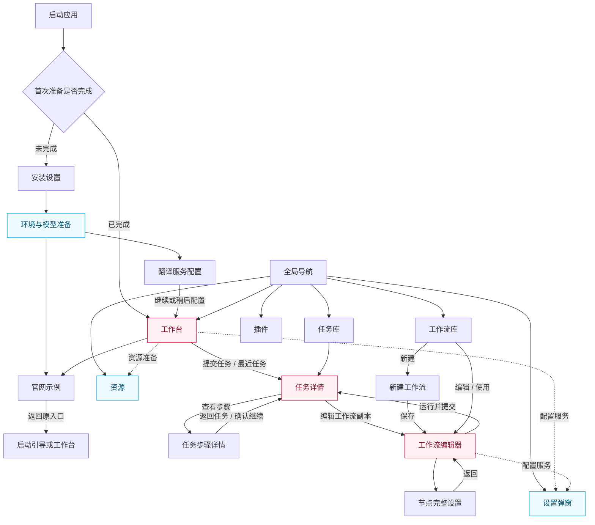
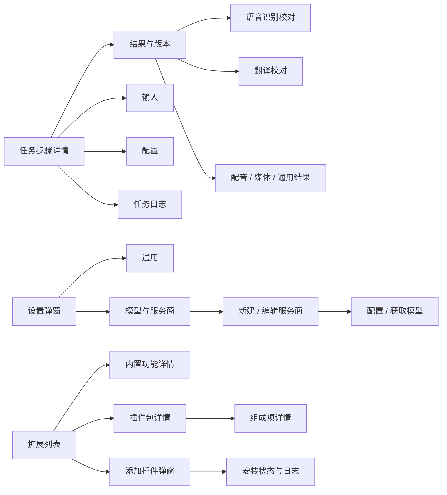

# YouDub 页面清单与关系图

2026-10-23 · 按当前 Harness 桌面版源码盘点。路径是应用内部导航标识；扩展页使用 Harness 面板，设置使用全局弹窗。按页面形态列举，新建与编辑工作流共享实现。动态安装插件可以追加页面，本表列出产品内置页面。

本轮原生状态、覆盖证据与限制见 [全产品 UI 验收](impeccable-ui-review.md)。

## 主页面清单

| 编号 | 页面 | 入口 / 内部路径 | 页面内主要视图 |
| --- | --- | --- | --- |
| P01 | 工作台 | `/`；侧栏“工作台”“新建任务”和 Logo | 视频链接/上传、工作流与参数、资源状态、最近任务 |
| P02 | 任务库 | `/tasks` | 任务列表、状态筛选、任务操作 |
| P03 | 任务详情 | `/tasks/:id` | 播放器、生成文件、执行图、步骤列表、任务日志、重新处理 |
| P04 | 任务步骤详情 | `/tasks/:id/nodes/:nodeId` | 结果、输入、配置、任务日志；结果版本选择 |
| P05 | 工作流库 | `/workflows` | 内置与自定义工作流、新建、导入、编辑、使用 |
| P06 | 新建工作流 | `/workflows/new` | 空白工作流编辑器，保存后进入已保存工作流 |
| P07 | 工作流编辑器 | `/workflows/:id` | 画布、添加节点、输入/输出、校验结果、运行面板、节点简要设置 |
| P08 | 工作流节点完整设置 | `/workflows/:id/nodes/:nodeId` | 节点配置、执行方式、相关服务/模型；返回所属画布 |
| P09 | 资源 | `/resources` | 环境与模型资源、准备/下载/校验状态、诊断详情 |
| P10 | 官网示例 | 官网 `#demo` | 启动引导和工作台均通过外部浏览器打开；本地只保留黄仁勋采访工作流输入 |
| P11 | 插件 | `/extensions` → Harness `plugins` 面板 | 内置功能、已安装插件、插件详情、添加插件 |

来源：[桌面路由及导航](../../apps/harness/src/client.jsx)、[任务库与详情](../../apps/web/src/plugin/builtin/library.tsx)、[任务步骤详情](../../apps/web/src/plugin/builtin/workflow-task.tsx)、[工作流](../../apps/web/src/plugin/builtin/workflows.tsx)、[资源页](../../apps/harness/src/frontend/resource-pages.tsx)、[插件页装配](../../apps/harness/src/frontend/plugins.tsx)。

## 首次启动界面

| 编号 | 界面 | 进入与离开 |
| --- | --- | --- |
| O01 | 安装设置 | 首次运行选择语言和安装目录，提交后进入准备阶段 |
| O02 | 环境与模型准备 | 环境安装、模型下载、运行校验；失败/重试、暂停/恢复和日志属于本界面的状态 |
| O03 | 翻译服务配置 | 环境就绪后配置服务；继续或稍后配置进入工作台 |

检测中、连接错误、启动校验和失败诊断属于启动流程状态。测试跳过环境配置属于启动选项。资源已准备、引导已完成的用户无需重复经过这些步骤。

来源：[启动组合](../../apps/harness/src/client.jsx)、[安装设置](../../apps/web/src/components/setup-installation.tsx)、[环境准备](../../apps/web/src/components/setup-screen.tsx)、[启动状态控制](../../apps/web/src/components/setup-gate.tsx)、[翻译配置](../../apps/web/src/components/translation-setup-view.tsx)。

## 设置、插件内部视图与弹窗

| 所属区域 | 子视图 | 展示方式 |
| --- | --- | --- |
| 设置 | 通用 | 全局设置弹窗分区；语言、主题等通用项与当前版本 |
| 设置 | 模型 | 全局设置弹窗分区；服务商列表、新建/编辑服务商、预设/自定义、模型列表 |
| 插件 | 内置功能详情 | `item` 内部视图，含 YouDub 内置功能与状态 |
| 插件 | 更多插件列表 | `more` 内部视图，内容足够多时出现 |
| 插件 | 插件包详情 | `package` 内部视图 |
| 插件 | 插件组成项详情 | `row` 内部视图，由包详情进入 |
| 插件 | 添加插件与安装进度 | 安装弹窗，包含来源/连接配置及过程状态 |
| 插件 | 卸载确认 | 操作确认弹窗 |
| 模型设置 | 获取模型、删除服务商确认 | 模型配置相关弹窗 |
| 任务 / 工作流 / 设置 | 未保存修改保护 | 离开编辑区域时触发的共享弹窗 |
| 全局 | 主题选择、语言选择、参数选择 | 菜单控件 |
| 桌面外壳 | 文件/目录选择、退出确认、致命错误恢复 | 系统或桌面层对话框 |

任务步骤的结果区按节点类型展示：语音识别校对、翻译校对、配音结果或通用结果查看器；这些共享 P04 的导航和版本/日志结构。工作流运行参数是 P07 的面板。播放器、下载日志和原始数据是页面中的组件。

来源：[Harness通用设置](../../vendor/deepseek-harness/source/packages/client/ui-settings-general/src/client/index.ts)、[Harness模型设置](../../vendor/deepseek-harness/source/packages/client/ui-settings-models/src/client/index.ts)、[插件内部导航](../../vendor/deepseek-harness/source/packages/client/ui-plugin-manager/src/client/navigation-store.ts)、[插件页面与弹窗](../../vendor/deepseek-harness/source/packages/client/ui-plugin-manager/src/client/PluginManagerPage.tsx)、[编辑离开保护](../../apps/web/src/plugin/builtin/workflow-guard.tsx)、[桌面外壳](../../apps/harness/src/desktop-product.ts)。

## 页面关系图

实线表示可进入的页面或流程；虚线表示跨页面配置入口。图中的全局导航覆盖工作台、任务库、工作流、资源、插件与设置。

## 页面内部关系

## 导航别名、旧Web壳与外部入口

- 桌面 `/settings` 打开全局设置；`/settings/models` 和 `/settings/connections` 打开模型分区。
- 桌面 `/settings/resources` 跳转独立资源页；`/settings/extensions` 跳转扩展面板。版本信息放在通用设置。
- 仓库仍有Web壳的设置实现：`general`、`models`、`resources`、`extensions`、`about`五分区。应按实际承载端核对；当前桌面导航采用上述Harness结构。来源：[Web设置](../../apps/web/src/plugin/builtin/settings.tsx)、[桌面映射](../../apps/harness/src/client.jsx)。
- 侧栏“问题反馈”打开 GitHub 问题模板；环境诊断使用环境配置模板；GitHub图标打开仓库。这些是外部网页。
- `output/ui-design-reference.html` 是本地生成的设计规范工具页，不属于产品主导航。
- 未匹配的路径显示MissingPage；额外插件可通过页面插槽注册新路径。来源：[主路由解析](../../apps/harness/src/client.jsx)。
