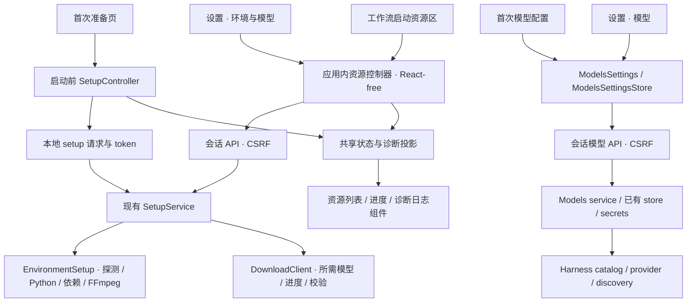

# 设置与首次准备流程统一设计

本文保留 2026-10-21 的设计决定与阶段记录。2026-10-23 已统一使用 Harness 外壳、设置和模型服务，旧独立实现已删除；涉及旧文件的引用链接到历史提交。当前源码与验证范围见 [Harness 保留范围](../../apps/harness/docs/FRAMEWORK-SCOPE.md)，界面约定见 [视觉与组件规范](harness-visual-spec.md)。

## 1. 产品决定

设置页移除“默认处理配置”。语言、配音、背景音、字幕输出和人工确认属于工作流及节点；工作台根据所选工作流显示节点声明的快捷设置。用户需要长期复用一套处理方式时，保存工作流。

设置集中管理应用偏好、模型供应商、环境与模型、扩展和更新。“模型”管理供应商目录、自定义端点、模型候选和密钥；“环境与模型”展示本机环境和本地模型安装。首次配置与日常模型设置直接复用 `ModelsSettings`、编辑器及同一个 Host API。

实施前“运行环境”里的 OpenAI compatible 是 provider 状态摘要，“服务连接”里的 OpenAI 兼容翻译是同一 adapter 的地址和密钥表单。首期合并这两处；本轮进一步改用 Harness 的模型供应商管理。旧 `openai` adapter 和旧连接仅服务历史任务兼容，新配置由 `llm.<route>` 供应商管理。远端服务不混进本机资源列表，界面不直接展示 `text.translate/v1` 等执行标识。

节点参数、语言传递及“中文不可用”的判定规则另见[节点配置设计审查](node-configuration-review.md)。该文是节点契约的独立设计，设置重构不包含全部节点的重新设计；语言参数仅由真正负责该选择的入口/翻译节点保存，下游消费端口中的语言事实。

工作台 Logo、文案、动画、色彩和交互组件沿用 [`13943b0` 的原版 Studio](https://github.com/liuzhao1225/YouDub-webui/blob/13943b01eadc65108b5c641ea9133f7aa83d7ba2/apps/web/src/plugin/builtin/studio.tsx)。页面宽度与基础间距遵循用户随后要求统一布局后形成的 `b490320`：复用 [PageContainer / Page / PageHeader](../../apps/web/src/components/page-layout.tsx) 和 [SectionCard](../../apps/web/src/components/section-card.tsx)。设置重组不恢复旧的页面宽度差异。按用户后续要求直接复用 Harness 模型供应商管理：供应商 profile 存在已有 settings store，凭据仍由现有 secrets 持有；不另建账号系统、配置数据库或通用向导引擎。

工作台完整保留原全页布局：首屏居中 animated BrandMark → “AI 视频翻译 · 配音 · 字幕” badge → “让视频说”与渐变“另一种语言” hero 标题 → 视频链接输入 → “或上传本地视频”分隔 → 原 `min-h-[132px]` 拖拽区 → 底部胶囊快捷设置与同行开始按钮。背景、首屏高度、短屏适配、示例入口、任务区域和多语言文案都按原版保留。节点声明决定字段及其值，正常选项逐字段使用原 Select 胶囊：标签 + 当前值，点击直接展开选项列表。本轮设置交互按 DeepSeek Harness 调整为覆盖当前页面的弹窗，保留 YouDub 视觉及其他页面布局。

## 2. 实施前审查基线

| 实施前事实 | 影响 | 实施目标 |
| --- | --- | --- |
| [设置页](https://github.com/liuzhao1225/YouDub-webui/blob/c92b670f079428eed40ca6ab7bdfd69e3328fef4/apps/web/src/plugin/builtin/settings.tsx)把外观、插件设置、运行环境、连接、更新和扩展放在一张长页面 | 设置入口同级混杂；远端 provider 同时出现在运行环境和连接区域 | 设置弹窗，按用户操作分区 |
| [主外壳](https://github.com/liuzhao1225/YouDub-webui/blob/c92b670f079428eed40ca6ab7bdfd69e3328fef4/apps/web/src/plugin/builtin/shell.tsx)从同一 `shell.navigation` 列表渲染主导航；设置按 order 30 排在普通入口中 | 设置没有独立的底部位置 | 主导航底部固定设置入口 |
| [localize-editor](../../apps/web/src/plugin/builtin/localize-editor.tsx)向 `settings.sections` 注册“默认处理配置”，保存完整旧 `TaskConfig` | 用户在全局页面修改下一次任务的语言、模型、配音等；与工作流参数重复 | 新任务参数只落在图节点；旧编辑器保留在需要兼容的旧任务路径 |
| [模板工厂](../../packages/builtin/src/workflow-templates.ts)每次读取官方模板时，将 `settings.defaults` 的语言和模型应用到图 | 仅删除设置 UI 后，隐藏旧默认值仍会改变模板 | 显式迁移，停止新图的持续全局覆盖 |
| [ConnectionForm](https://github.com/liuzhao1225/YouDub-webui/blob/c92b670f079428eed40ca6ab7bdfd69e3328fef4/apps/web/src/plugin/builtin/settings.tsx)和 [TranslationSetupController](../../apps/web/src/runtime/onboarding.ts)分别实现连接测试与保存，保存连接后再写 `defaults.translation`；首次引导还组合 ASR 等任务参数 | 两套行为可能漂移；保存连接可能成功而模型保存失败 | 一套连接行为；连接保存不重写任务参数 |
| [Python bridge](../../backend/workers/bridge.py)的远端探测读取 `defaults.translation.model`；[runtime](../../backend/app/v1/runtime.py)返回的是配置的模型候选，未请求远端验证 | 删除 defaults 读取会使原自定义模型从 catalog 消失；“已配置”不能代表“测试成功” | 模型候选归连接配置；运行绑定归图节点；状态分别展示 |
| [SetupService](../../apps/harness/src/backend/resources.ts)先准备 Python 和基础依赖，再加载应用；应用加载后按工作流准备依赖与模型 | 首次准备发生在 store、catalog、登录会话可用之前 | 保留启动前通道，复用其服务能力，不强行依赖登录后的 API |
| [SetupController](../../apps/web/src/runtime/onboarding.ts)和[工作流资源控制器](../../apps/web/src/plugin/runtime/workflow-resources.ts)各有轮询；[准备日志](../../apps/web/src/lib/setup-diagnostics.ts)只读取顶层 environment/models/error | 设置资源页若再实现一套状态将继续分叉；工作流资源错误不能直接完整进入现有报告 | 共用资源快照/行为与诊断投影，保留启动阶段差异 |
| [WorkflowOptions](../../apps/web/src/plugin/builtin/workflow-options.tsx)已从 `configSchema` 按 `ui.quickFields` 提取字段，按节点实例显示 | 已有合适的工作台基础设置来源 | 直接复用此能力，不再维护全局 TaskOptions 的平行副本 |

当前 [SettingsService.runtime](../../packages/builtin/src/settings.ts)把多个能力聚合为一个 ready/degraded 状态；它包含当前工作流可能完全不需要的 TTS 等能力。新界面改为逐项展示，任务启动条件由当前图的资源检查决定。

## 3. 参考 deepseek-harness 的范围

参考本机源码对应固定提交 [`99f6f02fecdb7dff40c3fbc9470f5907c29f74ca`](https://github.com/deepseek-ai/deepseek-harness/tree/99f6f02fecdb7dff40c3fbc9470f5907c29f74ca)。

| 参考源码 | 采用的结构 | YouDub 适配 |
| --- | --- | --- |
| [SidebarRoot](https://github.com/deepseek-ai/deepseek-harness/blob/99f6f02fecdb7dff40c3fbc9470f5907c29f74ca/packages/client/ui-sidebar/src/client/SidebarRoot.tsx) | 设置由主侧栏底部入口承载 | 桌面底部紧凑齿轮按钮；移动端顶栏齿轮按钮 |
| [SettingsRoot](https://github.com/deepseek-ai/deepseek-harness/blob/99f6f02fecdb7dff40c3fbc9470f5907c29f74ca/packages/client/ui-settings-general/src/client/SettingsRoot.tsx) | 居中弹窗覆盖原页面，左侧分区、右侧内容，提供关闭操作 | YouDub 用现有 Base UI Dialog 实现，保留 URL 深链、未保存保护和背景页面状态 |
| [settings slot 契约](https://github.com/deepseek-ai/deepseek-harness/blob/99f6f02fecdb7dff40c3fbc9470f5907c29f74ca/packages/client/ui-settings/src/client/contract/slots.ts) | 分区由功能注册，外壳不持有具体表单业务 | 最小扩展现有 `settings.sections`，保留旧插件 |
| [模型设置插件装配](https://github.com/liuzhao1225/deepseek-harness/blob/99f6f02fecdb7dff40c3fbc9470f5907c29f74ca/packages/client/ui-settings-models/src/client/index.ts) | 同一套模型设置进入日常设置和首次引导 | 直接复用 `ModelsSection`、供应商/模型编辑器、store 与 schema 解释；适配 YouDub HTTP、订阅、主题和离开保护 |
| [ModelsSettingsStore](https://github.com/deepseek-ai/deepseek-harness/blob/99f6f02fecdb7dff40c3fbc9470f5907c29f74ca/packages/client/ui-settings-models/src/client/store.ts) | Host 是配置事实来源，客户端通过快照订阅与明确动作操作 | 沿用 YouDub React-free runtime、Zustand vanilla、`bindComponent`，写入失败原样可见 |

模型管理直接使用保留的 Harness `llm-pi-ai`、Settings 和 Credentials 服务，包括 profile、revision 与独立凭据更新。[翻译服务接入](../../apps/harness/src/backend/llm.mjs)把已配置模型注册到 YouDub 工作流；旧平台复制的模型管理与 LLM 请求实现已移除。

## 4. 导航与界面结构

```text
主应用（保留在弹窗背景）        设置弹窗
├ 工作台                       ┌ 设置                          × ┐
├ 任务库                       ├ 分类           ┬ 当前分区内容   ┤
├ 工作流                       │ 通用           │ 分区标题       │
│                              │ 模型           │ 表单/状态/操作 │
└ 底部齿轮按钮                 │ 环境与模型     │                │
                               │ 扩展           │                │
移动端：顶栏齿轮按钮           │ 关于与更新     │                │
                               └────────────────┴────────────────┘
```

设置以 Base UI modal 覆盖当前页面，背景页面保持挂载，遮罩阻止与背景交互。弹窗左侧为分类，右侧为当前分区；关闭按钮、Escape 和遮罩均通过同一关闭动作回到原页面。直接打开设置深链时以工作台为背景，关闭回 `/`。已实施的路径如下：

| 路径 | 名称 | 内容与主要操作 |
| --- | --- | --- |
| `/settings/general` | 通用 | 语言、主题；沿用现有保存位置与立即生效语义 |
| `/settings/models` | 模型 | 供应商目录、自定义供应商、API Key、服务地址、协议及模型候选；获取模型、编辑、保存、删除 |
| `/settings/resources` | 环境与模型 | 应用专用 Python、依赖、推理设备、FFmpeg、已安装/可准备模型；重新检测、下载、暂停/继续、诊断日志 |
| `/settings/extensions` | 扩展 | 安装、启用/停用、卸载；插件提供的配置分区 |
| `/settings/about` | 关于与更新 | 当前版本、自动检查更新、检查更新、下载新版、发布记录 |

`/settings` replace 到 `/settings/general`；工作流的模型配置入口指向 `/settings/models`，资源问题指向 resources。旧 `/settings/connections` replace 到 models，以保留旧入口；其他未知分区显示明确的页面不存在状态。窄屏弹窗占满屏幕，左侧保留紧凑图标栏，通过可访问名称和 Tooltip 标识分类，右侧内容独立滚动。

`NavigationEntry` 的可选 `placement: 'main' | 'footer'` 缺省仍为 main。设置注册 footer，以紧凑齿轮按钮显示在桌面侧栏底部的应用控制区；移动端显示在顶栏。移动端底部主导航只保留主入口，不重复加入设置。

`RouteEntry.layout?: 'app' | 'standalone' | 'dialog'` 默认 app。设置插件将 `/settings` 与 `/settings/:section` 注册为 `layout: 'dialog'`。Shell 同时保留来源页面与设置弹窗，继续提供主题、语言、会话与更新能力；连接和资源表单仍归设置插件。已有 standalone 布局继续兼容需要独立页面的插件。设置菜单和分区渲染使用同一份分类定义。

主侧栏工作台、任务库、工作流的顺序保持不变。展开和折叠状态均使用带可访问名称的设置图标按钮；语言和主题快捷操作继续共用通用设置的存储与行为。

### 4.1 五个分区的具体内容

| 分区 | 页面组织 | 不承担的配置 |
| --- | --- | --- |
| 通用 | 界面语言、主题两行设置；立即生效并显示保存错误 | 视频原文语言、翻译目标语言 |
| 模型 | 沿用 Harness 的供应商列表、添加/编辑卡、模型列表和候选选择；管理地址、协议、脱敏 Key、模型 ID/名称及容量；目录获取失败原样显示 | ASR/TTS 本地模型下载、节点实际模型覆盖、把目录获取当作真实推理测试 |
| 环境与模型 | “基础环境”展示 Python、依赖、FFmpeg、推理设备；“模型”展示本地模型及安装状态。只在对应项提供可执行操作，日志放底部 | 远端 API Key、未使用模型导致的整机不可用判断、无安装资源的示例 provider |
| 扩展 | 已安装扩展列表、启用/停用与重启状态、安装入口；选择扩展后显示它注册的配置，保留原插件配置 ID | 内置连接和模型的第二套设置表单 |
| 关于与更新 | 当前版本、自动检查开关、检查结果、更新操作和发布记录 | 模型文件下载；安装包入口继续使用 latest |

弹窗头部显示“设置”和关闭按钮，右侧只显示一个当前分区标题，卡片标题用于区分具体服务或资源组。分类和内容使用现有 YouDub 色彩、边框与控件；长内容在右侧区域滚动，左侧分类保持可见。桌面使用居中弹窗，窄屏使用全屏弹窗和左侧图标栏；各分区保持相同内容边界，不额外嵌套 Page 外壳。

### 4.2 入口上下文与保存行为

进入设置时保存来源路由和历史位置。分类切换使用 `replace`，同一次设置访问不为每个分类新增历史项。关闭调用 `dismissDialog()`：从应用内正常打开时返回原历史项；直接深链打开时回 `/`。浏览器后退也经过同一离开保护，前进可以重新打开相应分区。工作台的缺模型供应商提示直接打开 `/settings/models`，缺依赖提示打开 `/settings/resources`。

保存规则按动作区分：通用偏好沿用即时保存；模型编辑器有明确应用动作，插件沿用各自保存动作；下载和检测单独触发。只有用户实质修改了未保存字段才拦截离开。浏览分类、展开日志、刷新状态、获取模型候选、查看节点不产生编辑脏状态，采纳候选会修改草稿。模型写入进行中阻止切换、关闭与继续引导，避免供应商和凭据的分步写入被隐藏。

打开、切换分类和关闭设置时，背景页面保持原组件实例与滚动位置，工作台文件、链接、节点选项及工作流编辑草稿不因弹窗开合而重建。已有内存草稿控制器继续处理真正的页面往返，不增加草稿数据库；API Key 不进入工作台草稿。刷新页面后的本地 File 仍需重新选择，不展示已可上传的假状态。

`navigation.block(handler, scope)` 区分 `page` 与 `dialog`，默认 page。打开或关闭设置不改变背景页面时，只处理设置自己的未保存状态；背景页面真正离开时才触发 page 保护。连接或插件表单在切换分类、关闭按钮、Escape、遮罩和浏览器后退时使用 dialog 保护。浏览设置不产生 dirty；保存失败保留 dirty 与原错误。

“获取模型”读取候选，用户采纳后仍需应用草稿。首次引导显示同一个 `ModelsSettings`，保存并读回后才允许继续；也可在没有未保存修改时稍后配置。目录、凭据与配置检查都不能宣称真实翻译调用成功。已修改表单切换分类、返回或关闭时使用现有离开保护；单纯查看、展开日志与查询状态不提示。完整保存后重新读取实际状态再退出编辑态。

## 5. 配置归属与工作台快捷设置

| 数据 | 唯一归属 | 可编辑位置 |
| --- | --- | --- |
| 应用语言、主题、更新偏好 | 已有应用偏好存储 | 通用 / 关于与更新 |
| 供应商地址、协议、凭据引用、模型候选 | 已有 settings store 的 `llm-providers-v1` 与 secrets；API 暴露 `llm-pi-ai` namespace | 模型；首次配置复用同一组件 |
| 本机依赖、模型文件、下载进度 | 文件系统、现有 SetupService | 环境与模型；准备引导；工作流启动资源区 |
| 入口语言、翻译目标、声音、背景音、字幕输出、节点专有参数 | 对应责任节点的 `GraphNode.config`；下游语言由端口数据提供 | 节点编辑页；节点声明的工作台快捷设置 |
| 实际执行的服务、模型、设备 | `GraphNode.provider` | 工作流节点设置 |
| 是否等待人工确认 | `GraphNode.autoContinue` | 对应节点设置 |
| 视频文件、链接等本次输入 | graph inputs / `nodeRuntimeInputs` | 工作台；不写入全局设置或公开模板 |
| 运行时配置和连接凭据选择 | 已有 task graphSnapshot、connections、credentialRefs | 创建任务时固定；任务页显示实际快照 |

### 5.1 节点声明，工作流汇总

[节点契约](../../packages/builtin/src/node-contracts.ts)已有 `configSchema`、`defaults`、`ui.quickFields`。首期直接使用以下规则：

1. 节点声明字段类型、约束、默认值、`x-title` 和快捷字段名。未声明为快捷字段的参数留在节点完整设置中。
2. 工作流遍历真实节点实例，按 `quickFields` 提取 schema；正常选项逐字段生成胶囊，触发器显示字段标签与当前值，展开原 `SelectContent` / `SelectItem` 选项列表。原样复用 [13943b0 的 TaskOptions](https://github.com/liuzhao1225/YouDub-webui/blob/13943b01eadc65108b5c641ea9133f7aa83d7ba2/apps/web/src/components/localize-task-config.tsx) 的视觉和交互。重复字段在必要时用所属节点名称/实例序号区分，各字段独立写回对应节点。
3. 修改写入本次运行的图副本，未暴露的 config 字段、边、provider 和 autoContinue 原样保留。点击工作流编辑页的保存动作才修改持久工作流。
4. 每条翻译分支拥有自己的目标语言，配音/对齐/导出沿其 translation 端口读取语言，不重复要求填写。两个翻译节点可以使用不同目标语言；不能按字段同名把全图统一赋值。具体职责、当前重复字段和旧图迁移见[节点配置设计审查](node-configuration-review.md)。首期不添加参数联动 DSL。
5. 工作台不硬编码 ASR/TTS 控件，不为无 TTS 的图显示声音设置。下载节点不设置文件大小配额。快捷设置不得自动改变节点数量、连接关系或人工确认点。
6. 缺少插件类型、配置校验失败等问题要定位到节点与字段；不能因没有可渲染控件就把无效配置作为默认成功提交。

[WorkflowOptions](../../apps/web/src/plugin/builtin/workflow-options.tsx)只承担从节点 schema 汇总字段和写回本次图的职责。展示使用原版逐字段 Select，不增加每节点一张大 Popover 表单或新的快捷设置框架；复杂参数继续放在已有节点设置页。此次设计不另设“工作台默认参数”。字幕、配音、字幕加配音继续是不同工作流；工作台 Logo、badge、渐变 hero 标题和全页布局保持上述原版基准。

### 5.2 模型供应商与节点绑定

[Harness 模型服务接入](../../apps/harness/src/backend/llm.mjs)按 `llm.<route>` 注册翻译 provider，读取框架中的 profile、模型候选与凭据。模型目录和协议由保留的 Harness `llm-pi-ai` 提供。

模型页直接复用 Harness 的供应商目录、编辑器、模型候选选择与 schema 表单规则。预置供应商使用其目录协议与认证方式；手工指定协议可选 OpenAI Chat Completions、OpenAI Responses 和 Anthropic Messages。需要独立 OAuth/账号流程的供应商不因此自动获得登录能力；配置和本机认证条件不满足时必须显示不可用。

`discoverModels` 对已知供应商返回安装包内目录；自定义兼容端点按当前草稿请求 `/models`。这个动作不保存候选，也不证明推理端点、密钥和模型已完成真实调用。修改草稿地址或协议后，未显式提供新密钥时，不得把原地址存储的密钥发给新端点。发现失败保留原因，并继续允许用户手工填写模型。

模型候选属于供应商配置；真正执行的模型由节点 `provider.model` 固定。官方模板可为尚未绑定的新节点选取当前可用候选；打开设置、保存供应商、修改候选或更换密钥不改写已有图与历史任务。翻译任务在创建时固定 profile 与凭据引用，执行不重新读取可变设置。

原 `openai` connection 及 Python adapter 保留给历史任务。首次初始化模型设置时，可将旧地址、候选模型和已有凭据引用导入 `openai-compatible` route；`YOUDUB_TRANSLATION_MODELS` 只参与旧配置导入及历史路径，不持续覆盖新 profile。新设置不再写旧 connection 或 `defaults.translation`。已经运行的任务和原始响应文件保持原样。

状态须分别表达配置存在、凭据已配置、模型能力满足和实际调用结果。目录条目、已存密钥、provider probe 均不等同于网络测试成功。新翻译执行通过 [Harness 翻译接入](../../apps/harness/src/backend/llm.mjs)，发送前同时检查模型声明能力与实际请求最大输出参数至少为 65,535；无法满足的模型或协议停止调用，保留具体原因。没有静默降低上限或自动换模型。

密钥由现有 secrets 持有，接口只返回前缀加 `****`；短密钥全部隐藏。空输入保留原密钥，输入新值替换，环境变量提供的凭据保持只读。供应商配置和凭据按上游明确的两步操作保存；若 profile 已保存而凭据失败，显示失败并保留仅重试凭据的状态，不重新覆盖 profile，不显示整体成功。删除供应商保留历史任务所需的快照和旧 secret 引用。保存进行中阻止离开；完成后重新读取实际状态。

### 5.3 “默认处理配置”的迁移

移除面板与停止模板隐式覆盖必须作为同一迁移交付，避免隐藏旧行为。建议按已有实体完成一次幂等迁移：

1. 保留原 `defaults` 数据和历史任务快照，作为旧 `youdub.localize` 任务及重运行的兼容输入；新界面不再写整份 defaults。
2. 若 connection 尚无 model，将旧 `defaults.translation.model` 复制到同 adapter 的连接元数据。已有新字段优先，不用旧数据覆盖。
3. 已保存的用户工作流保持原样。对数据库中实际存在的非空 `defaults`，生成一个现有类型的用户 workflow 文档“原默认处理配置”，以旧 output_mode 选择对应图并显式映射语言、模型/设备、声音、背景音和对齐需求。迁移按实施时已生效的节点契约验证；本次设置重组不以全部节点重设计为前置条件。[节点责任方案](node-configuration-review.md)实施时再执行其字段版本迁移。没有持久化 defaults 的空安装不生成此图。首次连接引导也可能自动写入 defaults，因此这项条件只判断记录存在，不声称能区分人工偏好与引导初始化。
4. 将生成的文档 ID 与迁移版本记在已有系统插件配置命名空间中；写入成功后再标记完成。使用稳定 ID 和当前工作流 revision 防止重复创建。新工作台首次可以选择该图，后续按用户明确选择运行。
5. 完整图通过现有 workflow 校验才写入并标记迁移成功。某项旧能力无法映射时，保留旧数据，显示具体未迁移项，不创建声称可用的图、不换成其他模型、不标记完成。用户仍能选择其他有效图；旧任务继续使用原 task.config。迁移问题入口放在工作流库，避免恢复全局处理表单。
6. 官方模板工厂停止逐次应用全局 defaults，使用自己的显式 config；新建运行副本时仅为尚未绑定模型的节点提供连接登记候选。`provider.model` 一旦存在就不被全局修改覆盖。

迁移实现前必须用旧 TaskConfig 的三种 output_mode 样例核对图结构。当前模板工厂只应用语言和模型，并未实现所有旧参数映射；声音模式、分离可选性和字幕对齐需要单独确认。历史证据保持不变，旧任务重运行和新图迁移各自验收。

## 6. 准备流程的共用架构



### 6.1 Service：实际工作与事实来源

[SetupService](../../apps/harness/src/backend/resources.ts)继续拥有基础准备、工作流资源选择、下载状态和实际任务。复用 `checkResources(selections)` / `prepareResources(selections)`、[EnvironmentSetup](../../packages/builtin/src/setup-environment.ts)与[下载器](../../packages/builtin/src/setup-download.ts)。只在确有共用需要的地方提取函数和类型，不增加第二套资源管理服务。

启动前仍使用 `/api/setup`，保留 loopback、Host/Origin 与 setup token 检查。Python 不可用时，页面、日志和重试入口必须可用。应用加载后，设置和工作流通过受认证保护的 API 使用相同服务方法。工作流现有 `/api/v2/workflow-documents/resources/check|prepare` 继续负责从图解析 selections。

“环境与模型”页需要直接选择资源时，增加薄接口 `/api/v2/resources/check|prepare`，输入已存在的 `{providerId, model?}` selections；服务端按 catalog 校验并映射到官方资源清单。该接口不接受任意下载地址、路径或命令；不为了调用旧接口构造虚假工作流。共享状态只保留现在的当前准备任务，首期不建立历史任务队列或资源数据库。

暂停/继续/重试已抽取为 SetupService 动作，启动前 `POST /api/setup` 与应用内 `/api/v2/resources/action` 委托同一实现。应用内动作接受当前准备操作和其中的 model id，按 catalog、当前操作和动作状态校验；两种入口分别保留 setup token 与登录/CSRF 权限边界。

资源类型已移到不依赖 React 的 `runtime/setup-contracts.ts`，`onboarding.ts` 不再从 `setup-screen.tsx` 反向导入类型。启动阶段 snapshot 与工作流 ResourcePreparationSnapshot 保留各自字段，通过纯投影函数生成公共展示/诊断模型。

### 6.2 Controller：请求、快照与生命周期

保留启动前 SetupController 与应用内资源控制器两种访问适配。前者负责 Python/auth 尚未可用的启动阶段；后者由设置页和工作流启动区共同使用，以规范化 selections 为范围提供检测、准备、暂停、继续与显式重试。共用契约、资源展示与诊断投影，不额外建立一个通用轮询框架。两个入口读取同一个 Host 状态；一个准备操作只由 Host 执行一次，相同需求复用状态，不同需求冲突时展示现有操作及原因。

模型设置复用 `ModelsSettingsStore`、供应商编辑器和模型 API，统一加载、草稿、候选获取、保存、凭据与错误。`TranslationSetupController` 仅获取会话、判断是否展示引导并协调继续/稍后配置；不再拥有第二套连接表单，不决定 ASR、语言、输出方式。沿用 `youdub.onboarding.translationDeferred` 表达稍后设置；跳过不等于模型可用，依赖远端翻译的图仍提示缺项。

生命周期要求：

- 只读请求由订阅范围持有，最后一个订阅释放后停止轮询和本地请求；旧响应不能覆盖新一轮检测。
- 离开页面只取消客户端等待。已接受的 Host 下载不会被页面卸载假装取消；进入其他入口读取同一个进度。
- 暂停是显式 Host 动作，保留可继续的下载分片；继续从服务实际状态出发。
- 模型保存进行中阻止设置切换/关闭与引导继续，直到明确成功或失败。已被 Host 接受的写入不能通过页面关闭假装取消；重新打开读取实际结果，迟到响应不得覆盖新草稿。部分保存失败保留明确的下一次重试边界。
- 操作失败进入明确失败状态，保留原因。重新检测、重试和继续分别表达各自动作，后台没有静默重试循环。
- 配置刷新与表单草稿分离。外部更新不能覆盖用户未保存输入；展示可见的配置变更状态，由用户重新加载或保存明确内容。

### 6.3 Component：共享内容，不共享页面职责

设置外壳沿用现有 Base UI、Tailwind 和 `bindComponent`；模型设置复用 Harness 组件并适配 YouDub 主题 tokens、React 订阅和 HTTP 接口。环境步骤列表、模型进度列表、诊断日志区保持共用。首次准备页面负责阶段导航，设置页面负责分区，工作台负责当前图启动条件。

已有 `ConfigEditor` 服务节点参数；供应商表单使用原 Harness schema 解释与模型编辑器。二者按各自已存在的契约工作，不追加一个平行的通用表单引擎。

### 6.4 复用范围与保留差异

| 层次 | 共用实现 | 首次准备特有职责 | 设置 / 工作流特有职责 |
| --- | --- | --- | --- |
| 模型供应商 | ModelsSettings、ModelsSettingsStore、编辑器、模型 API 与密钥语义 | 获取 session/CSRF、是否展示引导、稍后设置、继续到工作台 | 管理供应商和模型、编辑保存、返回原任务草稿 |
| 基础环境 | SetupService、EnvironmentSetup、探测和安装实现 | auth/Python 之前可用；基础准备完成才加载应用 | 读取安装结果与诊断，用户明确操作后处理缺项 |
| 模型与运行依赖 | checkResources/prepareResources/action、清单、下载器 | 先准备 base，再由用户确认准备四个内置模型，校验通过后进入应用 | 按真实节点依赖或资源选择下载；任务就绪以当前图为准 |
| 客户端状态 | 公共类型、规范化 selections、展示/诊断投影 | 独立 setup 访问适配 | 设置和工作流共用应用内资源控制器 |
| 界面 | ModelsSettings、ResourceRow、SetupDiagnostics、Page/SectionCard | 引导步骤与继续按钮 | 分类导航、资源定位、启动前检查结果 |

后端当前已共享 EnvironmentSetup 和 DownloadClient，本轮是在现有服务上提取必要动作及投影。页面卸载不停止 Host 已接受的安装。跨入口进度通过同一 Host 快照恢复，不通过复制另一页的 React 状态同步。

## 7. 自动检测与按需准备

当前 Harness 首次安装先准备应用自己的 Python 环境与基础依赖，再由用户确认准备 Whisper、VoxCPM2、Demucs、Qwen3 Aligner 四个内置模型。四模型及其依赖通过检查后进入工作台。完成首次初始化后，资源页按项准备，工作流按当前图所需资源判断可用性。

| 场景 | 自动发生 | 用户触发的写操作 |
| --- | --- | --- |
| 首次启动 | 检测基础环境，显示逐步进度 | 确认准备环境和四个模型；失败后重试；模型下载暂停/继续 |
| 打开环境与模型页 | 检测当前安装与当前准备状态 | 下载所选模型/缺失依赖；重新检测 |
| 工作台选择 workflow 或更改 provider/model | 计算所需资源并检测，去重相同需求 | 点击准备所需资源；就绪后开始处理 |
| 已有后台准备任务 | 展示真实状态，复用已有下载 | 暂停/继续；冲突需求不得另起相同环境安装 |
| 已安装完整资源 | 探测版本、可执行性与清单要求 | 不重复下载；用户明确修复才进入相关操作 |

现有 providerGroups 已按 media、download、openai、whisper、voxcpm、demucs、align 组织依赖。保留检测后仅安装缺失组的行为；FFmpeg 需同时具备 ffprobe 和所需字幕能力，Whisper 才需要对应分句资源。模型仅准备图中实际引用且支持自动下载的清单项；第三方资源没有下载契约时明确告知由插件提供准备方式。

资源页、首次准备页和工作流共用 `ResourceEntry` 与 `ResourceRow`，统一展示“待准备”“准备中”“已暂停”“可用”“失败”“受阻”，没有使用的模型不算环境故障。设备检测只表示实际设备可用性，节点的 device 选择仍由 workflow 持有；更改工作流不会修改全局 GPU 模式或偷偷切 CPU。

下载默认优先官方来源，先做最长约 3 秒的连通性测试；不可用或实际下载出现网络错误时切换已配置的国内镜像或 ModelScope。应用专用 Python、依赖、FFmpeg 和模型展示来源、实际下载进度与可展开的下载/安装日志，保留原错误及切源过程。Python 依赖由应用专用 venv 内的 uv 安装，继续使用现有 requirements 分组。准备完成需验证可执行文件、依赖及模型清单，不凭“文件夹存在”宣称就绪。设置页面重构不新建 OSS Bucket，也不把安装包下载混入模型准备；安装包及公告入口继续使用 latest 链接。

## 8. 诊断日志与反馈 Issue

共用诊断函数覆盖基础环境、选中资源和连接到准备服务失败三种情况。资源准备 snapshot 的 environment、models、error 必须纳入，解决现有 `setupReport` 只看顶层字段的缺口。

报告顺序固定为：版本与系统 → 当前阶段/所选工作流或资源 → 环境步骤 → 模型进度 → 错误日志。错误日志放最后，不分短版/长版。错误原因保留完整可定位内容，去除 setup token、API Key、认证头、敏感 URL 参数和个人目录；不序列化整份配置或 credentials。

界面统一使用独立小标题“诊断日志”，提供“复制完整日志”和“反馈 Issue”。失败时日志区域展开，可直接全选。反馈行为遵循用户最后确定的方式：尝试复制完整日志，打开预填基本环境信息的 Issue，由用户手动粘贴日志；不把完整日志塞进 URL，不自动上传，不自动提交 Issue。剪贴板失败显示原错误和手动选择入口。

Issue 继续使用[现有模板](../../.github/ISSUE_TEMPLATE/setup-problem.md)的独立“诊断日志”小标题和醒目提示：

> **❗ 请务必在这里粘贴从准备页复制的完整诊断日志。**

连接测试错误也可以复制诊断，但不得包含输入的密钥或把完整模型请求内容混入环境报告。日志属于当前操作上下文；打开另一个资源检查不把其他操作的失败藏掉或改写成当前操作失败。

## 9. 插件扩展契约

继续使用现有 Cordis 注册与 Client SDK，不新增并行插件系统。建议最小向后兼容扩展如下：

| 位置 | 首期变更 | 兼容规则 |
| --- | --- | --- |
| `shell.navigation` | 可选 placement | 老插件默认 main |
| `shell.routes` | 可选 layout，设置声明 dialog | 老插件默认 app；保留 standalone；主题、语言、会话能力继续有效 |
| 导航保护与关闭 | `block(handler, scope)` 区分 page/dialog；`dismissDialog()` 关闭弹窗 | 未传 scope 继续保护页面；设置分类 replace，关闭恢复来源历史项 |
| `settings.sections` | 保留 id/order/component，增加可选 label | 插件配置统一放“扩展”下；缺 label 时显示注册 id，内容中的原有标题保留；原 id 继续用于配置读写 |
| `SettingsSectionProps` | 保留 settings/save，增加可选 `onDirtyChange(dirty)` | 内置表单接入离开保护；第三方插件可逐步适配，未上报的旧插件保持原有行为 |
| 设置分区定义 | 五个内置分区共用一份定义生成菜单与内容 | 设置外壳不持有具体表单业务；首期不开放任意插件替换系统分区 |
| 节点基础设置 | 沿用 `configSchema` + `ui.quickFields` | 新旧节点均可使用；不依赖插件品牌或节点 ID 硬编码 |
| 资源准备 | 沿用 provider 选择与 Host 已知清单 | 没有自动准备契约时报告缺失与插件指导；不允许前端任意执行安装命令 |

插件设置仍经现有 `plugins[id]` 命名空间写入。Schema 校验由设置提供方承担；API Key 必须走 secrets，不得放公共 plugin JSON。保留 enabled、active、restartRequired 的现有含义：停用请求保存后先显示“重启后生效”，实际插件卸载后才移除其注册入口与表单，本次不增加即时卸载能力。已存在图里的未知节点保留数据并报缺失插件，不自动删除。

内置表单负责计算真实 dirty 状态；扩展表单通过可选 onDirtyChange 上报，由设置外壳接入现有导航阻断。保存成功或用户明确放弃后清除标记，保存失败保留。未经上报的旧插件内部状态不可由外层可靠判断，其原有保存行为继续可用；未保存保护的保证只覆盖内置与已适配表单，不通过 DOM 猜测或读取插件内部 React 状态实现。实际卸载、切换分类和返回都使用已报告的状态判断是否需要提示。

本阶段不新增通用插件首次引导注册 API，也不实现任意第三方下载器。先交付可复用组件与控制器；独立插件出现明确需求时，再复用这些稳定边界扩展契约。

## 10. 实施顺序与开发态验证

以下保留实施顺序和验收要求，开发实现与已执行检查见第 12 节。当前开发范围不包含构建、打包、CI 执行或发布；将来明确进入发布阶段后，由同一负责人推进候选构建与安装后读回。表内发布相关条件仍待执行，开发验证不能作为发布完成证据。

| 阶段 | 最小交付 | 必须通过的验收 |
| --- | --- | --- |
| 1. 数据归属与迁移 | 连接 model 字段、probe/catalog 去除新路径对 defaults 的依赖、偏好导入现有 workflow、旧任务兼容 | 无持久化 defaults/引导初始化的 defaults/已有自定义模型/三种旧输出模式/已有用户图；幂等重启；失败不标成功；凭据引用与旧任务快照不被覆写 |
| 2. 模型供应商共用 | 复用 Harness 模型目录、profile/schema、编辑器、store 与 API 契约；日常设置/首次引导共用；不再保存全局 TaskConfig | 新 key、空 key 保留、删除、改地址不泄露旧 key、目录/发现失败、部分写入失败、保存中离开保护；引导跳过只改跳过标记 |
| 3. 资源共用 | 现有 SetupService 加薄适配，共享控制器/展示/诊断 | 干净目录基础启动；字幕图不下载 TTS；已安装不重复下载；切页进度继续；暂停/继续；并发需求冲突；失败日志完整可复制 |
| 4. 设置外壳与插件 | 桌面底部/移动端顶栏齿轮、覆盖原页面的分类弹窗、五个分区、深链、旧插件归扩展 | 主导航工作台→任务库→工作流；桌面居中/窄屏全屏；分类不增加历史项；关闭/Escape/遮罩/后退恢复原页面与草稿；只浏览无提示，未保存连接有提示；插件配置命名空间不变 |
| 5. 入口串联与开发交付 | 首次启动、设置、工作台共享行为；更新开发分支与说明 | 上传文件/粘贴链接→缺资源→进入对应设置→返回后保留输入→检测通过；切页下载不中断；已有任务重跑保持原配置；当前布局基线无回退 |

必要测试聚焦数据迁移、状态变化与真实用户操作，不为静态文案复制实现写测试。UI 检查截图包括：首次环境准备、连接引导、五个设置分区、资源失败诊断、工作台进入设置再返回。工作台按本轮开始前的 `b490320` 截图核对共用宽度，保留原版视觉与 Select 交互；包含正常高度、短屏和窄屏。截图不能替代资源探测、保存读回或实际操作结果。

### 10.1 最小代码改动地图

| 代码区域 | 计划改动 |
| --- | --- |
| Client slots、`builtin/shell.tsx`、`builtin/navigation.ts` | placement/layout、紧凑设置入口、背景页面与 dialog 并存；分类 replace、按 scope 保护与关闭历史恢复 |
| `apps/web/src/plugin/builtin/settings.tsx` 与必要的 settings 子组件 | Base UI Dialog、五个分区与 SectionCard；一次只渲染当前分区；桌面分类列表和窄屏图标栏 |
| `builtin/localize-editor.tsx`、`workflow-templates.ts` | 取消全局默认处理面板注册，停止图模板逐次应用全局 defaults；保留旧任务编辑组件 |
| `runtime/onboarding.ts`、`apps/harness/src/frontend/translation-setup.tsx` | 引导只协调继续/稍后配置；与日常设置直接使用 Harness 模型设置页面；移除前一版 ConnectionController/ConnectionForm |
| `runtime/workflow-resources.ts`、`setup-screen.tsx`、`setup-diagnostics.ts` | 共用资源契约、模型行、环境步骤和诊断投影；应用内控制器支持 selections 与已知资源动作 |
| `apps/harness/src/backend/resources.ts` | action 方法抽取、应用内资源薄接口；继续调用现有准备和下载服务 |
| `apps/harness/src/backend/llm.mjs` | 对接 Harness 模型和凭据服务、冻结任务配置、检查请求输出上限；旧平台模型副本已删除 |
| 现有 workflow 文档存储与迁移路径 | 幂等导入旧 defaults；保留旧值和历史任务；不新增配置数据库 |

### 10.2 发布阶段另行执行

后续明确进入发布阶段时，覆盖 macOS arm64、Windows x64 无系统 Python 环境，应用专用目录含空格和中文、国内资源条件、已完成准备的升级安装。确认安装包复用同一准备服务，更新 latest 资源/官网链接后读回版本、下载资源与首次启动结果。以上均未在本次开发工作中执行。

## 11. 风险与边界

| 风险 | 处理与证据 |
| --- | --- |
| 去掉 defaults 后自定义远端模型消失 | 连接元数据与 runtime.probe 同步迁移；旧 Qwen 模型仍出现在候选且节点绑定不变 |
| 旧 TaskConfig 到图存在结构差异 | 全字段映射、图校验、未映射项显式错误；旧数据保留；不将旧 templateFactory 的有限映射当成完整迁移 |
| 引导复用后启动死锁 | SetupService 与启动前接口继续独立于 Python store/auth；模拟 Python 未安装、安装失败仍能打开日志 |
| 连接变更影响运行中的任务 | 保持现有连接快照与 credentialRefs 语义；验证轮换/清除行为，不借此次重构改变旧任务的凭据生命周期 |
| 打开设置时丢工作台文件或节点草稿 | 保持背景组件挂载和滚动位置；page/dialog 分别保护真实修改；实际上传前后分别验收 |
| 页面取消被当成操作取消，或卸载后继续第二次写入 | Host 操作状态为准；写操作合并到明确边界；过期响应不写新页面，不静默串行追加写入 |
| 重复资源安装或全能力 degraded 阻塞无关工作流 | 共用 Host 当前任务；资源按 selections 去重；就绪判断以当前图为单位 |
| 旧插件失去设置入口 | 可选元数据兼容；缺元数据时归扩展；SDK 不引入第二份 React |
| 日志 URL 超长、泄露密钥、遗漏资源错误 | 完整报告只复制；Issue 手动粘贴；纯诊断投影脱敏；长错误与资源失败样例验证 |
| 设置重组使其他页面偏离当前设计 | 采用 b490320 的统一页面边界，保留原版 BrandMark、标题、链接/上传区与 Select；设置往返只改变路由，不改变本次处理草稿 |

本轮实现按以上依赖顺序推进。后续明确要求的模型供应商管理沿用 Harness profile 与编辑器；没有新增 OAuth 账号登录系统。通用资源市场、批量环境修复、全部节点重设计、工作流跨节点参数联动和自动日志上传仍不在此次范围内。


## 12. 开发实现记录（2026-10-21）

以下首批记录对应设置与准备流程共用实现，保留为历史记录。弹窗交互调整见 12.1；服务连接和 ConnectionController/ConnectionForm 已由 12.2 的模型供应商实现取代，首批验证不替代本轮新实现的验收。

- 已分为通用、服务连接、环境与模型、扩展、关于与更新五个分区，并提供 `/settings/:section` 深链。首批独立页面布局已由 12.1 的弹窗替换。
- `ConnectionController` 和 `ConnectionForm` 同时用于首次连接引导与日常设置。模型、地址、密钥通过一次 connection PATCH 保存，不再写入处理 defaults；测试状态与保存状态独立。
- 旧 defaults 经原处理流程规划器转成 `原默认处理配置` 工作流，文档与迁移标记单事务保存。失败保留原值并显示诊断，历史任务和现有用户工作流不改写。
- 环境步骤、模型下载行、完整诊断报告由启动页和设置共享；应用内资源接口保留身份认证、CSRF 和 catalog 校验。基础依赖、实际 GPU 运算及本地模型分别检测；暂停/继续使用同一个下载任务。
- 通过 history state 保留设置入口来源；工作台内存草稿保留视频 File、链接、节点参数和第三方流程配置。仅实际编辑触发离开提示，保存成功后可直接离开。
- 兼容原插件 settings/save 参数；可选 label 缺失时使用插件 id，onDirtyChange 用于需要离开提醒的插件。

验证范围：连接与引导、五分区路由/底部入口/离开提示、工作台草稿往返、旧配置迁移、资源接口认证及控制器、诊断报告；执行定向测试、两端 TypeScript 和相关 ESLint 检查，并检查真实开发页面。未执行真实远端 LLM 调用、大模型下载、安装包构建或生产发布。

### 12.1 设置弹窗与导航调整

设置按 DeepSeek Harness 的交互改为紧凑齿轮入口和覆盖原页面的 Base UI modal。桌面入口位于侧栏底部，移动端入口位于顶栏；移动端底部主导航不包含设置。弹窗左侧选择分类，右侧显示内容；窄屏为全屏弹窗和左侧图标栏。

`layout: 'dialog'` 保留背景页面；设置分类使用 replace。`dismissDialog()`、page/dialog 导航保护统一处理关闭、Escape、遮罩及浏览器后退，保留原页面位置和草稿。直接打开 `/settings[/section]` 仍可使用，关闭回工作台。

[桌面 ready-smoke](https://github.com/liuzhao1225/YouDub-webui/blob/c92b670f079428eed40ca6ab7bdfd69e3328fef4/apps/desktop/ready-smoke.js)已改为定位可见设置按钮、弹窗分类按钮和弹窗内标题/表单，并检查分类历史长度和关闭后的背景页面实例。脚本通过 `node --check`；本轮未运行原生打包或 ready-smoke，不据此宣称桌面弹窗已通过打包验收。开发浏览器与导航测试结果由本轮实施记录单独报告。

### 12.2 Harness 模型供应商管理接入

本轮代码以 [`99f6f02`](https://github.com/liuzhao1225/deepseek-harness/tree/99f6f02fecdb7dff40c3fbc9470f5907c29f74ca) 的原模型设置和 `llm-pi-ai` 模块为来源，直接复用供应商目录、模型候选/自定义列表、编辑器、store、配置解析和 provider 构造。YouDub 适配 HTTP、现有 store/secrets、会话、主题、节点翻译和输出 token 规则。供应商目录限定当前提供 API Key 配置路径的条目，已保存的其他 profile 继续显示其真实就绪状态；目录可见性不承诺已支持完整 OAuth 登录。

设置分类为“模型”，路径 `/settings/models`；旧 `/settings/connections` 只做 replace 兼容。首次配置使用同一 `ModelsSettings`，不再维护旧连接控制器和表单。旧 `openai` 的设置写入口停止供新配置使用，保存的连接、任务快照和原始响应继续保留给历史路径。用户截图要求的“第三方模型提供商 / 自定义模型 API”标签区分别组合原 `ProviderEditor` 与 `CustomProviderCard`；已有配置列表保留在上方，编辑已有条目时隐藏添加表单。该标签布局是 YouDub 的最小适配，本机参考提交不包含截图中的布局，不能宣称逐行来自该版本。

模型设置错误、凭据失败、实际调用不兼容均需可见；获取候选不触发翻译、不会自动保存。新的翻译 provider 不依赖 Python OpenAI SDK 或本地推理模型。原准备服务仍只为选择的工作流准备本地资源。

本轮审查核对了来源、许可证、目录/自定义协议和实际请求字段；独立发现的改地址密钥复用、保存中关闭与协议能力边界交由对应负责人修复并定向验证。开发测试和浏览器结果以本轮最终记录为准。本段不宣称真实外部推理、完整目录联调、原生 ready-smoke、构建、打包或发布已验收。桌面静态资源同时分发根目录 [THIRD_PARTY_NOTICES.md](../../THIRD_PARTY_NOTICES.md)，保留被打包前端的原 MIT 声明。
