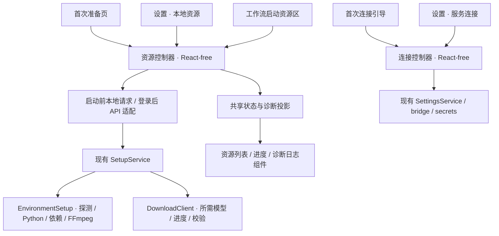

# 设置与首次准备流程统一设计

状态：设计稿，待评审；本文件不表示设置页重构已经实施或验收。核对日期：2026-10-21。基于 `codex/harness-frontend` 工作区的当前实现，包括正在合入的工作台节点快捷设置。

## 1. 产品决定

设置页移除“默认处理配置”。语言、配音、背景音、字幕输出和人工确认属于工作流及节点；工作台根据所选工作流显示节点声明的快捷设置。用户需要长期复用一套处理方式时，保存工作流。

设置集中管理应用偏好、服务连接、本地资源、扩展和更新。“OpenAI 兼容”只在服务连接中配置；本地资源只展示本机环境和模型。连接、资源的查询与操作各有一套实现，首次引导和日常设置复用它们。

节点参数、语言传递及“中文不可用”的判定规则另见[节点配置设计审查](node-configuration-review.md)。该文是本方案的配套设计，均未表示设置与节点契约重构已经实施；语言参数仅由真正负责该选择的入口/翻译节点保存，下游消费端口中的语言事实。

工作台视觉基准固定为 [`13943b0` 的原版 Studio](https://github.com/liuzhao1225/YouDub-webui/blob/13943b01eadc65108b5c641ea9133f7aa83d7ba2/apps/web/src/plugin/builtin/studio.tsx)，要求完整一致：布局、文案、Logo、动画、字号、间距、色彩与交互组件均按原版保留。参考 deepseek-harness 的功能分层与装配方式。首期沿用现有连接、插件配置、工作流文档和准备任务，不增加连接 profile、账号系统、配置数据库或通用向导引擎。

工作台完整保留原全页布局：首屏居中 animated BrandMark → “AI 视频翻译 · 配音 · 字幕” badge → “让视频说”与渐变“另一种语言” hero 标题 → 视频链接输入 → “或上传本地视频”分隔 → 原 `min-h-[132px]` 拖拽区 → 底部胶囊快捷设置与同行开始按钮。背景、首屏高度、短屏适配、示例入口、任务区域和多语言文案都按原版保留。节点声明决定字段及其值，正常选项逐字段使用原 Select 胶囊：标签 + 当前值，点击直接展开选项列表。设置独立页是本次明确要求的界面调整，不能借此改动其他页面的视觉设计。

## 2. 当前事实与需要消除的耦合

| 当前事实 | 影响 | 目标 |
| --- | --- | --- |
| [设置页](../../apps/web/src/plugin/builtin/settings.tsx)把外观、插件设置、运行环境、连接、更新和扩展放在一张长页面 | 设置入口同级混杂；远端 provider 同时出现在运行环境和连接区域 | 独立设置外壳，按用户操作分区 |
| [主外壳](../../apps/web/src/plugin/builtin/shell.tsx)从同一 `shell.navigation` 列表渲染主导航；设置按 order 30 排在普通入口中 | 设置没有独立的底部位置 | 主导航底部固定设置入口 |
| [localize-editor](../../apps/web/src/plugin/builtin/localize-editor.tsx)向 `settings.sections` 注册“默认处理配置”，保存完整旧 `TaskConfig` | 用户在全局页面修改下一次任务的语言、模型、配音等；与工作流参数重复 | 新任务参数只落在图节点；旧编辑器保留在需要兼容的旧任务路径 |
| [模板工厂](../../packages/builtin/src/workflow-templates.ts)每次读取官方模板时，将 `settings.defaults` 的语言和模型应用到图 | 仅删除设置 UI 后，隐藏旧默认值仍会改变模板 | 显式迁移，停止新图的持续全局覆盖 |
| [ConnectionForm](../../apps/web/src/plugin/builtin/settings.tsx)和 [TranslationSetupController](../../apps/web/src/runtime/onboarding.ts)分别实现连接测试与保存，保存连接后再写 `defaults.translation`；首次引导还组合 ASR 等任务参数 | 两套行为可能漂移；保存连接可能成功而模型保存失败 | 一套连接行为；连接保存不重写任务参数 |
| [Python bridge](../../backend/workers/bridge.py)的远端探测读取 `defaults.translation.model`；[runtime](../../backend/app/v1/runtime.py)返回的是配置的模型候选，未请求远端验证 | 删除 defaults 读取会使原自定义模型从 catalog 消失；“已配置”不能代表“测试成功” | 模型候选归连接配置；运行绑定归图节点；状态分别展示 |
| [SetupService](../../packages/builtin/src/setup.ts)先准备 Python 和基础依赖，再加载应用；应用加载后按工作流准备依赖与模型 | 首次准备发生在 store、catalog、登录会话可用之前 | 保留启动前通道，复用其服务能力，不强行依赖登录后的 API |
| [SetupController](../../apps/web/src/runtime/onboarding.ts)和[工作流资源控制器](../../apps/web/src/plugin/runtime/workflow-resources.ts)各有轮询；[准备日志](../../apps/web/src/lib/setup-diagnostics.ts)只读取顶层 environment/models/error | 设置资源页若再实现一套状态将继续分叉；工作流资源错误不能直接完整进入现有报告 | 共用资源快照/行为与诊断投影，保留启动阶段差异 |
| [WorkflowOptions](../../apps/web/src/plugin/builtin/workflow-options.tsx)已从 `configSchema` 按 `ui.quickFields` 提取字段，按节点实例显示 | 已有合适的工作台基础设置来源 | 直接复用此能力，不再维护全局 TaskOptions 的平行副本 |

当前 [SettingsService.runtime](../../packages/builtin/src/settings.ts)把多个能力聚合为一个 ready/degraded 状态；它包含当前工作流可能完全不需要的 TTS 等能力。新界面改为逐项展示，任务启动条件由当前图的资源检查决定。

## 3. 参考 deepseek-harness 的范围

参考本机源码对应固定提交 [`99f6f02fecdb7dff40c3fbc9470f5907c29f74ca`](https://github.com/deepseek-ai/deepseek-harness/tree/99f6f02fecdb7dff40c3fbc9470f5907c29f74ca)。

| 参考源码 | 采用的结构 | YouDub 适配 |
| --- | --- | --- |
| [SidebarRoot](https://github.com/deepseek-ai/deepseek-harness/blob/99f6f02fecdb7dff40c3fbc9470f5907c29f74ca/packages/client/ui-sidebar/src/client/SidebarRoot.tsx) | 设置由主侧栏底部入口承载 | 复用 YouDub 主导航样式，增加底部区域 |
| [SettingsRoot](https://github.com/deepseek-ai/deepseek-harness/blob/99f6f02fecdb7dff40c3fbc9470f5907c29f74ca/packages/client/ui-settings-general/src/client/SettingsRoot.tsx) | 设置外壳只组织左侧分区、右侧内容和关闭/返回 | 上游使用居中弹层；YouDub 按本次要求使用独立设置界面，支持 URL 深链接 |
| [settings slot 契约](https://github.com/deepseek-ai/deepseek-harness/blob/99f6f02fecdb7dff40c3fbc9470f5907c29f74ca/packages/client/ui-settings/src/client/contract/slots.ts) | 分区由功能注册，外壳不持有具体表单业务 | 最小扩展现有 `settings.sections`，保留旧插件 |
| [模型设置插件装配](https://github.com/deepseek-ai/deepseek-harness/blob/99f6f02fecdb7dff40c3fbc9470f5907c29f74ca/packages/client/ui-settings-models/src/client/index.ts) | 同一个模型设置控制器注入日常设置和首次引导 | 共用 YouDub 连接控制器、表单；共用资源服务、控制器、状态组件 |
| [ModelsSettingsStore](https://github.com/deepseek-ai/deepseek-harness/blob/99f6f02fecdb7dff40c3fbc9470f5907c29f74ca/packages/client/ui-settings-models/src/client/store.ts) | Host 是配置事实来源，客户端通过快照订阅与明确动作操作 | 沿用 YouDub React-free runtime、Zustand vanilla、`bindComponent`，写入失败原样可见 |

本次不引入上游完整 settings namespace、provider profile 或 onboarding slot 体系。先用当前两个实际引导阶段完成复用；插件确有第三个独立引导步骤时再扩展协调器。现有技术分层见[前端迁移说明](harness-frontend-migration.md)。

## 4. 导航与界面结构

```text
主应用                         设置界面
├ 工作台                       ┌ 设置侧栏       ┬ 当前分区内容
├ 工作流                       │ ← 返回工作台   │ 分区标题
├ 任务库                       │ 通用           │ 表单 / 状态 / 操作
│                              │ 服务连接       │
└ 设置（固定底部）             │ 本地资源       │
                               │ 扩展           │
                               │ 关于与更新     │
                               └────────────────┴─────────────
```

设置界面使用自己的侧栏取代主应用侧栏，避免左右重复导航。保留 YouDub 品牌入口；“返回”回到进入设置前的内部页面，直接打开设置时回工作台。浏览器前进、后退和刷新均可恢复当前分区。路径建议如下，属于待实施契约：

| 路径 | 名称 | 内容与主要操作 |
| --- | --- | --- |
| `/settings/general` | 通用 | 语言、主题；沿用现有保存位置与立即生效语义 |
| `/settings/connections` | 服务连接 | 服务地址、API Key、模型名称；测试连接、保存连接 |
| `/settings/resources` | 本地资源 | 应用专用 Python、依赖、推理设备、FFmpeg、已安装/可准备模型；重新检测、下载、暂停/继续、诊断日志 |
| `/settings/extensions` | 扩展 | 安装、启用/停用、卸载；插件提供的配置分区 |
| `/settings/about` | 关于与更新 | 当前版本、自动检查更新、检查更新、下载新版、发布记录 |

`/settings` 解析到通用页；工作流的“连接设置”直接指向 connections，资源问题直接指向 resources 并选中相关资源。未知分区显示明确的页面不存在状态，不自动切到另一个分区。手机端将设置侧栏收为可访问的分区选择器，保留同一 URL 与内容顺序。

主应用导航的最小变更是在现有 `NavigationEntry` 增加可选 `placement: 'main' | 'footer'`，缺省仍为 main。设置注册 footer；移动端仍有一个设置入口。设置页外壳和普通应用页外壳由明确路由布局选择；不让页面组件依靠 CSS 隐藏另一套导航。

保存规则按动作区分：通用偏好沿用即时保存；连接与插件表单有“保存修改”；下载和检测是明确动作。只有用户实质修改了未保存字段才拦截离开。切换分区、展开日志、刷新状态、测试连接、查看节点不产生编辑脏状态。

从工作台带着文件、链接和本次节点选项进入连接设置后返回，应恢复同一内存草稿。最小实现将已有启动草稿的生命周期上移至页面间可复用的控制器，不建草稿数据库；API Key 不进入此草稿。刷新页面后本地 File 无法恢复时明确要求重选，不展示已可上传的假状态。

## 5. 配置归属与工作台快捷设置

| 数据 | 唯一归属 | 可编辑位置 |
| --- | --- | --- |
| 应用语言、主题、更新偏好 | 已有应用偏好存储 | 通用 / 关于与更新 |
| 地址、凭据引用、远端模型候选 | 已有 connection 记录及 secrets | 服务连接；首次连接引导复用 |
| 本机依赖、模型文件、下载进度 | 文件系统、现有 SetupService | 本地资源；准备引导；工作流启动资源区 |
| 入口语言、翻译目标、声音、背景音、字幕输出、节点专有参数 | 对应责任节点的 `GraphNode.config`；下游语言由端口数据提供 | 节点编辑页；节点声明的工作台快捷设置 |
| 实际执行的服务、模型、设备 | `GraphNode.provider` | 工作流节点设置 |
| 是否等待人工确认 | `GraphNode.autoContinue` | 对应节点设置 |
| 视频文件、链接等本次输入 | graph inputs / `nodeRuntimeInputs` | 工作台；不写入全局设置或公开模板 |
| 运行时配置和连接凭据选择 | 已有 task graphSnapshot、connections、credentialRefs | 创建任务时固定；任务页显示实际快照 |

### 5.1 节点声明，工作流汇总

[节点契约](../../packages/builtin/src/node-contracts.ts)已有 `configSchema`、`defaults`、`ui.quickFields`。首期直接使用以下规则：

1. 节点声明字段类型、约束、默认值、`x-title` 和快捷字段名。未声明为快捷字段的参数留在节点完整设置中。
2. 工作流遍历真实节点实例，按 `quickFields` 提取 schema；正常选项逐字段生成胶囊，触发器显示字段标签与当前值，展开原 `SelectContent` / `SelectItem` 选项列表。原样复用 [13943b0 的 TaskOptions](https://github.com/liuzhao1225/YouDub-webui/blob/13943b01eadc65108b5c641ea9133f7aa83d7ba2/apps/web/src/components/localize-task-config.tsx) 的视觉和交互。重复字段在必要时用所属节点名称/实例序号区分，各字段独立写回对应节点。
3. 修改写入本次运行的图副本，未暴露的 config 字段、边、provider 和 autoContinue 原样保留。点击工作流编辑页的保存动作才修改持久工作流。
4. 每条翻译分支拥有自己的目标语言，配音/对齐/导出沿其 translation 端口读取语言，不重复要求填写。两个翻译节点可以使用不同目标语言；不能按字段同名把全图统一赋值。具体职责、当前重复字段和旧图迁移见[节点配置设计审查](node-configuration-review.md)。首期不添加参数联动 DSL。
5. 工作台不硬编码 ASR/TTS 控件，不为无 TTS 的图显示声音设置。下载节点的技术限制如 `maxBytes` 不进入快捷设置。快捷设置不得自动改变节点数量、连接关系或人工确认点。
6. 缺少插件类型、配置校验失败等问题要定位到节点与字段；不能因没有可渲染控件就把无效配置作为默认成功提交。

[WorkflowOptions](../../apps/web/src/plugin/builtin/workflow-options.tsx)只承担从节点 schema 汇总字段和写回本次图的职责。展示使用原版逐字段 Select，不增加每节点一张大 Popover 表单或新的快捷设置框架；复杂参数继续放在已有节点设置页。此次设计不另设“工作台默认参数”。字幕、配音、字幕加配音继续是不同工作流；工作台 Logo、badge、渐变 hero 标题和全页布局保持上述原版基准。

### 5.2 服务连接与模型绑定

同一 adapter 首期仍只有一条连接。现有用户配置的 Qwen、DeepSeek 等 OpenAI 兼容地址共用该入口；不新增以品牌命名却保存同一份 key 的重复表单。

连接页保留“服务地址”“API Key”“模型名称”。其中模型名称表示这条连接登记的候选和连接测试对象；真正执行的模型由节点 `provider.model` 固定。新建节点可用此候选初始化一次；打开、保存连接或执行已有图不会覆盖节点模型。需要切换已有图模型时到相应节点修改。

为解除 `defaults.translation.model` 的耦合，首期在现有 connection 记录增加一个可选 `model` 标量，保存和公开投影一并支持它。原有多模型环境配置继续作为 catalog 候选来源，不扩展为多账号或 profile 管理。需同步修改 [ConnectionPatch](../../backend/app/v1/contracts.py)、bridge、远端 probe、catalog、测试连接表单；不能只迁移 UI。字段是拟议变更，当前契约尚未包含它。

状态必须区分：

- 未配置：缺地址、密钥或节点所需模型，指出具体缺项。
- 已配置：本地配置完整；尚未证明远端可用。
- 测试成功：对本次地址、模型、凭据选择完成了实际测试，展示检测时间；修改任一项立即使该结果过期。
- 测试失败：保留 HTTP 状态、服务端原因和相关地址路径，提示可以采取的修改；不换地址、换模型或降低参数自动重试。

密钥继续由 secrets 持有，界面只返回现有前缀加 `****`。空输入保留原 key，明确勾选才清除；改地址时不能携带旧地址密钥偷偷测试。提交的 model 与连接元数据在同一次设置操作处理，消除“保存连接后再改整份 TaskConfig”的第二步。若凭据系统已变更而数据库失败，返回现有部分应用错误，重新读取状态并显示实际结果，不伪装成功或静默回滚。

连接测试继续验证最大输出 token 参数至少为 65,535；不支持该限制的服务返回明确的不兼容错误。引导和设置必须走同一条测试行为。配置检测不自动调用外部 LLM；只在用户点击测试时发送测试内容。

### 5.3 “默认处理配置”的迁移

移除面板与停止模板隐式覆盖必须作为同一迁移交付，避免隐藏旧行为。建议按已有实体完成一次幂等迁移：

1. 保留原 `defaults` 数据和历史任务快照，作为旧 `youdub.localize` 任务及重运行的兼容输入；新界面不再写整份 defaults。
2. 若 connection 尚无 model，将旧 `defaults.translation.model` 复制到同 adapter 的连接元数据。已有新字段优先，不用旧数据覆盖。
3. 已保存的用户工作流保持原样。对旧默认处理偏好，生成一个现有类型的用户 workflow 文档“原默认处理配置”，以旧 output_mode 选择对应图并显式映射语言、模型/设备、声音、背景音和对齐需求。语言按[节点责任方案](node-configuration-review.md)写到入口/翻译节点，避免再为下游生成重复配置。仅当存在实际已保存的处理偏好时创建，空安装不生成。
4. 将生成的文档 ID 与迁移版本记在已有系统插件配置命名空间中；写入成功后再标记完成。使用稳定 ID 和当前工作流 revision 防止重复创建。新工作台首次可以选择该图，后续按用户明确选择运行。
5. 完整图通过现有 workflow 校验才算迁移成功。某项旧能力无法映射时，保留旧数据，显示具体未迁移项并阻止该导入图运行；不丢掉字段、不换成其他模型、不标记完成。用户仍能选择其他有效图。
6. 官方模板工厂停止逐次应用全局 defaults，使用自己的显式 config；新建运行副本时仅为尚未绑定模型的节点提供连接登记候选。`provider.model` 一旦存在就不被全局修改覆盖。

迁移实现前必须用旧 TaskConfig 的三种 output_mode 样例核对图结构。当前模板工厂只应用语言和模型，并未实现所有旧参数映射；声音模式、分离可选性和字幕对齐需要单独确认。历史证据保持不变，旧任务重运行和新图迁移各自验收。

## 6. 准备流程的共用架构



### 6.1 Service：实际工作与事实来源

[SetupService](../../packages/builtin/src/setup.ts)继续拥有基础准备、工作流资源选择、下载状态和实际任务。复用 `checkResources(selections)` / `prepareResources(selections)`、[EnvironmentSetup](../../packages/builtin/src/setup-environment.ts)与[下载器](../../packages/builtin/src/setup-download.ts)。只在确有共用需要的地方提取函数和类型，不增加第二套资源管理服务。

启动前仍使用 `/api/setup`，保留 loopback、Host/Origin 与 setup token 检查。Python 不可用时，页面、日志和重试入口必须可用。应用加载后，设置和工作流通过受认证保护的 API 使用相同服务方法。工作流现有 `/api/v2/workflow-documents/resources/check|prepare` 继续负责从图解析 selections。

本地资源页需要直接选择资源时，可增加薄接口 `/api/v2/resources/check|prepare`，输入已存在的 `{providerId, model?}` selections；服务端按 catalog 校验并映射到官方资源清单。该接口不接受任意下载地址、路径或命令；不为了调用旧接口构造虚假工作流。共享状态只保留现在的当前准备任务，首期不建立历史任务队列或资源数据库。

资源类型定义移到不依赖 React 的契约文件，由 service、controller、UI 同时消费。当前 `onboarding.ts` 从 `setup-screen.tsx` 导入类型的反向依赖应在此处消除。启动阶段 snapshot 与工作流 ResourcePreparationSnapshot 可以保留各自字段，通过一个纯投影函数生成公共展示/诊断模型；不强行把不同阶段塞成一个含大量可选字段的对象。

### 6.2 Controller：请求、快照与生命周期

资源控制器按启动阶段或规范化 selections 管理订阅、检测、准备、暂停、继续、重新检测与显式重试。首次引导和日常设置订阅同一个 Host 状态。一个准备操作只由 Host 执行一次；相同需求复用状态，不同需求冲突时展示现有操作及原因。

连接控制器统一加载、字段草稿、测试、保存、密钥清除和错误。首次引导只决定是否展示、是否允许“稍后设置”、成功后去哪里；不复制 API 调用，也不决定 ASR、语言、输出方式。沿用 `youdub.onboarding.translationDeferred` 表达稍后设置；跳过不等于连接可用，依赖远端翻译的图仍提示缺项。

生命周期要求：

- 只读请求由订阅范围持有，最后一个订阅释放后停止轮询和本地请求；旧响应不能覆盖新一轮检测。
- 离开页面只取消客户端等待。已接受的 Host 下载不会被页面卸载假装取消；进入其他入口读取同一个进度。
- 暂停是显式 Host 动作，保留可继续的下载分片；继续从服务实际状态出发。
- 保存请求发出后，即使关闭页面也可能已在服务端生效。重新打开必须读取实际结果；客户端停止后不得接着执行第二次写入或把过期成功写回新草稿。
- 操作失败进入明确失败状态，保留原因。重新检测、重试和继续分别表达各自动作，后台没有静默重试循环。
- 配置刷新与表单草稿分离。外部更新不能覆盖用户未保存输入；展示可见的配置变更状态，由用户重新加载或保存明确内容。

### 6.3 Component：共享内容，不共享页面职责

沿用现有 Base UI、Tailwind 和 `bindComponent`；组件只接收快照与动作。最小可复用组件包括连接字段/操作区、环境步骤列表、模型进度列表、诊断日志区。首次准备页面负责阶段导航，设置页面负责分区，工作台负责当前图启动条件。

无需先抽象通用表单引擎：已有 `ConfigEditor` 服务节点参数，连接表单有特定密钥语义，应使用明确组件。无异步副作用的格式化/诊断函数可独立复用。

## 7. 自动检测与按需准备

首次安装自动执行应用运行所需的最小基础准备：应用自己的 Python 环境与基础依赖。基础就绪后即可进入应用；不能因为未下载 VoxCPM2 就把只需要字幕的用户挡在首次安装页。

| 场景 | 自动发生 | 用户触发的写操作 |
| --- | --- | --- |
| 首次启动 | 检测并准备基础环境，显示逐步进度 | 失败后重试；允许的下载暂停/继续 |
| 打开本地资源页 | 检测当前安装与当前准备状态 | 下载所选模型/缺失依赖；重新检测 |
| 工作台选择 workflow 或更改 provider/model | 计算所需资源并检测，去重相同需求 | 点击准备所需资源；就绪后开始处理 |
| 已有后台准备任务 | 展示真实状态，复用已有下载 | 暂停/继续；冲突需求不得另起相同环境安装 |
| 已安装完整资源 | 探测版本、可执行性与清单要求 | 不重复下载；用户明确修复才进入相关操作 |

现有 providerGroups 已按 media、download、openai、whisper、voxcpm、demucs、align 组织依赖。保留检测后仅安装缺失组的行为；FFmpeg 需同时具备 ffprobe 和所需字幕能力，Whisper 才需要对应分句资源。模型仅准备图中实际引用且支持自动下载的清单项；第三方资源没有下载契约时明确告知由插件提供准备方式。

本地资源页分别展示“已安装”“未安装”“准备中/已暂停”“失败”，没有使用的模型不算环境故障。设备检测只表示实际设备可用性，节点的 device 选择仍由 workflow 持有；更改工作流不会修改全局 GPU 模式或偷偷切 CPU。

国内下载策略沿用用户已确定的阿里源和 ModelScope 方案及当前资源清单：应用专用 Python、依赖、FFmpeg 和模型都经过实际可用性检测，展示来源和下载进度。准备完成需验证可执行文件、依赖及模型清单，不凭“文件夹存在”宣称就绪。下载失败保留来源与原错误；按照既定策略选择来源和显式重试，不隐藏失败或无限自动切源。设置页面重构不新建 OSS Bucket，也不把安装包下载混入模型准备；安装包及公告入口继续使用 latest 链接。

## 8. 诊断日志与反馈 Issue

共用诊断函数覆盖基础环境、选中资源和连接到准备服务失败三种情况。资源准备 snapshot 的 environment、models、error 必须纳入，解决现有 `setupReport` 只看顶层字段的缺口。

报告顺序固定为：版本与系统 → 当前阶段/所选工作流或资源 → 环境步骤 → 模型进度 → 错误日志。错误日志放最后，不分短版/长版。错误原因保留完整可定位内容，去除 setup token、API Key、认证头、敏感 URL 参数和个人目录；不序列化整份配置或 credentials。

界面统一使用独立小标题“诊断日志”，提供“复制完整日志”和“反馈 Issue”。失败时日志区域展开，可直接全选。反馈行为遵循用户最后确定的方式：尝试复制完整日志，打开预填基本环境信息的 Issue，由用户手动粘贴日志；不把完整日志塞进 URL，不自动上传，不自动提交 Issue。剪贴板失败显示原错误和手动选择入口。

Issue 继续使用[现有模板](../../.github/ISSUE_TEMPLATE/setup-problem.md)的独立“诊断日志”小标题和醒目提示：

> **❗ 请务必在这里粘贴从准备页复制的完整诊断日志。**

连接测试错误也可以复制诊断，但不得包含输入的密钥或把完整模型请求内容混入环境报告。日志属于当前操作上下文；打开另一个资源检查不把其他操作的失败藏掉或改写成当前操作失败。

## 9. 插件扩展契约

继续使用现有 Cordis 注册与 Client SDK，不新增并行插件系统。建议最小向后兼容扩展如下：

| 位置 | 首期变更 | 兼容规则 |
| --- | --- | --- |
| `shell.navigation` | 可选 placement | 老插件默认 main |
| `settings.sections` | 保留 id/order/component，增加可选 label 和分组归属 | 无元数据的老插件配置放“扩展”下，保留 `SettingsSectionProps {settings, save}` |
| 设置分区注册 | 内置分区可声明完整页；插件配置默认归扩展 | 插件 ID 命名空间隔离，不覆盖系统连接/资源分区 |
| 节点基础设置 | 沿用 `configSchema` + `ui.quickFields` | 新旧节点均可使用；不依赖插件品牌或节点 ID 硬编码 |
| 资源准备 | 沿用 provider 选择与 Host 已知清单 | 没有自动准备契约时报告缺失与插件指导；不允许前端任意执行安装命令 |

插件设置仍经现有 `plugins[id]` 命名空间写入。Schema 校验由设置提供方承担；API Key 必须走 secrets，不得放公共 plugin JSON。停用插件后导航项与表单卸载；未保存改动按同样规则处理。已存在图里的未知节点保留数据并报缺失插件，不自动删除。

本阶段不新增通用插件首次引导注册 API，也不实现任意第三方下载器。先交付可复用组件与控制器；独立插件出现明确需求时，再复用这些稳定边界扩展契约。

## 10. 实施顺序与验收

以下是后续实施计划，不是本次已完成项。每阶段由同一实施负责人推进代码、必要测试、浏览器验收与文档同步；最终负责人负责候选构建、发布及发布后读回，代码交接不能替代交付。

| 阶段 | 最小交付 | 必须通过的验收 |
| --- | --- | --- |
| 1. 数据归属与迁移 | 连接 model 字段、probe/catalog 去除新路径对 defaults 的依赖、偏好导入现有 workflow、旧任务兼容 | 无配置/已有自定义模型/三种旧输出模式/已有用户图；幂等重启；失败不标成功；凭据引用与旧任务快照不被覆写 |
| 2. 连接共用 | 一个连接控制器与表单，日常设置/首次引导共用；不再保存全局 TaskConfig | 新 key、空 key 保留、清除、改地址、测试失败、部分写入失败、关闭后迟到响应；引导跳过只改跳过标记 |
| 3. 资源共用 | 现有 SetupService 加薄适配，共享控制器/展示/诊断 | 干净目录基础启动；字幕图不下载 TTS；已安装不重复下载；切页进度继续；暂停/继续；并发需求冲突；失败日志完整可复制 |
| 4. 设置外壳与插件 | 底部入口、独立左右布局、深链接、旧插件归扩展、默认处理面板移除 | 主题/语言、桌面/窄屏、键盘导航、浏览无离开提示、未保存连接有提示；工作台素材与本次参数返回后保留 |
| 5. 工作流与包验收 | 工作台快捷设置、图执行、打包使用同一准备流程 | 与 13943b0 对照完整首屏和展开后的 Select；两个同类型节点可不同语言；切换 workflow 不串参数；无 TTS 图不出现 TTS 设置；多个节点人工确认独立；生产静态页、macOS/Windows 安装后启动 |
| 6. 交付 | 一份已通过验证的候选；按当前发布授权执行发布与验收 | CI 与实际包分别记录；latest 资源/官网链接指向正确候选；发布后读回版本、下载资源与实际首次启动结果 |

必要测试聚焦数据迁移、状态变化与真实用户操作，不为静态文案复制实现写测试。UI 验收截图包括：首次环境准备、连接引导、五个设置分区、资源失败诊断、工作台完整首屏、胶囊关闭与 Select 展开状态、工作台进入设置再返回。工作台用相同窗口尺寸与 13943b0 对照，包含正常高度与短屏。截图不能替代下载校验、保存读回或实际图执行。

跨平台验收至少覆盖：macOS arm64、Windows x64 无系统 Python 的安装环境；应用专用目录含空格和中文；国内资源可达条件；已完成准备的升级安装。只在一台开发机启动成功不能标记安装流程完成。

## 11. 风险与边界

| 风险 | 处理与证据 |
| --- | --- |
| 去掉 defaults 后自定义远端模型消失 | 连接元数据与 runtime.probe 同步迁移；旧 Qwen 模型仍出现在候选且节点绑定不变 |
| 旧 TaskConfig 到图存在结构差异 | 全字段映射、图校验、未映射项显式错误；旧数据保留；不将旧 templateFactory 的有限映射当成完整迁移 |
| 引导复用后启动死锁 | SetupService 与启动前接口继续独立于 Python store/auth；模拟 Python 未安装、安装失败仍能打开日志 |
| 连接变更影响运行中的任务 | 保持现有连接快照与 credentialRefs 语义；验证轮换/清除行为，不借此次重构改变旧任务的凭据生命周期 |
| 切换设置时丢工作台文件或节点草稿 | 生命周期上移、File 仅内存持有、精确 dirty 判断；实际上传前后分别验收 |
| 页面取消被当成操作取消，或卸载后继续第二次写入 | Host 操作状态为准；写操作合并到明确边界；过期响应不写新页面，不静默串行追加写入 |
| 重复资源安装或全能力 degraded 阻塞无关工作流 | 共用 Host 当前任务；资源按 selections 去重；就绪判断以当前图为单位 |
| 旧插件失去设置入口 | 可选元数据兼容；缺元数据时归扩展；SDK 不引入第二份 React |
| 日志 URL 超长、泄露密钥、遗漏资源错误 | 完整报告只复制；Issue 手动粘贴；纯诊断投影脱敏；长错误与资源失败样例验证 |
| 工作台偏离原版 | 固定 13943b0 为完整视觉基准；居中 animated BrandMark、badge、渐变 hero 文案、全页布局、链接/上传区、逐字段标签+当前值胶囊、展开后的 Select 列表与同行按钮逐项截图对照 |

评审通过后按以上顺序实施。首期范围限定为现有设置与准备流程统一；远端多账号、通用资源市场、批量环境修复、工作流跨节点参数联动和自动日志上传均不在此次范围内。
