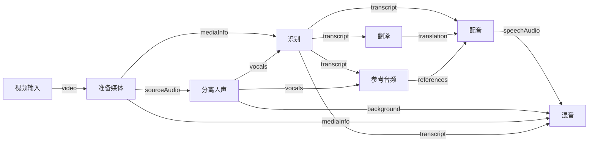
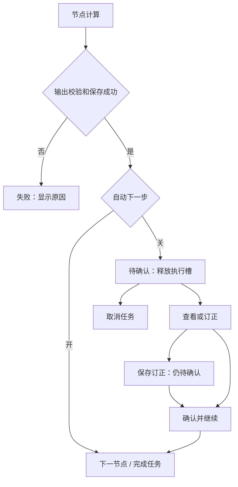

# YouDub 节点工作流设计

2026-10-20 · 设计提案 · 基线 `cb99992` / YouDub 0.0.7 · 分支 `codex/workflow-node-design`

本文定义后续实现目标。本分支只交付设计、接口草案和示例，不表示画布、人工确认或订正能力已经上线。工程契约与验收见 [实现设计](workflow-node-implementation.md)，数据示例见 [人工审核字幕工作流](workflow-samples/reviewed-subtitles.workflow.json)。

另一份独立示例为 [原声克隆配音工作流](workflow-samples/source-clone-dubbing.workflow.json)，包含 TTS、分离、参考音频和混音。两份示例分别表达无 TTS 与有 TTS 的图结构。

## 1. 目标与确定的范围

用户可以加载不同 workflow，在画布上拖拽节点、连接多个输入输出、调整简单参数；进入节点专属页面查看中间结果和订正内容；按节点设置是否自动继续，关闭后停在该节点等待确认。

第一版完整覆盖以下闭环：

1. 从内置模板、已保存工作流或 JSON 文件加载流程。
2. 添加、移动、复制和删除节点，连接或断开端口，保存为自己的 workflow。
3. 输入视频等素材，校验流程并创建一次独立运行。
4. 在画布查看节点状态，进入节点页面查看输入、输出、错误和原始结果。
5. 节点关闭「自动下一步」时，在计算完成后暂停整个当前任务。
6. 用户订正结果、保存并确认，后续节点使用已确认版本继续运行。
7. 已完成任务中的上游结果需要修改时，创建新的运行，复用未受影响的结果。

第一版支持有向无环图（DAG）的分支和汇合，执行仍使用单槽串行调度。多个输入端口、多个输出端口和一份输出被多个节点引用均属于首版范围。循环、嵌套子流程、并行 GPU 执行、在线协作、插件市场、任意脚本节点、ComfyUI 文件直接兼容留待后续明确需求。

## 2. 当前基础与需要补齐的部分

| 能力 | 基线情况 | 本次设计 |
| --- | --- | --- |
| 步骤输入输出 | 已有 JSON / artifact 端口及上游引用 | 增加可视化端口描述和连线规则 |
| 插件执行逻辑 | 已有 Host TypeScript 和 Python provider | 沿用 provider；同类节点的参数独立 |
| 工作流 | 插件生成静态有序计划 | 增加可保存、可加载的图文档与编译器 |
| 插件页面 | 已有路由、配置编辑器、任务面板 | 增加统一节点详情入口及插件页面插槽 |
| 任务运行 | 顺序执行、取消、失败、远端轮询 | 增加人工暂停、批准结果及恢复 |
| 重新生成 | 已有新任务和线性前缀复用 | 增加按实际依赖关系判断复用 |
| 中间结果 | 服务端保存步骤输出；下载 API 面向最终产物 | 增加受任务归属校验的中间结果读取 |

依据：[SDK](../../packages/sdk/src/index.ts)、[任务执行器](../../packages/builtin/src/tasks.ts)、[Client SDK](../../apps/web/src/plugin/sdk.tsx)、[文件访问 API](../../packages/builtin/src/api.ts)、[外部页面示例](../../fixtures/plugins/file-transform/README.md)。

## 3. 产品结构

保留现有简洁工作台和一键处理入口，增加「工作流」导航。工作台服务于选择 workflow、选视频、选语言和开始处理；工作流页面服务于流程组合和逐步校对。两种入口最终使用同一任务系统。新图模式不再用「输出模式」隐式增删 TTS 等步骤，所选 workflow 明确决定节点组成。

| 页面 | 内容 | 主要动作 |
| --- | --- | --- |
| 工作流库 `/workflows` | 内置模板、我的工作流、插件提供的工作流 | 打开、新建、导入 |
| 工作流编辑 `/workflows/:id` | 可编辑画布、输入定义、输出选择、节点参数 | 保存、另存为、运行 |
| 运行详情 `/tasks/:id` | 冻结流程与真实执行状态 | 查看节点、继续、取消、创建新运行 |
| 节点详情 `/tasks/:id/nodes/:nodeId` | 本次节点输入、结果、订正、日志 | 保存订正、确认并继续 |

草稿节点也可进入 `/workflows/:id/nodes/:nodeId`，显示配置和输入连接；未运行时明确显示「尚未运行」，不展示示例结果冒充真实结果。返回画布恢复缩放、位置和选中节点。

任务画布的结构与参数只读。移动运行画布中的节点只改变本地浏览位置，不修改任务计划；需要调整结构或模型参数时使用「编辑副本」创建新的 workflow / 运行。

## 4. 工作流库、加载与保存

### 4.1 来源

- **内置模板：** 随应用发布，只读；修改时保存为用户副本。
- **我的工作流：** 存在 YouDub 数据目录内的数据库，支持重命名、保存、复制和导出。
- **插件工作流：** 已启用插件提供，标明来源；支持图契约的可另存副本，旧版仅提供计划的保留原运行入口。
- **导入文件：** YouDub 自有 `.workflow.json`，作为新的用户工作流导入，不覆盖同名流程。

首批模板为三个独立 workflow，各自有独立 ID、图定义、配置和输出：

| Workflow | 节点组成 | TTS | 最终输出 |
| --- | --- | --- | --- |
| 字幕翻译 | 输入 → 准备媒体 → 识别 → 翻译 → 字幕/视频导出 | 无 | 原文字幕、译文字幕、带字幕的原声视频 |
| 视频配音 | 输入 → 准备媒体 → 识别 → 翻译 → 配音 → 混音 → 导出 | 有 | 配音音频、配音视频 |
| 字幕＋配音 | 视频配音图，增加字幕输出；模板需要模型对齐时显式包含对齐节点 | 有 | 配音视频、音频、原文及译文字幕 |

原声克隆版显式包含分离人声与参考音频节点；预设声线版可保存为另一份 workflow。是否保留背景音由实际背景音连线和混音参数共同表达。改变是否使用 TTS、字幕对齐等处理能力时，应加载另一 workflow 或编辑图后另存；模型、语言等参数只调整当前已有节点的行为。

「人工校对」属于某一具体 workflow 的节点开关配置，可以另存为「字幕翻译 · 人工校对」「字幕＋配音 · 人工校对」等独立副本。JSON 示例采用无 TTS 的字幕翻译图，在识别和翻译节点关闭自动下一步。

运行准备按当前 workflow 实际节点检查依赖：无 TTS 的流程不要求准备 TTS 模型；没有分离/对齐节点也不要求相应模型。当前固定准备四个模型的机制仍需在实施阶段调整，这项能力尚未存在。模型是否可用由实际环境检测，模板不承诺模型已经安装。

### 4.2 编辑与切换规则

1. 保存操作同时记录图结构、节点配置、端口连线、输出选择和布局。
2. 标题旁显示「未保存」或「已保存」；保存失败保留草稿和错误，不能显示成功。
3. 切换 workflow、导入其他文件或离开页面时，有未保存修改则提供「保存并离开」「放弃修改」「继续编辑」。
4. 「另存为」生成新的工作流 ID。保存当前 workflow 不改变已经创建的任务。
5. 「运行」使用当前草稿的完整快照，可运行未保存的草稿；任务标注「来自未保存草稿」，不暗中覆盖库里的版本。
6. 同时打开两个编辑窗口时，较旧版本保存返回冲突，保留本地草稿，可另存为；不以最后写入者静默覆盖。
7. 导入后先展示节点、依赖和校验结果，再由用户点击运行。加载 workflow 不执行模型、不安装插件、不下载模型。
8. 缺少插件、版本或模型时保留原节点和连线，以「缺少插件」「模型未就绪」定位问题；阻止运行，允许查看与导出。
9. 导出包含图定义、参数和布局；不包含 API Key、凭据引用、真实本地路径、上传文件、日志或执行结果。视频链接等运行输入在导出时清空，重新运行时填写。
10. 首版导出只支持 YouDub workflow 格式。导入 ComfyUI JSON 时明确报告格式不支持。

工作流定义与运行记录分开：定义描述“以后如何运行”，任务记录保存“这一次实际执行了什么”。删除用户工作流只删除库中的定义，既有任务快照及产物继续可查看。

## 5. 画布与视觉风格

### 5.1 布局

```text
YouDub 侧栏 │ 工作流名称 ▾  未保存        [撤销] [重做] [保存] [运行]
           │ ┌──────────────────────────────────┬──────────────────┐
           │ │ 输入 ── 准备媒体 ── 识别 ── 翻译 │ 翻译             │
           │ │          │          │       │    │ 模型      ▾      │
           │ │          └──────────┴── 配音     │ 目标语言  ▾      │
           │ │                            │     │ 自动下一步  ○    │
           │ │                          导出    │ [打开节点]       │
           │ │ [添加节点]      [−] [适应] [+]   │                  │
           │ └──────────────────────────────────┴──────────────────┘
```

节点库通过「添加节点」打开搜索面板，按输入、音视频、识别、翻译、配音、导出分类；支持拖入和点击添加。不长期占用第二条左侧栏。选中节点显示右侧设置栏，取消选择后收起。

画布铺满 Shell 的可用区域，不继承普通表单页面的 `max-w-6xl`。顶部工具栏固定在画布容器内，节点专属页面沿用应用的内容容器和滚动方式。

### 5.2 与现有 YouDub 一致

复用 [globals.css](../../apps/web/src/app/globals.css) 和现有组件：

| 元素 | 使用规则 |
| --- | --- |
| 背景、节点 | `background` / `surface` / `card`，浅色和深色主题一致切换 |
| 主操作 | `primary` 红色用于运行、确认并继续等当前主动作 |
| 选中与键盘焦点 | `ring` 蓝色，保持现有焦点语义 |
| 运行、完成、失败、待确认 | 对应 `status-running/success/danger/warning` 及文字图标 |
| 边框、阴影、圆角 | `border`、`shadow-card`、现有 radius 比例 |
| 背景点阵 | 复用 `grid-dot`；弱对比，不影响字幕和节点文字 |
| 图标、控件 | 现有 Lucide、Button、Select、输入框；复用中英日文切换 |

节点宽度使用统一组件 token，以最长常用端口标签和基础控件为依据；多端口增加高度，不缩小文字。设置栏使用统一面板宽度 token，窄容器改为抽屉。连线使用中性颜色，选中路径才强调；类型通过文字和图标识别，状态不能仅靠颜色。

运行状态只在实际运行节点上显示进度动画，遵守 reduced motion。首版不增加装饰性粒子、持续流动连线或画布背景光效。

### 5.3 节点卡片

每个卡片展示：

- 名称、类别图标、状态。
- 左侧具名输入端口，右侧具名输出端口。
- 最多三个由插件声明的基础配置控件，例如模型、目标语言、声音。
- 「自动下一步」开关和「打开节点」动作。
- 运行时的真实进度或错误摘要；未知进度显示运行状态，不伪造百分比。

API Key、服务地址和设备安装配置继续集中在设置页，节点通过已配置连接选择服务。复杂提示词、逐句文本、播放器、日志放在详情页。

### 5.4 操作与无障碍

| 操作 | 行为 |
| --- | --- |
| 拖节点标题 | 移动位置；编辑参数、选文字不会拖动节点 |
| 拖输出端口到输入端口 | 预览连线与兼容性，松开后提交图修改 |
| 单击节点 | 选中并显示简易设置 |
| 双击节点 /「打开节点」/ Enter | 进入节点专属页面 |
| 点击连线 | 选择、显示两端名称，可删除 |
| 复制节点 | 复制参数、生成新 ID；不复制运行结果、入边和出边 |
| 删除节点 | 删除节点及相关连线；下游缺输入立即标明，支持撤销 |
| 空白拖动 / Space 拖动 | 平移画布；滚轮或触控板遵循画布导航设置 |
| Ctrl/Cmd+S、Z、Shift+Z | 保存、撤销、重做；输入框内保留文本编辑快捷键 |
| Escape | 关闭面板或取消连线，不取消正在运行的任务 |

键盘用户可从节点设置中的「输入来源」下拉选择上游端口，完成连线而无需拖拽。提供「适应画布」「放大」「缩小」按钮。375px / 768px 下保留查看、详情、订正和继续，设置栏改为抽屉；大规模图编辑以桌面为主，不能让关键按钮移出屏幕。

## 6. 端口与连线

一个节点可以有多个输入和输出。每个端口有稳定 ID、显示名称、数据类别、schema 标识及是否必需。



图示为现有原声克隆流程的部分数据依赖，完整端口以 [媒体操作契约](../../packages/builtin/src/media-contracts.ts) 为准。

连线规则：

1. 一个输入端口最多连接一个来源；一份输出可连接多个下游。
2. “多个输入端口”允许同时接收原文、译文和参考音频；首版不支持同一个端口接任意多条线。需要列表时由一个输出提供符合 schema 的数组。
3. JSON 与文件端口分开验证。类型兼容必须由输入端口声明允许的 schema，不能仅因为文件扩展名或端口名称相似就连接。
4. 禁止自环、循环、连接不存在的端口、重复占用输入和从下游反向引用造成环路。
5. 必需输入未连接时允许保存草稿，阻止运行。可选输入未连接时按节点契约省略。
6. 所有可选执行节点必须通向至少一个选定最终输出；游离节点运行前报错，不能静默丢弃。
7. 输出定义选择实际节点输出端口，可发布多个视频、音频、字幕等 artifact。JSON 中间结果可在节点页查看；首版最终文件列表仍只发布 artifact。
8. 布局位置不影响执行顺序；同样图和参数生成同样的稳定拓扑顺序。

## 7. 节点专属页面

通用页面壳包含面包屑、节点名称、状态、输入、结果、配置和日志。插件贡献主要内容区域；确认、取消和保存状态由宿主统一控制，避免每个插件实现不同的任务规则。

| 节点 | 页面重点 | 第一版订正能力 |
| --- | --- | --- |
| 输入 / 准备媒体 | 视频预览、时长、轨道、输出音频 | 修改草稿输入；已运行输入通过新任务替换 |
| 分离人声 | 原声、人声、背景音试听 | 只读预览和调整参数后新运行 |
| 识别 | 视频/音频与分段文本同步定位 | 修改文本、起止时间；保留 segment ID |
| 翻译 | 原文/译文逐句对照、搜索定位 | 修改译文；保留 segment ID |
| 参考音频 | 每段原声与参考文本 | 只读核对 |
| 配音 / 混音 | 分段试听、最终音轨与对应文本 | 只读试听和调整参数后新运行 |
| 字幕对齐 / 导出 | 字幕预览、时间轴结果、视频 | 只读检查；通过上游订正产生新结果 |
| 第三方节点 | 插件提供的 React 页面 | 插件同时提供服务端订正校验才开放编辑 |

识别首版不提供新增、合并、拆分句子；这些操作会改变后续译文和配音索引，需要单独的语义设计。修改文本或时间后，该段自动词级时间戳标为失效，规范化结果使用 `words: null`；原始识别响应保持原样。翻译订正必须与当前输入原文的 segment 集合一一对应。

节点页有未保存订正时，返回画布、切换节点/任务或浏览器后退均由宿主拦截，提供「保存订正并离开」「放弃修改」「继续编辑」。保存成功后可以离开，但任务仍待确认；保存失败保留页面、草稿和错误。关闭窗口使用浏览器离开保护，首版不承诺恢复尚未保存的文本。

无专属页面的节点使用通用只读结果页和 schema 参数表单。插件声明了专属页面但加载失败时显示原始错误，并可显式进入通用只读查看；不能把编辑器加载失败伪装成正常编辑状态。

## 8. 自动下一步与人工确认

### 8.1 精确语义

「自动下一步」是每个执行节点的设置，默认开启。关闭后，该节点照常计算，输出通过校验并持久化以后，任务进入「待确认」。整个当前 workflow 暂停，包括尚未执行的独立分支；其他任务可以继续使用执行槽。



- 这里的停止点位于节点完成后。运行前就暂停、运行中断点调试不在首版范围。
- 暂停任务刷新页面、关闭页面或重启应用后仍待确认；没有倒计时和自动批准。
- 关闭最后一个节点的自动下一步，同样需要确认；确认前不能将任务标为成功或把未确认结果作为最终完成结果。
- 「保存订正」只保存候选结果。「确认并继续」批准页面显示的具体版本。
- 有未保存修改时提供「保存并继续」，作为一次原子提交；校验或保存失败则保持暂停。
- 开始运行后配置快照锁定，自动下一步开关不直接改变正在执行的计划。暂停时点击继续只批准当前节点，后续节点仍遵守原设置。
- 节点失败时进入失败状态，不能通过确认按钮跳过错误。

### 8.2 运行提示与动作

| 状态 | 用户看到的内容 | 可用动作 |
| --- | --- | --- |
| 运行中 | 节点进度、正在执行的步骤 | 查看、取消 |
| 远端处理中 | 供应商处理中及轮询状态 | 查看、取消本机等待 |
| 待确认 | `翻译待确认`、结果预览 | 打开节点、确认并继续、取消 |
| 保存订正失败 | 字段错误或保存原因，草稿保留 | 修改、再次保存 |
| 已完成 | 已确认最终产物 | 查看、编辑副本并重新生成 |

只有后端确认状态变化后才切换界面。超时显示「提交结果待核实」，按本次操作 ID 查询；不自动再次触发模型调用。

## 9. 订正与重新执行

每次订正产生新的结果版本，保留模型原始响应、原始规范化输出和已批准版本。用户可以查看「原始结果」「当前订正」，恢复原始内容也通过新订正版本保存。

| 修改位置 | 行为 |
| --- | --- |
| 当前暂停节点，后续尚未执行 | 保存候选版本；批准后在同一任务继续 |
| 已被后续节点消费的结果 | 创建派生任务，原任务保持可查看 |
| 模型、提示词、设备、连线或输入素材 | 编辑副本后新运行；运行快照不原地修改 |
| 仅节点位置、缩放、节点显示名称 | 不触发计算，不改变结果有效性 |

重新执行依据依赖关系决定范围。例如订正译文，配音、混音、对齐和导出需重新执行；识别、分离及参考音频可在身份、参数和输入一致时复用。识别原文修改会影响翻译及原声克隆参考，不能继续使用不匹配的旧结果。

确认之前展示「将复用的节点」「将重新运行的节点」。首版按整个节点重跑，逐句 TTS 缓存和跨任务全局缓存不在范围内。复用文件复制到新任务并重新登记，删除原任务不能破坏新任务。

## 10. 首版验收场景

1. 加载字幕模板，拖动节点、增删连线、修改模型、保存并重新打开，图和参数一致。
2. 添加两个同类型节点，配置不同参数，实际请求分别使用各自参数。
3. 分离节点有两个输出，配音节点有三个输入；一个原文输出同时连到翻译、参考和配音。
4. 错误类型、环路、缺少必需输入和缺少插件均定位到具体节点/端口，并阻止运行。
5. 识别关闭自动下一步，计算后暂停；在节点页改错字，保存后仍暂停，批准后译文使用订正文本。
6. 翻译关闭自动下一步，订正后继续；配音使用修改后的译文，原始译文仍可查看。
7. 任务 A 暂停后任务 B 可以执行；重启后 A 仍暂停，继续 A 不重复执行已确认上游。
8. 最后导出节点关闭自动下一步，确认前任务不成功，确认后直接完成。
9. 两个窗口同时订正或批准，仅一个有效版本被接受，另一窗口保留草稿并显示冲突。
10. 已完成任务改译文，生成新任务，原任务不变，未受影响节点复用，依赖节点重算。
11. 浅色/深色、中文/英文/日文和窄屏可操作；键盘可以连线、进入节点、保存和继续。
12. 内置流程、用户 workflow、外部插件 workflow 可分别加载；旧版任务和原工作台仍可使用。
13. 下载节点填写视频链接，生成视频后进入后续流程；保存/导出 workflow 不带运行链接，重新加载时要求填写。
14. 字幕翻译与视频配音以不同 workflow ID 加载；无 TTS 的图没有 TTS 节点、声线配置或 TTS 模型准备要求，有 TTS 的图显示并验证完整配音依赖。

工程测试、发布责任与线上验收见 [实施与验收](workflow-node-implementation.md#10-实施顺序与验收责任)。

## 11. 参考与采用边界

- [ComfyUI 节点输入输出](https://docs.comfy.org/custom-nodes/backend/server_overview)：参考具名端口、节点参数和数据流组织。
- [ComfyUI 工作流](https://docs.comfy.org/basic-concepts/workflow)与[工作流管理](https://docs.comfy.org/interface/workflows)：参考工作流作为可保存、可加载的流程定义，以及未保存状态和流程切换。
- [ComfyUI 连线](https://docs.comfy.org/basic-concepts/links)与[界面](https://docs.comfy.org/interface/overview)：参考数据流、节点库和画布操作组织。
- [React Flow 自定义节点](https://reactflow.dev/learn/customization/custom-nodes)、[多端口](https://reactflow.dev/learn/customization/handles)、[主题](https://reactflow.dev/learn/customization/theming)：作为 React 画布实现候选，支持复用 YouDub 组件。
- [React Flow 保存与恢复](https://reactflow.dev/examples/interaction/save-and-restore)：参考节点、连线与视图持久化。

YouDub 的人工确认、字幕订正和结果版本规则由本设计定义。ComfyUI 的文件格式、插件运行时和默认外观均不作为兼容承诺。实施前验证画布库与当前 React、插件打包及桌面 WebView 的兼容性，再锁定依赖版本。
