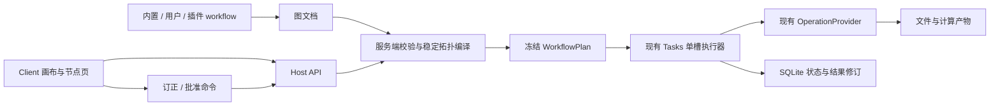

# 节点工作流：接口、执行与实施设计

实现入口见[节点工作流使用说明](../workflows.md)和[验收记录](../validation/workflow-nodes-2026-10-20.md)。本文保留最初设计基线，具体接口以 SDK 源码为准。

2026-10-20 · 原始设计基线 · 配套 [产品与交互设计](workflow-node-design.md)

本文中的新增类型、HTTP 路径和数据库版本均为提案。以 `cb99992` 的实现为现状依据；文中示例不代表当前 SDK 已暴露这些接口。

## 1. 架构决策



1. 复用 Cordis、`catalog`、`tasks`、`files`、`store` 和 provider 协议，图编辑成为 Client 插件。
2. 新增普通内置 workflow `youdub.graph`，承担图编译与执行入口；用户保存的 workflow 是文档，不为每个副本注册一套服务。
3. 图编译为现有 `WorkflowPlan.steps`，拓扑顺序显式保存。首版不引入第二套任务队列或并行运行时。
4. 节点定义扩展 provider 的 operation 描述，输入类型和配置来自公开契约。默认模型选择不进入编译器硬编码。
5. 画布 JSON 不直接使用 React Flow 内部对象作为公共文件格式，避免 UI 库升级改变运行协议。
6. 旧 `youdub.localize` 与 plan-only 插件继续读取和重跑旧任务。新的「字幕翻译」「视频配音」「字幕＋配音」使用不同文档 ID 和独立图定义，共享 `youdub.graph` 编译器。新工作台以 workflow 选择代替输出模式驱动的隐式分支；旧任务的 config 保持原样。

## 2. 现有约束

| 当前实现 | 对设计的约束 |
| --- | --- |
| [StepSpec / WorkflowPlan](../../packages/sdk/src/index.ts) | 已有多端口、上游引用、provider 固定身份 |
| [plan 校验与执行](../../packages/builtin/src/tasks.ts) | 输入只能引用先出现的步骤，按未完成步骤顺序执行 |
| [SQLite CAS](../../backend/workers/store.py) | plan、config、inputs 等快照不可原地修改 |
| [waiting 领取逻辑](../../backend/workers/store.py) | `waiting` 专供远端轮询，不能用作人工暂停 |
| [部分重跑](../../packages/builtin/src/tasks.ts) | 当前要求相同配置并复用线性前缀，需另增依赖图复用 |
| [媒体 schema](../../packages/builtin/src/media-schemas.ts) | JSON Schema 之外还需要分段 ID、时间范围等语义校验 |
| [Client SDK](../../apps/web/src/plugin/sdk.tsx) | 已有路由和插槽，缺少统一节点上下文 |
| [当前 artifact API](../../packages/builtin/src/api.ts) | 仅发布最终输出，需要增加中间结果读取 |

以上是源码核对，不等同于本设计功能已经通过运行验收。

## 3. 节点定义与多端口

### 3.1 Operation 的可视化描述

在现有 `ProviderDescription.operations[]` 中增加可选 `node` 描述；旧插件未声明时仍按原 workflow 运行，不能猜测输入类型后直接加入可编辑节点库。

```ts
type InputPortDefinition = {
  id: string
  label: LocalizedText
  kind: 'artifact' | 'json'
  acceptedSchemaIds: string[]
  required: boolean
}

type NodeDescriptor = {
  type: string                 // 包内稳定且全局唯一，如 youdub.translate
  version: string              // 节点配置/端口定义版本
  label: LocalizedText
  category: string
  inputs: InputPortDefinition[]
  runtimeInputSchema?: JsonObject // 本次运行填写的值，如下载 URL
  configSchema: JsonObject
  defaults: JsonObject
  ui?: {
    quickFields?: string[]     // 最多三个顶层字段
    editorId?: string
    detailId?: string
  }
  corrections?: {
    outputPorts: string[]     // 允许订正的输出端口
    schemaIds: string[]
  }
}
```

输出继续使用既有 operation `outputs: OutputPort[]`，增加可选显示 label；不重复维护第二份输出 schema。所有输入端口 ID 对应 operation `inputSchema.properties` 的顶层字段。配置字段与数据端口分开：数据端口只能来自上传、连接或既有受管结果，不能由配置文本伪造 artifact 路径。

原始值由 `runtimeInputSchema` 明确声明，例如下载节点的 `url`。它与具名连线端口共同覆盖 operation 输入，字段不能重叠，不接受任意未声明 JSON。首次运行在节点表单填写，提交为 `CreateTask.nodeRuntimeInputs[nodeId]`；该容器与图文档分离，不保存到可分享 workflow。Host 校验后固定为本次 StepSpec.input 的 JSON 常量。文件输入仍使用上传和受管 artifact，runtime input 不能伪造文件引用、凭据或路径。

下载输入示例：节点定义声明 `runtimeInputSchema.properties.url = { type: 'string', format: 'uri' }` 且为 required；创建任务提交 `nodeRuntimeInputs.download.url`，编译为 download 步骤的 `input.url`。Host 继续使用现有 videoSource URL 校验，不把任意 URI 当作已支持视频来源。

注册时验证 node 元数据与 operation 契约一致。连线先检查 `kind` 和 `acceptedSchemaIds`；提交运行时再次校验图，实际执行继续验证完整输入和输出 schema。schema ID 是数据类型标识，不代替内容验证。

### 3.2 每个节点独立绑定

一个 workflow 可包含多个翻译节点或多个配音节点，每个实例拥有自己的 node ID、config、provider 选择和 `autoContinue`。编译后的 `bindingKey = node.id`，不沿用默认流程中按能力共享的 key。

`binding.options` 保存该节点已解析配置；`model/modelRevision/device` 仍在固定 provider binding 中。编译时按「节点 defaults → provider 声明的非秘密 defaults → 本节点 config」解析并校验，归一化为完整 options。模型和设备来自本节点选择，不能从其他节点补入。官方 camelCase / snake_case 映射在官方节点适配器完成，进入计划后每个选项只有一个明确值。

当前 Python [Operation](../../backend/workers/operations.py) 合并全局 config 与 binding options，[python-provider](../../packages/builtin/src/python-provider.ts) 还会在执行期补 config.options。图模式需关闭未固定的执行期默认值合并，只读取冻结的 binding；全局 config 只包含宿主运行元数据。旧 `youdub.localize` 保留原逻辑，独立回归验证。

| 节点 | 固定的主要 binding.options |
| --- | --- |
| recognize | sourceLanguage、initialPrompt |
| translate | sourceLanguage、targetLanguage、maxCompletionTokens |
| synthesize | targetLanguage、voice |
| mix | keepBackground |
| export | targetLanguage、outputMode |

新图模式的 export.outputMode 仅为复用既有媒体导出适配器而保留。编译时根据**当前导出节点**的 finalAudio 输入连线与简单参数 renderSubtitles 确定：

| finalAudio 输入 | renderSubtitles | 适配器 outputMode |
| --- | --- | --- |
| 未连接 | true | subtitles |
| 已连接 | false | dubbing |
| 已连接 | true | both |
| 未连接 | false | 首版报不支持 |

对应 dubbedTimeline 等输入按模式检查。`WorkflowDocument.outputs` 只决定公开哪些已生成文件；不公开音频下载仍可生成配音视频，不公开独立字幕仍可烧录字幕。多个导出节点各自推导，不能共享全图模式。这个适配参数不生成或删除 TTS 等节点，也不作为工作台切换整个流程的选项。测试双翻译节点不同目标语言、双配音节点不同声线、同 provider 的混音/导出参数及两个导出节点互不串用。

现有工作台语言、声音等设置在“生成官方模板图”时写入相应节点。用户手工修改后以图为准，不能因刷新设置而重新生成并覆盖图。首版不引入通用参数表达式语言。

## 4. WorkflowDocument

```ts
type Endpoint = { nodeId: string; portId: string }
type GraphNode = {
  id: string
  type: string
  typeVersion: string
  label?: string
  provider: { id: string; model?: string; device?: string }
  config: JsonObject
  autoContinue: boolean
}
type WorkflowDocument = {
  format: 'youdub.workflow'
  formatVersion: 1
  id: string
  title: string
  nodes: GraphNode[]
  edges: { id: string; source: Endpoint; target: Endpoint }[]
  inputs: {
    id: string; label: string; required: boolean
    kind: 'artifact'; schemaId: string
    acceptedMimeTypes: string[]
  }[]
  outputs: {
    id: string; label: string; kind: 'artifact'
    schemaId: string; required: boolean; source: Endpoint
  }[]
  presentation: {
    positions: Record<string, { x: number; y: number }>
    viewport: { x: number; y: number; zoom: number }
  }
}
```

格式说明：

- `nodes` 数组中的稳定顺序只用于拓扑排序同层节点的平局规则；拖动只更新 `presentation`。
- 图输入在画布显示为虚拟 `$inputs` 卡片，出边引用输入 ID；卡片不调用 provider。
- 图输出显示为虚拟 `$outputs` 卡片，连线由 `outputs[].source` 派生，文件中不重复保存这组边。
- 首版公共图输入沿用现有具名 artifact 上传。链接下载由下载节点的 runtimeInputSchema 表单提供，运行时填写，导出文件不包含 nodeRuntimeInputs。
- 文件格式、节点定义版本、provider 插件版本与工作流保存 revision 分别管理。
- 文档只存 provider 选择；创建任务时由宿主解析实际 pluginId / pluginVersion / integrity / modelRevision，并固定在 plan。导入文件不能自报 integrity 绕过插件验证。
- 数据库外层保存 `revision/createdAt/updatedAt/origin`；导出文档无数据库 revision、凭据和上传内容。
- 所有支持字段采用白名单；未知字段或格式版本明确报错。不能从导入 JSON 动态 import JS 或安装依赖。

对应 [JSON 示例](workflow-samples/reviewed-subtitles.workflow.json) 表达两个暂停点与多端口连接，属于无 TTS 的独立字幕翻译 workflow。节点 type 为计划新增的公开名称，实际实现前仍需注册；该文件当前用于评审和契约测试。示例有意不填翻译模型，未来导入后必须从用户实际配置的模型中选择，模型未选择时阻止运行；示例不承诺任何供应商已连通。

[原声克隆配音示例](workflow-samples/source-clone-dubbing.workflow.json) 使用另一个文档 ID，显式加入 TTS 及其依赖，并发布配音视频和音频；同样保留翻译模型待选择。示例中的 CPU 和模型名称只表达配置，不替代实际设备、文件和语言支持检查。

### 4.1 持久化和任务快照

复用 `desktop.sqlite`，新增一张用户 workflow 表，存储 ID、revision、标题、document JSON 和时间。保存使用 SQLite CAS；不用额外工作流服务器或第二个数据库。内置与插件模板从 catalog 枚举，列表合并后标明 source，用户表不复制只读模板。

任务创建时保存：

- `workflowId = 'youdub.graph'` 与编译器版本。
- `workflowSource = { documentId, documentRevision | null, title }`。
- 不可变 `graphSnapshot` 和编译后的 `plan`。
- 不可变 `nodeRuntimeInputs`，下载 URL 等经过服务端校验后编入对应节点输入。
- 实际上传输入、凭据引用快照与各 node 独立 provider binding。
- UI 可从图快照显示原始布局；用户本地浏览缩放不写回执行快照。

草稿运行的 documentRevision 为 null。Host 直接接收受验证文档快照，避免为“运行一次”强制增加库中的永久副本。旧客户端不能运行含新状态语义的图任务，需在客户端清单/SDK 协议升级中声明兼容范围。

## 5. 校验与图编译

为图文档提供明确调用入口，不依赖既有 `validate(inputs, config, catalog)` 偷渡图数据：

```ts
type GraphCompileRequest = {
  document: WorkflowDocument
  inputs: Record<string, ArtifactRef>
  nodeRuntimeInputs: Record<string, JsonObject>
}
type GraphWorkflowDefinition =
  Omit<WorkflowDefinition, 'validate' | 'plan'> & {
    graph: {
      compile(request: GraphCompileRequest, catalog: CatalogService):
        Promise<{ plan: WorkflowPlan; graphSnapshot: WorkflowDocument }>
    }
  }
type RegisteredWorkflow = WorkflowDefinition | GraphWorkflowDefinition
```

`catalog.registerWorkflow` 接受这个联合类型。`tasks.create` 检测已注册 workflow 的 graph 能力后调用 compile；旧 workflow 仍调用原 validate/plan。两条路径共同执行 checkPlan、凭据快照、文件校验与持久化。graph 请求只能发给支持该能力的 workflow，编译错误携带 Diagnostic 列表；图数据与任意 config 不混用。

编译纯粹产生计划和诊断，不发模型请求：

1. 校验格式版本、ID 唯一性、节点数量/文本/文件大小等受控上限。
2. 解析已安装且启用的 node 定义与 provider，验证版本及配置 schema。
3. 校验输入输出端口、单输入单来源、kind/schema 兼容、必需输入和最终输出。
4. 验证所有执行节点通向至少一个选定最终输出；缺依赖、游离节点和环路都返回定位诊断。
5. 执行稳定拓扑排序，生成 node 到 step 的一一映射。虚拟输入输出卡片不成为计算步骤。
6. 每节点生成独立 binding；输入引用编译为 `{ from: 'task', name }` 或 `{ from: 'step', stepId, output }`；显式 runtime input 编译为 JSON 常量，三种来源互斥。
7. 从 provider 复制完整输出契约和配置快照，附加 `autoContinue`。运行时仍校验真实数据和 artifact。
8. 校验跨节点媒体语义，例如 source/target language、segment 类型、原声克隆所需 references 与背景混音输入。
9. 保存不可变计划和图，再入队。任何一项失败都不创建可运行任务。

错误包括 `nodeId/portId/edgeId/field`，画布定位到相应对象。缺少必需输入的草稿可以保存，但运行校验必须失败。不同 workflow 切换不取消或改写正在运行的任务。

文件导入和运行可接受的资源上限在实现时复用现有 HTTP 限制并通过代表性工作流测量确定，不在设计中凭空承诺无限图规模。

### 5.1 不同 workflow 的依赖准备

现有 setup 先固定准备四个模型再开放工作台，无法满足无 TTS workflow 独立使用。实施时分为基础宿主准备与所选图的运行资源检查：

- 基础 Python、存储和界面就绪后允许加载/编辑 workflow。将基础 Host 包与 provider 专属 Python 包分组准备，避免完整 requirements 中未选 provider 的依赖阻塞启动。
- 图校验返回实际节点的缺失资源；首版官方节点通过 provider/model 映射模型、Python 依赖组和检查项，复用下载器和校验。
- 字幕翻译仅检查所需识别、翻译连接、媒体工具；没有 TTS/分离/对齐节点时不要求它们就绪。
- 有 TTS 的 workflow 在运行前明确准备其 TTS 及图上出现的分离/对齐依赖；导入/切换流程只展示缺项，用户点击「准备依赖」才启动下载。
- 保留阿里源、ModelScope、平台自动检测和原始错误展示。缺失资源不能通过删除节点或替换模型绕过。
- 第三方资源未知时明确报未就绪并指向插件要求，不自动执行任意安装指令。

当前 setup-environment 安装完整 requirements、setup 最后全量 verify，二者均需调整；只过滤模型列表不足以完成该项。未选择 provider 的包/模型缺失以 unavailable 留在目录，不阻止打开工作流库或运行无依赖的其他图。验收环境需实际移除 VoxCPM 包及模型，证明字幕 workflow 能进入并完成。

## 6. 人工暂停、确认与重启

### 6.1 状态

新增 `TaskStatus.paused` 与 `StepStatus.awaiting_review`。现有 `waiting` 继续表示远端执行轮询，不能与人工确认混用。

| 当前 | 触发 | 新状态与动作 |
| --- | --- | --- |
| step running | 输出保存成功，autoContinue=true | step completed；下一步 queued 或最终 succeeded |
| step running | 输出保存成功，autoContinue=false | step awaiting_review；扫描其他依赖就绪节点，无可运行节点才 task paused |
| step awaiting_review | 保存订正成功 | 更新该节点候选版本，保留其他分支状态 |
| step awaiting_review | 批准当前结果版本 | step completed；仅依赖就绪节点 queued，所有节点完成后 finalize |
| task paused | 取消 | task cancelled；当前 awaiting_review 和后续 pending 步骤 cancelled；已批准 completed 保持 |
| task paused | 重启 | 保持 paused 和相同候选版本 |
| step running | provider / 输出校验失败 | task failed，保留原始原因 |

`paused` 无 `nextPollAt`、无 `finishedAt`；不会被 `store.claim` 领取。`active=true` 的未结束任务列表包含 paused，调度 runnable 集合单独判断。保留暂停任务对依赖插件的版本保护，扩展卸载/升级不能使其无法恢复。

计算输出落库与节点设为 awaiting_review 在同一次任务 CAS 中完成；其他依赖就绪节点继续调度。没有可运行节点时设为 paused 并释放执行槽。等待人工确认本身不保留 Promise、Python worker 或 GPU 模型占用。确认请求用 attempt 与该节点 outputRevision 判断冲突，无关分支的进度和审核不使请求失效；任务存储仍通过 CAS 原子提交。

最终成功的条件增加“所有人工确认已通过”。最后一步批准后在同一受控命令内汇总最终输出，不将没有待执行步骤的任务重新入队。

派生任务可能已有可复用计算结果，但仍需新的人工确认。创建、批准和恢复调度前统一推进检查：按拓扑顺序扫描依赖已满足的节点；已有结果且未批准的 gate 设为 awaiting_review，同时继续扫描其他分支，不再次调用 provider。需要计算且输入均已批准的节点进入队列；没有可运行节点且存在 gate 时 paused，全部完成并批准后 finalize。例如所有结果都可复用，仅将翻译 autoContinue 从 true 改为 false，任务应在翻译暂停且没有新的模型调用。

### 6.2 候选结果版本

```ts
type NodeResultRevision = {
  revision: number
  parentRevision: number | null
  source: 'computed' | 'correction'
  actionId: string | null
  outputs: JsonObject
  createdAt: string
}
type NodeReview = {
  nodeId: string
  candidateRevision: number
}
```

每个节点保存追加式 `resultRevisions`；现有 `outputs` 作为当前有效版本的索引投影。自动执行节点计算后直接批准 v1；人工节点在 awaiting_review 时仅作为候选展示，调度器不得消费。批准记录保存版本和操作 ID，后续输入解析固定使用已批准版本。

订正文件使用新的 artifact ID 和受管路径，不覆盖原 invocation 文件。原始供应商响应保持不变；原始输出版本、订正版本和批准记录均保留。文件先完整写入、校验、登记，任务 CAS 再提交引用；失败保留诊断，不推进下游。现有 artifact 存储还没有完整版本系统，这部分属于新增实现。

### 6.3 订正验证

服务端根据节点声明验证允许修改的端口、完整 JSON schema、嵌套 artifact 的归属与存在性，再执行领域规则：

- transcript：segment ID 唯一且集合不变；时间在媒体范围内，start < end，排序符合现有语义；文本/时间变更的 words 清空，原始响应不修改。
- translation：语言合法，segment_id 与本次输入 transcript 一一对应；不允许遗漏、重复或额外 ID。
- 只读 diagnostic、未声明端口、任意本地路径和其他任务的 artifact 均拒绝。
- 第三方订正同时要求节点声明和服务端 validator；只有前端编辑器无法开放写入。

Host `OperationProvider` 增加可选 `validateCorrection(request)`，参数包含 operation、固定 inputs、基准 outputs 和仅涉及允许端口的 patch，返回规范化完整 outputs 或抛出带字段的诊断。宿主先检查允许端口，将 patch 合并进基准输出，再调用 hook，并重新验证完整 schema、嵌套文件归属和未编辑输出未改变。识别节点订正 transcript 时必须保留 raw 等其他输出。hook 只验证/规范化，不执行模型或外发请求；未提供 hook 的第三方节点只读。

首版不支持运行中直接编辑；可以复制当前已落库结果在本地查看，但写入仅允许人工暂停节点或新派生任务。

### 6.4 并发与失败

每个变更携带 `actionId`、`expectedAttempt`、`expectedTaskRevision`、`expectedOutputRevision`。Host 锁内校验并由 SQLite CAS 提交。相同 actionId 和相同内容查询既有结果；相同 ID 不同内容返回冲突。操作回执随任务持久化，避免双击或响应丢失造成重复执行。

「保存并继续」在一次提交内追加订正版本、批准它并改变任务状态。文件校验失败、CAS 冲突、持久化失败都保持下游未执行。提交结果未知时返回明确状态，通过 actionId 查回；不自动重发操作或调用供应商。

两个窗口提交旧 revision 返回 409，前端保留草稿并提供重新读取/另存内容，不自动覆盖。取消与批准竞争时，只允许满足当前 revision 的一个命令生效。

重启继续沿用当前运行中断和远端结果未知处理：已运行但未确认结果不能推断为成功，`mayStillRun` 仍阻止普通重试。已经持久化的 paused 保持原状；恢复过程不会自动批准人工节点。

## 7. 依赖复用与新运行

当前暂停节点的候选订正不产生新任务，因为下游尚未消费结果。修改已被消费的节点、参数或连线时创建新任务，原运行保留。

复用算法：

1. 比较源图与新图中相同 node ID 的 type/version、operation、provider 固定身份、配置与输入来源；输入媒体按受管内容身份确认。
2. 标记变化节点及其传递下游为需重算；变化包括输入来源版本改变、模型 revision 改变和结果人工订正。
3. 不受影响且已批准的成功节点可复用，复制实际文件并重新登记 artifact 引用；缺失文件或身份不一致直接报告不可复用。
4. 人工订正的目标节点作为新运行的已确认替代结果写入，来源记录为 correction；它的下游重新执行。仅修改配置时目标节点本身重新执行。
5. 自动下一步规则变化不使计算结果失效，但新增人工确认要求必须重新停留；不能复用旧批准绕过新规则。
6. 布局和标签变化不影响计算有效性。首版不做全局缓存，不跨不相关任务自动寻找结果。

复用预览由服务端计算，返回复用/重算集合及原因；创建时固定相同输入、图和源结果 revision，再重新校验。若源版本变化或文件缺失，停止创建并显示原因。

源任务 paused 时可使用「停止此运行并创建副本」进入派生路径；源任务先显式取消并读回成功，再创建新任务。任一步失败报告真实状态，不把取消失败隐藏为新运行成功。运行中的任务先取消，确认本机进程停止且远端风险已处理后再派生。派生请求明确携带 source attempt、各复用/订正结果 revision 和用户选择采用的修订；取消保留修订但不自动批准候选，终态的原任务批准接口拒绝继续。

## 8. 插件页面与 API 草案

### 8.1 Client 扩展

在现有 `slots` 上新增 `workflow.node.editors` 和 `workflow.node.details`，分别接收配置草稿与运行上下文；注册 ID 匹配 node 描述的 `editorId/detailId`。

```ts
type NodeDetailProps = {
  taskId: string
  nodeId: string
  mode: 'read' | 'review'
  inputs: JsonObject
  result: { revision: number; outputs: JsonObject } | null
  diagnostics: Diagnostic[]
  readOnly: boolean
  onDraftChange(outputs: JsonObject): void
}
```

宿主持有 dirty 状态、保存、批准、取消和版本冲突处理；插件仅编辑允许的结果内容。输入与结果由 API 返回受控 JSON 和授权文件 URL，前端不读取本地绝对路径或凭据。配置页继续复用现有 schema 表单；未知 schema 显示不支持并要求插件编辑器。

插件的详情页面允许自定义媒体播放器、表格和订正控件，但使用 YouDub 主题变量和组件约定。无自定义详情时使用通用只读页；声明的自定义页异常要保留错误。

### 8.2 HTTP

沿用现有 `/api/v2` 认证和 CSRF。为避免改变已有 `/workflows` 的 catalog 语义，用户图文档使用 `/workflow-documents`：

| 方法与路径 | 作用 |
| --- | --- |
| `GET /api/v2/workflows` | 保留旧列表，新增可选图能力和模板来源描述 |
| `GET /api/v2/node-types` | 可用节点类型、端口、参数 schema、页面 ID |
| `GET/POST /api/v2/workflow-documents` | 用户图文档列表 / 新建 |
| `GET/PUT/DELETE /api/v2/workflow-documents/:id` | 读取 / CAS 保存 / 删除用户定义 |
| `POST /api/v2/workflow-documents/validate` | 校验草稿并返回节点/端口定位诊断 |
| `POST /api/v2/tasks` | 保留具名上传；graph workflow 接收受验证文档快照 |
| `GET /api/v2/tasks/:id/nodes/:nodeId` | 输入、状态、候选/批准版本、原始结果引用 |
| `GET /api/v2/tasks/:id/nodes/:nodeId/results/:revision` | 指定结果版本 |
| `GET /api/v2/tasks/:id/artifacts/:artifactId` | 受 task 归属和文件读锁保护的中间文件 |
| `POST /api/v2/tasks/:id/nodes/:nodeId/corrections` | 保存订正；`continue: true` 表示原子保存并批准 |
| `POST /api/v2/tasks/:id/nodes/:nodeId/approve` | 批准明确的候选版本并继续或 finalize |
| `GET /api/v2/tasks/:id/actions/:actionId` | 查询操作提交结果 |
| `POST /api/v2/tasks/:id/rerun-preview` | 返回依赖复用与重算计划 |
| `POST /api/v2/tasks/:id/rerun` | 增加图模式派生参数，保留旧 fromStep 语义 |

图模式请求不复用 `config` 塞入不受检验的任意 JSON；CreateTask 新增明确的 `graphDocument` 与 `nodeRuntimeInputs` 字段，宿主通过 `youdub.graph.graph.compile` 编译，并把规范化快照传给创建逻辑。upload parser 需显式支持这些字段和动态输入槽，仍拒绝客户端提供任意 artifact/path。JSON 创建可用于仅提供 URL 的流程；视频文件走既有 multipart 具名上传。

API 返回的中间文件必须属于指定 task 的已登记输入或结果版本，并经路径/文件校验；不会因为知道 artifact ID 就绕过任务归属。节点 JSON 中的文件引用由 Host 转成只读 URL。检查失败保留原始错误，不自动回退到旧结果。

## 9. 存储升级、旧任务与技术选型

数据库从当前 schema v2 设计为 v3：增加用户 workflow 表，扩展可识别状态和 task JSON 字段，将 graphSnapshot、workflowSource、nodeRuntimeInputs 纳入既有 CAS 的不可变字段检查。迁移在事务中执行，失败停止启动并保留诊断。已有 terminal 任务保留原快照；没有图的旧任务继续用现有步骤列表，不能伪造编辑能力或人工批准历史。

迁移前要求活动计算结束或明确取消，并以数据副本验证；同一数据库禁止两个版本 Host 同时运行。旧版应用遇到新数据库按版本检查拒绝写入；不把降级描述为自动回滚。

SDK 新增能力需在实现时确定兼容版本：provider.node 为可选扩展，旧 provider 继续可用；含新 TaskStatus 的 Client/Host 必须成套发布。扩展声明支持的 SDK 范围，版本不符明确提示。

画布首选验证 `@xyflow/react`：其[自定义节点](https://reactflow.dev/learn/customization/custom-nodes)、[多 Handle](https://reactflow.dev/learn/customization/handles)与[主题接口](https://reactflow.dev/learn/customization/theming)符合现有 React 页面组合方式。只作为呈现层，执行、类型校验、结果版本均由 YouDub 管理。

实施前做最小兼容验证：当前 React 19.2.4 / Next 16.3.8、Cordis 共享 React、ESM 插件打包、macOS WKWebView、Windows WebView2。通过后精确锁版本；本设计分支不安装依赖。撤销/重做用本地编辑操作历史，保存/恢复使用自有图文档，不依赖商业示例代码。

## 10. 实施顺序与验收责任

以下是后续实施计划，均未在本设计分支完成。负责人指职责，实际实现时由统筹者明确承接；交付必须包含正式发布和公开资源验收。

| 阶段 | 负责职责 | 工作与完成标准 |
| --- | --- | --- |
| P0 契约与兼容验证 | 统筹 + Host / Client 实现 | 固定文档格式、节点类型与状态；画布库在两平台可加载；示例可校验与拓扑编译 |
| P1 工作流库与画布 | Client + 存储实现 | 多 workflow 加载、编辑、导入导出、保存冲突、键盘连线；浅深主题和窄屏验收 |
| P2 图执行与运行视图 | Host + provider / setup 适配 | 有/无 TTS 的独立 workflow、按图准备依赖、独立 node binding、分叉汇合、多端口；原工作台任务回归通过 |
| P3 暂停和节点订正 | Host + 节点页实现 | 识别/翻译人工确认、结果版本、重启保持、末节点批准、并发冲突和错误路径 |
| P4 派生运行与插件示例 | Host + 插件实现 | 依赖复用、源文件独立、缺版本失败；外部插件同时提供多端口与详情页 |
| P5 正式发布与线上验收 | 统筹负责到底 | 必要 CI、本地真实媒体、Windows/macOS 包验证；正常 PR 合并；正式版本发布及 latest 下载读回 |

每阶段是内部实现顺序。对外宣称首版完成前，P1–P4 的用户闭环及 P5 发布验收必须完成。后续发布遵循 [发布指南](../releasing.md)，公告和官网使用 latest；没有用户明确实施指令时停在设计交付。

### 10.1 必要验证矩阵

| 层级 | 必测事项 | 通过证据 |
| --- | --- | --- |
| 图契约 | 多端口、fan-out、汇合、重复入边、环路、孤立节点、缺类型、版本错误 | 编译测试与精确诊断 |
| 参数 | 同类节点不同模型/语言；全局设置变化不覆盖快照 | 实际 Invocation 参数断言 |
| workflow 存储 | 保存/加载/导出 round-trip、双窗口 CAS、缺依赖占位 | DB 与 UI 读回 |
| workflow 隔离 | 无 VoxCPM 包/模型时字幕图仍可进入并完成；有 TTS 图检查实际依赖；URL 在 runtime inputs 中绑定且不导出 | 节点集合、资源准备与真实请求记录 |
| 暂停调度 | 中间/末节点 gate、释放槽、B 任务可运行、重启保持 | 任务与调用记录，无重复执行 |
| 订正 | schema/ID/时间非法、words 失效、原始输出保留、候选版本批准 | 版本和下游真实输入读回 |
| 并发失败 | 双击、旧 revision、取消竞争、DB 提交未知、worker 异常 | 原始错误可见，下游未意外执行 |
| 派生 | 改译文仅影响依赖闭包、同配置复用、缺文件失败、删源任务不破坏新任务 | 两任务独立文件与调用集合 |
| 复用暂停 | 仅新增人工确认开关时复用计算结果、直接停在 gate，批准后继续扫描 | 零额外 provider 调用及正确状态 |
| API | 非本 task 的 artifact、任意路径、未声明订正端口、CSRF | 拒绝且无状态变化 |
| UI | 拖拽/点击连线、撤销、节点页返回位置、未保存保护、浅深主题、三语言、375/768/1440px | 实际交互和渲染截图 |
| 插件 | 外部 node 的输入输出、配置、详情、订正 validator；加载失败 | 安装后的公开契约验收 |
| 媒体闭环 | 一份真实视频完成识别订正→翻译订正→配音/字幕导出 | 产物可播放、内容确实包含订正 |
| 发布 | Windows EXE、macOS 签名/公证、最新资源下载校验、官网 latest | 正式包与线上链接读回 |

真实外部 LLM 请求遵守仓库要求，最大输出 token 参数至少 65,535；供应商不支持则明确停止并报告，不能为了通过验收降低限制。模型测试与浏览器/存储测试分开标注，模拟数据通过不代表真实推理通过。

### 10.2 代码落点

- `packages/sdk/src/index.ts`：图契约、节点描述、新状态、任务快照与命令类型。
- `packages/builtin/src/catalog.ts`：节点目录与模板图能力。
- 新 `packages/builtin/src/workflow-graph.ts`：纯校验和拓扑编译，注册 `youdub.graph`。
- 新 `packages/builtin/src/workflow-documents.ts`：用户 workflow CRUD，复用 store。
- `packages/builtin/src/tasks.ts`：gate、订正、批准、派生和复用。
- `backend/workers/store.py`：schema v3、用户文档 CAS、状态集合、任务命令提交。
- `packages/builtin/src/files.ts` / `api.ts`：中间结果访问与修订文件。
- `packages/builtin/src/media-contracts.ts`：官方 node 元数据与订正语义；Python provider 保留计算职责。
- `packages/builtin/src/setup.ts` / `setup-environment.ts` / `setup-models.json`、`backend/workers/setup_probe.py` 及 Python 依赖分组：基础宿主准备与按图选择包、模型和检查项，复用原下载校验。
- `apps/web/src/plugin/contracts.ts` / `sdk.tsx`：节点上下文和插槽。
- 新 `apps/web/src/plugin/builtin/workflows/`：库、画布、节点卡片与详情壳。
- 新 `apps/web/src/plugin/builtin/node-editors/`：原文与译文订正页。
- `fixtures/plugins/`：真实外部多端口节点和详情页示例。
- `apps/web/scripts/build-plugins.mjs` / `youdub.config.ts`：注册 Client 与 Host 组合。

## 11. 设计评审检查表

- [x] 现有能力与待实现能力分开描述。
- [x] 多 workflow、拖拽连线、多输入输出和节点专属页面有明确入口。
- [x] 自动下一步的时点、影响范围、末节点和重启行为确定。
- [x] 订正与参数修改分别定义；旧结果保留，下游消费版本确定。
- [x] 首版保持单槽执行，支持 DAG 表达。
- [x] 缺依赖、类型错误和保存失败可见，没有静默跳过规则。
- [x] YouDub 主题、原工作台和旧任务兼容有明确要求。
- [x] 未来实施计划包含发布与公开资源验收。
- [ ] 实现阶段完成依赖兼容 spike 与数据迁移测试。
- [ ] 实现阶段完成 P1–P5 验收。

末两项明确属于未来工程工作，不应在设计交付时标记完成。

## 12. 本设计分支的验证记录

2026-10-20 已完成文档交叉评审、Markdown 本地链接与代码块闭合检查，以及两个 JSON 示例的解析和现有 operation 端口对照：

- 无 TTS 字幕图：4 个执行节点、8 条边、3 个最终输出，识别/翻译两个人工确认点。
- 有 TTS 原声克隆图：8 个执行节点、20 条边、2 个最终输出，包含分离、参考音频、配音和混音。
- 两图 ID 不同；输入端口唯一，必需输入完整，数据 schema 匹配，拓扑无环，所有节点通向最终输出。
- 示例不包含凭据、本机路径或运行素材；翻译模型有意留待环境选择。

以上验证针对设计样例和当前契约的一致性。画布交互、迁移、人工暂停和真实媒体运行仍按 P0–P5 在实现阶段验收。
