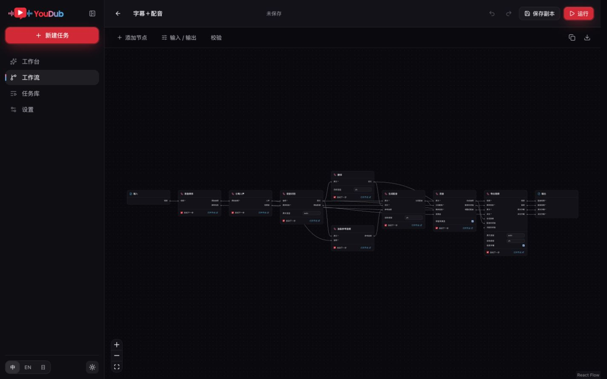

# 节点工作流实现验收

本记录针对 `codex/workflow-nodes` 分支。功能验收与正式版本发布分别记录，不能将本地通过等同于已发布安装包。

## 实际媒体

macOS arm64、Python 3.12、现有本地模型权重、隔离数据目录 `output/validation/workflow-nodes-20261020/`。通过真实 Host API、会话、CSRF、multipart 上传运行；没有替换官方 provider。

| 工作流 | 任务 ID | 结果 |
| --- | --- | --- |
| 准备媒体 → Whisper tiny → 人工订正 | `2eae4201-11e8-48af-aed4-6be8c45d554f` | 识别实际合成英语语音，暂停后订正文本，保存并批准；最终 succeeded，两个结果版本，修改段 words 为 null，原 raw 文件保留 |
| 导入双语 SRT → 准备媒体 → 烧字幕导出 | 见本地 `real-subtitles-result.json` | 导入和末节点均实际暂停，分别批准后 succeeded；MP4 抽帧显示“你好，这是一个工作流测试” |
| 导入双语 SRT → 准备媒体 → Demucs → 参考音频 → VoxCPM2 → 混音 → 导出 | `b245bfeb-e811-4dbe-a252-3af7f10e4ae4` | 实际 CPU 配音完成，末节点批准后 succeeded，MP4 52,811 bytes、WAV 536,108 bytes |

配音 MP4 经 FFprobe 确认为 H.264 / AAC、2.792 秒，FFmpeg 完整解码成功。字幕原始测试曾因 SRT 结束时间超出短视频而明确失败；修正测试素材时间后创建新任务成功，原失败任务未覆盖。

本地 `verify-media.mjs`、三个 `real-*-result.json`、输出视频、音频和字幕抽帧保留于上述目录。外部 LLM API 未在这组媒体验收中调用；翻译结果的订正与下游传递由真实 SQLite 任务测试覆盖，供应商请求协议由现有翻译测试覆盖。

## 自动化回归

- 图编译：独立模板、模型与配置冻结、同 provider 多节点隔离、稳定拓扑、循环/类型/必需输入错误、运行时下载 URL、订正语义。
- 真实 SQLite 运行时：暂停释放槽、重启保留暂停、末节点批准直接完成、结果版本与 raw 保留、订正传入下游、CAS 冲突、同 action 幂等回执、响应丢失后查询、取消与批准竞争。
- 派生任务：按图依赖失效、无关分支复用、旧 revision 与缺文件拒绝、文件独立复制、改变人工确认开关不重复计算。
- schema 2 → 3 迁移与工作流文档 CAS；原线性任务回归保留。
- 派生任务的复用节点在暂停后订正：依赖下游重新计算，无关分支复用；连续确认和取消后重启均保留历史与文件。
- 外部远端插件的就绪条件由 provider 声明；无凭据插件可运行，官方 OpenAI 仍验证服务连接。
- Host 完整回归：114 项通过，1 项仅 Windows 执行的测试在 macOS 跳过。
- Python 完整回归：484 项通过。
- 前端回归：97 项通过；TypeScript、ESLint、生产构建通过。
- Host TypeScript 和 6 项发布约束测试通过；前端生产依赖审计无漏洞。

## 浏览器订正

实际 Whisper 任务 `c8aa8eda-9fc3-473f-9c03-af98657da220` 在节点页将原文改为 `Hello, this is a verified workflow review.`。保存订正后仍为待确认，显示版本 2；确认并继续后任务成功。音频预览、逐段时间和原始结果均可查看。截图保存在 `output/validation/workflow-nodes-20261020/ui-review-paused.jpg`。

外部插件页面的空白校验、刷新持久化与下游产出见[插件验收](workflow-plugin-2026-10-20.md)。独立无推理包环境的字幕流程见[无 TTS 验收](workflow-no-tts-2026-10-20.md)。

## 画布与多语言

浏览器实际验证模板保存副本、独立节点页修改、键盘输入来源选择、鼠标端口连线、节点拖动、撤销重做、保存后刷新、添加删除节点、未保存导航保护、导出 JSON 后重新导入。最终字段标题与输入来源标签已读回，原文语言和目标语言分别显示。

检查宽度为 375、768、1440 px，覆盖中文、英文、日文和浅色/深色。窄屏运行面板、独立节点设置与底部导航可操作。配音模板的 VoxCPM2 设置只显示模型实际支持的原声克隆声线。

详细本地截图为 `ui-canvas-*.jpg`、`ui-run-light-375.jpg` 和 `ui-node-settings.jpg`。首次配置页另覆盖无 Torch、模型列表为空时保存翻译配置的回归；所选 ASR 作为待准备配置，资源就绪仍由工作流检查决定。

## 打包与发布范围

跨平台打包由本分支 PR 的「质量与安全门禁」记录结果：Windows 构建 EXE 与 ZIP，验收原生窗口、安装、重装和保留数据卸载；macOS 构建应用并执行 smoke。CI 产物供分支验收使用，正式签名、公证和 Release 属于后续正式发布流程。本分支不更改应用版本号或 `latest` 下载资源。
