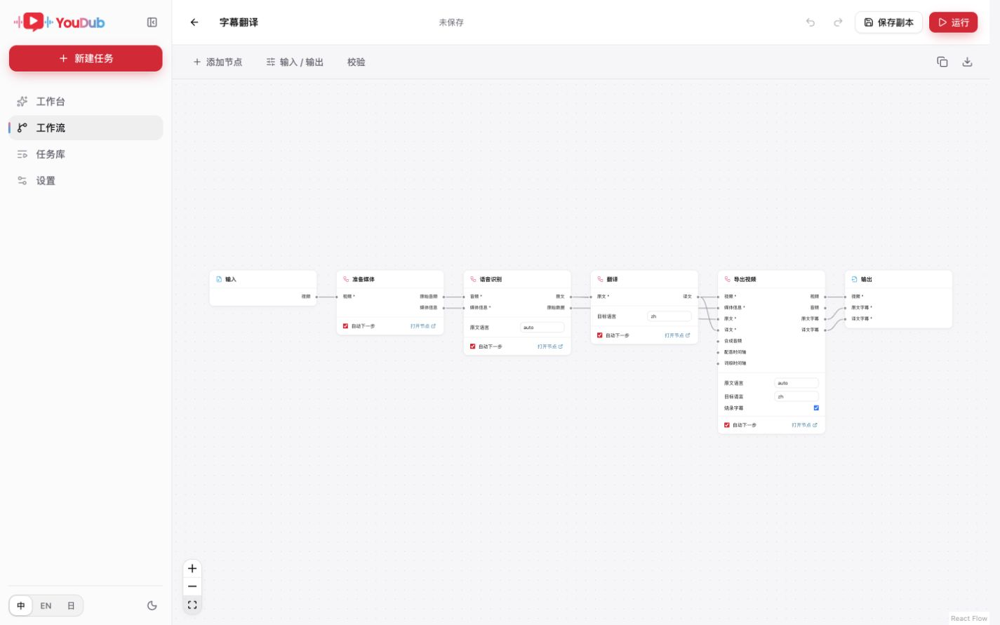
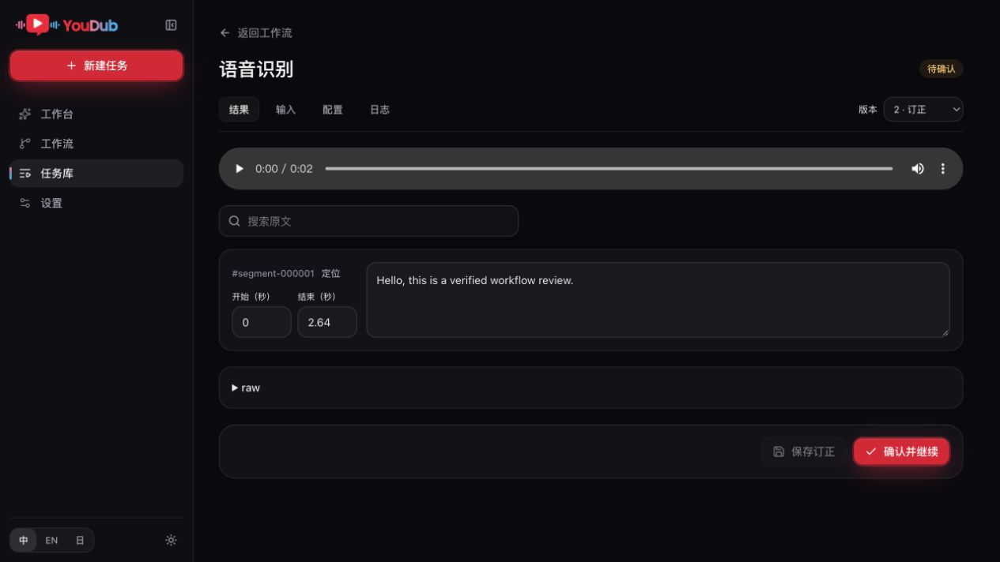

# 节点工作流

工作台按 workflow 创建任务。内置「字幕翻译」「字幕翻译 · 人工校对」「视频配音」「字幕＋配音」四份图；字幕流程不包含配音节点，也不会准备配音模型。



## 编辑与运行

1. 在「工作流」中点击「使用」选择素材并运行；点击「编辑」调整节点，也可新建工作流或导入 `.workflow.json`。
2. 拖动节点调整布局，从输出端口连到输入端口。每个输入只能连接一个来源；一个输出可连接多个节点。节点设置中的输入来源选择框可完成相同操作。
3. 选择节点的供应商、模型、设备和参数。进入节点页面查看完整设置；缺少插件的节点保留在图中，补齐插件前不能运行。
4. 在运行面板上传图需要的文件；下载节点的链接只用于本次运行。页面自动检查所选节点的资源，缺失时点击「下载所需资源」。
5. 运行前服务端校验连线、模型与语言、必需输入及最终输出。存在错误时保留草稿，并定位相关节点或端口。

模板可以预览和调整；保存时创建自己的副本，内置模板保持原样。导出的工作流保存节点、连线、配置和画布布局，不包含 API Key、上传文件、下载链接、日志或运行结果。导入工作流不会安装插件或执行代码。

已创建任务保存独立的图和供应商配置快照。编辑库中的 workflow、切换工作流或刷新全局设置，不会改变已有任务。

## 查看与订正

任务页显示运行图。进入节点可查看输入、中间文件、输出及历史结果版本。音频和视频可以预览，文件可下载。

关闭节点的「自动下一步」后，该节点计算并保存结果，节点卡片显示「待确认」。只有依赖其未确认输出的下游等待，其他已满足输入条件的分支继续执行。一个工作流可以有多个同时待确认的节点，也可以在后续阶段出现新的待确认节点。

在对应节点点击「确认结果」，保存订正或确认当前结果。确认后自动运行输入已齐全、上游结果均已确认的下游节点；汇合节点会等待所有输入分支。所有可运行节点都处理完、只剩人工确认阻塞时，任务显示「等待节点确认」并释放执行槽。重启保留每个节点的确认状态。

语音识别和翻译节点支持逐段订正：

- 识别文本和时间可以修改，分段 ID 与顺序保持不变。时间必须在原视频范围内，分段不能交叠。修改文本或时间后，该段旧词级时间被清除。
- 翻译必须保留每个原文分段，不能增加、删除或重排分段。
- 「保存订正」新增一个结果版本，该节点继续待确认；「保存并继续」保存并批准这个版本。
- 「确认并继续」让可运行的下游使用当前版本。所有节点完成且人工节点均已确认后，任务才会完成。

原始输出和供应商诊断文件保留。取消任务不会删除已经生成的结果与订正历史。提交中断时可以查询该次操作的回执；页面不会盲目重发订正或批准命令。



## 修改已经处理的结果

已经被下游消费的输出，通过派生任务修改。先预览哪些节点复用、哪些需要重新计算，再创建新任务；原任务保持原样。

复用按图的依赖关系决定。改变翻译结果会影响依赖它的配音、混音和导出，不影响无关分支。派生任务复制必要的文件，删除源任务后仍可读取自己的结果。只改变人工确认开关可以复用计算结果，并重新要求人工批准。

运行中的任务需要先停止，再创建派生任务。图运行是单槽串行执行；分叉与汇合表达数据依赖，首版不提供并行模型执行、循环或嵌套子流程。

## 插件节点

后端 SDK `1.1.0` 在 provider 的 `operations[].node` 中声明可视化节点，旧的 plan-only workflow 仍可使用：

```ts
node: {
  type: 'example.translate', version: '1.0.0',
  label: { default: 'Translate', translations: { zh: '翻译', ja: '翻訳' } }, category: 'text',
  inputs: [{ id: 'transcript', label: '原文', kind: 'json',
    acceptedSchemaIds: ['transcript/v1'], required: true }],
  configSchema: { type: 'object', additionalProperties: false,
    properties: { targetLanguage: { type: 'string' } } },
  defaults: { targetLanguage: 'zh' },
  ui: { quickFields: ['targetLanguage'], detailId: 'example.translation' },
  corrections: { outputPorts: ['translation'], schemaIds: ['translation/v1'] },
}
```

输出沿用 operation 的 `outputs`。输入声明必须与 operation 的 `inputSchema` 一致。需要运行时原始值的节点使用 `runtimeInputSchema`；这些值不进入分享文档，也不能伪造受管文件或上游引用。

声明订正能力的 provider 同时实现 `validateCorrection({ operation, inputs, baselineOutputs, patch })`，返回完整、归一化后的输出。宿主检查输出 schema、可编辑端口、不可变输出和文件归属；插件检查领域语义。前端的节点详情插件通过宿主回调修改草稿，保存、批准和取消由宿主统一执行。

完整类型以 [Host SDK](../packages/sdk/src/index.ts) 和 [Client SDK](../apps/web/src/plugin/sdk.tsx) 为准；官方节点实现见 [节点契约](../packages/builtin/src/node-contracts.ts)。

[文本校对插件示例](../fixtures/plugins/graph-text-review/README.md)包含多输入输出节点、模板、校对组件、订正校验和导出节点；按示例说明构建后，可通过扩展页面安装。

## 数据与升级

工作流文档和任务状态保存在现有 `desktop.sqlite`。此实现将数据库从 schema 2 迁移到 schema 3；旧任务保留，新增工作流文档表及任务图快照。保存采用 revision 检查，冲突时需要保留草稿并读取最新版本。

迁移后的数据库不要同时由旧版和新版 Host 打开。插件变更前需要完成或取消活动任务，等待确认的任务也属于活动任务。

## 验证记录

- [节点运行时与实际媒体验收](validation/workflow-nodes-2026-10-20.md)
- [无 TTS 包和模型的独立环境验收](validation/workflow-no-tts-2026-10-20.md)
- [外部节点插件及专属页面验收](validation/workflow-plugin-2026-10-20.md)
- 原始设计：[产品交互](design/workflow-node-design.md)、[接口与执行](design/workflow-node-implementation.md)。
