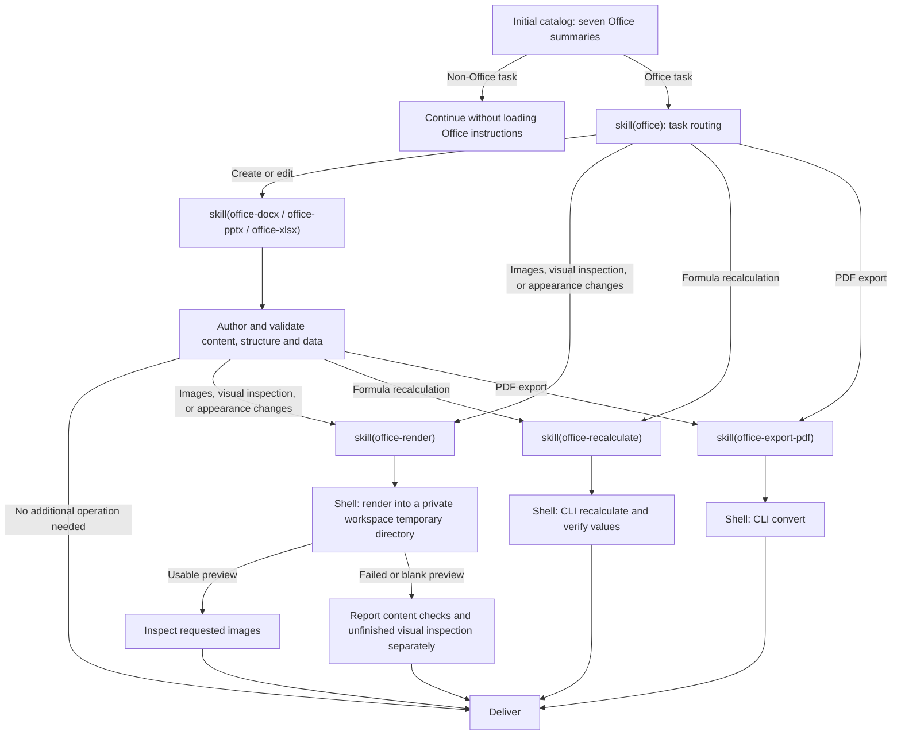

# @deepseek-ai/dsh-skill-office

English | [中文](README.zh.md)

## Summary

The catalog lists the Office router and six authoring or operation skills. Full instructions load on demand. Authoring skills use the selected Python libraries; operation skills supply the configured Node and LibreOffice Kit CLI paths. SDK and Desktop mount the skill provider and dependency query separately.

## Table of Contents

- [Use this package](#use-this-package)
  - [Progressive loading](#progressive-loading)
- [Understand the implementation](#understand-the-implementation)
- [Further Exploration](#further-exploration)
- [Model Experience](#model-experience)
- [Known Limitations and Deferred Work](#known-limitations-and-deferred-work)
- [Dev Note](#dev-note)

-----

<a id="use-this-package"></a>
## Use this package

Mount the skill provider beside the skill registry and `dsh-tool-skill`. The provider supplies skill instructions; operation skills append absolute interpreter and CLI paths when loaded.

```yaml
- name: '@deepseek-ai/dsh-skill-office'

```

| Field | Default | Meaning |
|---|---|---|
| `assetRoot` | Carrier resources or packaged `assets/` | Absolute directory containing the seven skill folders. |
| `node` | Host Node.js | Standalone Node executable for operation skills; packaged carriers supply it explicitly. |
| `cli` | Installed Kit CLI | Absolute CLI entry; `false` disables operation execution. |

Invalid skill assets reject registration. Authoring instructions do not resolve renderer paths; loading operation instructions validates existing interpreter and CLI files without preparing engines. Bash or PowerShell owns approvals, sandboxing, cancellation, and output management. Resources and execution tools must refer to the same host.

<a id="progressive-loading"></a>
### Progressive loading

The model chooses skills from the task; the host does not inject complete instructions based on file extensions. All seven skills are listed and loadable by name through `skill` or explicit user invocation. Requested appearance changes, including spreadsheet cell fills and text alignment, require rendering even without an explicit visual-check request; an explicit request to skip rendering takes precedence. Pure operations can enter the corresponding skill directly.



New files and content, data, or formula edits do not require rendering solely because they include incidental basic formatting. Preview images use a private, randomly named temporary directory inside the workspace and are removed after inspection; replies report the inspection in text without linking them. PDF export validates the command result and `%PDF-` signature without searching for PDF readers. Loaded instructions remain in session history after an operation finishes. The diagram describes ordinary presets across supported clients; it does not change the shell-only definition of minimal or sdk-minimal.

-----

<a id="understand-the-implementation"></a>
## Understand the implementation

<details>
<summary>Implementation internals — click to expand</summary>

The provider reads descriptions at registration and bodies on demand. Registry precedence, scope, and invocation permissions apply to every skill. Each loaded skill includes its resource directory for relative references. Disposal unregisters all candidates.

The provider registers no tools or activation projection. Loaded skill results remain logged through the generic skill loader. In PTC programs, print or return the full `tools.skill(...)` result so its instructions reach the model. Resume and fork use existing session history and tool declaration reconciliation. Interpreter and CLI paths are resolved only when an operation skill is loaded.

| File | Responsibility |
|---|---|
| [`src/index.ts`](src/index.ts) | Resource registration and unchanged skill bodies. |

| [`assets/`](assets/) | Router and six subskills. |

</details>

-----

<a id="further-exploration"></a>
## Further Exploration

- [Skill registry](../skill/README.md) — discovery and precedence.
- [Skill tool](../tool-skill/README.md) — model catalogs and loaded bodies.
- [File delivery](../../deliverables/tool-present/README.md) — current source-path delivery.

-----

<a id="model-experience"></a>
## Model Experience

Indirectly, through `dsh-tool-skill`, which renders the initial Office summary and returns routing or selected subskill instructions from `skill(name)`.

#### KV Cache effect

Skill results append to history without changing tool declarations, and loaded text or images remain after an operation finishes. Character estimates use `ceil(characters / 4)`: the summary is at most 50 tokens and the router body at most 200; authoring bodies are at least 35% smaller than the combined authoring and operation guides. Skill wrappers, the generic catalog, shell declarations, and `load_workspace_dependencies` are separate costs, and these estimates are not server usage.

## Known Limitations and Deferred Work

<a id="known-limitations-and-deferred-work"></a>

- The provider does not install authoring libraries.
- LibreOffice output can differ from native Office applications.
- Legacy, encrypted, and macro-enabled files need an appropriate separate workflow.

<a id="dev-note"></a>
### Dev Note

<details>
<summary>Working context for maintainers — click to expand</summary>

None.

</details>
